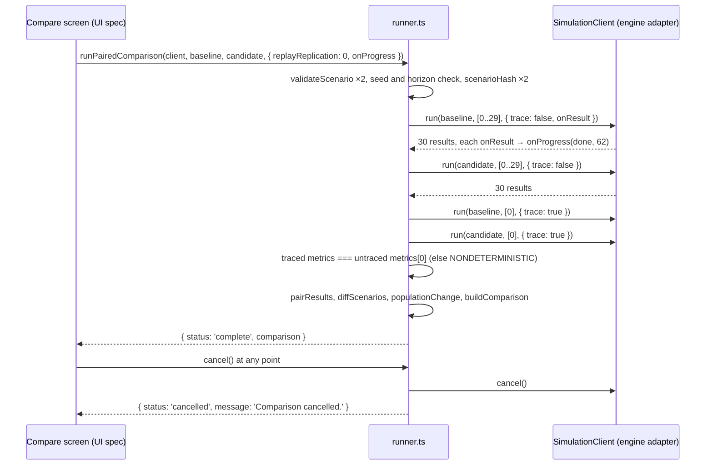

# Design Document

## Overview

`paired-comparison-and-release` is spec 11.1 of `plans/rehearsal-implementation-plan.md`: the Kiro-owned modules `src/comparison/` and `src/exports/`, their tests in `tests/comparison/`, the repository's `.kiro/` configuration and the release documents. Kiro implements it on branch `kiro/paired-comparison-and-release` under a 350-credit cap, in the owner's run order (`docs/DECISIONS.md`): tasks 1 to 9, then `scenario-editor-and-replay` tasks 18 and 19, then tasks 14 to 16, then `scenario-editor-and-replay` task 20; tasks 10 to 13 and `scenario-editor-and-replay` task 15 come last and only if the owner says there is time, and no earlier task depends on them. Dates in older copies of this file are void. It consumes the engine of spec `simulation-contract` through `validateScenario`, `scenarioHash`, `createPathCache`, `simulate` (tests only), `MODEL_VERSION`, `formatMetricValue`, `p95Index` and the worker adapter `SimulationClient`; it never changes scheduling or sampling semantics. The Compare and Print screens (`src/ui/`) and game view (`src/replay/`), which Kiro writes under `scenario-editor-and-replay` tasks 18, 19 and 15, consume it through `runPairedComparison`, `selectReplicate`, `selectReplay`, the generators in `src/exports/` and the constants in `src/comparison/labels.ts` and `src/comparison/replay-contract.ts`.

Design rules carried from plan sections 7 to 9 and 15: 30 paired replications with indices 0 to 29 and common random inputs; paired differences per replication; the empirical 10th to 90th percentile range labeled exactly `variation across these simulated runs`; improvement counts only from actual results; a population change disables person-for-person language; the replay shows one labeled replicate on one clock with a dashed, hatched, translucent baseline; every export carries scenario hash, model version, seed, replication and completion; CSV through `escapeFormulae`, xlsx with typed values and no formulas, printable HTML escaped and free of scripts and canvases; local storage holds only bounded scenario JSON and comparison summaries; nothing is claimed that was not observed and logged.

## Architecture

The comparison is a pipeline over engine outputs. The runner is the only stateful piece: it sequences four worker runs through the engine's adapter and assembles an immutable `Comparison`. Everything else is a pure function of a `Comparison` or a `Scenario`.

```mermaid
flowchart LR
  B[baseline Scenario] --> V[validateScenario + scenarioHash]
  C[candidate Scenario] --> V
  V --> R[runner.ts<br/>4 client.run calls, 62 replications]
  R --> P[paired.ts<br/>pairResults: differences, mean, p10 to p90, counts]
  B --> D[diff.ts<br/>diffScenarios, display units]
  C --> D
  B --> Q[population.ts<br/>populationChange]
  C --> Q
  P --> K[comparison.ts<br/>Comparison record]
  D --> K
  Q --> K
  R --> S[replay-contract.ts<br/>ReplaySelection, GHOST_STYLE]
  S --> K
  K --> U[src/ui Compare screen, src/replay game view (UI spec)]
  K --> X[src/exports<br/>scenario JSON, CSV, xlsx, printable comparison]
  B --> RS[run-sheet.ts<br/>path cache, staff-hours]
  K --> SM[summary.ts<br/>ComparisonSummary ≤ 32 KiB]
  SM --> ST[src/storage (UI spec)]
```



Ownership: Kiro writes every file of this spec in the main checkout (`.kiro/steering/revision-2026-11-16.md`); there is no integrator, fleet or worktree. Every file under `src/comparison/`, `src/exports/`, `tests/comparison/` and the `.kiro/` files named in this document belongs to this spec's tasks; `.kiro/settings/mcp.json` is written only by the owner's helper. A shared file (`package.json`, `package-lock.json`, `tsconfig.json`, `vite.config.ts`, `playwright.config.ts`, `index.html`, `src/main.tsx`, `src/app.tsx`, `README.md`) is edited by Kiro in the task that needs it, and the log row names it. `src/comparison/` and `src/exports/` import from `src/domain/`, `src/simulation/` (types, `MODEL_VERSION`, `formatMetricValue`, `p95Index`), `src/spatial/` (`createPathCache`) and `src/workers/client.ts` (the `SimulationClient` type), and from nothing under `src/ui/`, `src/replay/`, `src/imports/` or `src/storage/`. The engine's purity scan already forbids the reverse direction.

## Components and Interfaces

### File layout

```text
src/comparison/
  labels.ts            RANGE_LABEL, REPLAY_NOTE, replayLabel, progressText, COMPLETE_TEXT, countSentence, SAVE_REASONS, saveErrorText, restoredSummaryText, STALE_TEXT, COMBINED_NOTE, changesHeader, PER_PERSON_OFF
  percentiles.ts       percentileIndex, percentile
  metric-keys.ts       METRIC_KEYS, STATION_METRIC_KEYS, readMetric, readStationMetric
  replications.ts      REPLICATIONS, REPLICATION_INDICES (imports nothing, so labels.ts and paired.ts never form an import cycle)
  paired.ts            re-exports REPLICATIONS and REPLICATION_INDICES; pairResults, PairedMetric, PairedStation, formatChange, formatMean
  population.ts        populationChange, attendeePairs
  format.ts            display-unit formatters shared by diff, exports and the run sheet
  diff.ts              diffScenarios, ChangeEntry, AssumptionsDiff
  comparison.ts        Comparison, ScenarioRef, buildComparison, comparisonKey, isComparisonCurrent
  replay-contract.ts   ReplaySelection, buildReplaySelection, selectReplay, GHOST_STYLE, CANDIDATE_STYLE, GHOST_LEGEND
  runner.ts            runPairedComparison, selectReplicate, ComparisonOutcome, ComparisonErrorCode
  summary.ts           ComparisonSummary, toComparisonSummary, fromComparisonSummary, summaryBytes, COMPARISON_SUMMARY_MAX_BYTES, SAVED_SCENARIO_LIMIT
src/exports/
  assumptions-text.ts  ASSUMPTIONS, LIMITS_TEXT, NOT_A_FORECAST, FORBIDDEN_BADGE_WORDS, modelVersionLine
  html-escape.ts       escapeHtml
  scenario-json.ts     ScenarioExport, exportScenarioJson, parseScenarioExport, EXPORT_MAX_BYTES
  csv.ts               exportArrivalsCsv, exportStationsCsv, exportResultsCsv, exportComparisonCsv
  xlsx.ts              workbookRows (pure), exportWorkbook (SheetJS)
  printable-comparison.ts  renderComparisonHtml
  run-sheet.ts         buildRunSheetModel, renderRunSheet, RunSheetModel
tests/comparison/      see Testing Strategy; tools/third-party-notices.mjs; performance.measure.test.ts
.kiro/steering/        claims-policy.md, units-and-determinism.md, model-limits.md, accessibility.md, revision-2026-11-16.md (all inclusion: always; no ownership.md)
.kiro/hooks/           verify-on-stop.json, model-tests-on-save.json, README.md
.kiro/agents/          rehearsal-playwright.json (written by task 14: lists the `playwright` MCP server for the v2-engine session of matrix row 30)
.kiro/settings/        mcp.json (written only by the owner's helper; ships disabled: true with a placeholder command)
docs/                  third-party-notices.md, performance.md, acceptance/<date>-release.md; README.md sections "Model limits" and "Privacy"
```

### Labels and percentiles

```ts
// src/comparison/labels.ts
import { REPLICATIONS } from './replications';
export const RANGE_LABEL = 'variation across these simulated runs';
export const REPLAY_NOTE = 'This replay is one example run; the comparison numbers come from all 30.';
export const COMPLETE_TEXT = `${REPLICATIONS} of ${REPLICATIONS} paired runs complete`;   // renders '30 of 30 paired runs complete'; composed from REPLICATIONS so the literal-count scan of 2.4 never matches a source literal
export const STALE_TEXT = 'Stale, rerun';
export const COMBINED_NOTE = 'Combined candidate: run each change on its own first to see which one moves the numbers.';
export const PER_PERSON_OFF = 'Per-person comparison is off because the attendee populations differ.';
export const SAVE_REASONS = {
  quota: 'storage quota exceeded',
  unavailable: 'storage is unavailable in this browser',
  limit: '10 saved scenarios already; delete one first',
} as const;
export function replayLabel(r: number): string;                       // `Replay of replication ${r}, one example run`
export function progressText(done: number, total: number): string;    // `Running paired replications: ${done} of ${total}`
export function loadingReplicationText(r: number): string;            // `Loading replication ${r}…`
export function timingText(pairedMs: number): string;                 // `30 paired runs took ${(pairedMs / 1000).toFixed(1)} s on this device`
export function saveErrorText(reason: keyof typeof SAVE_REASONS): string;   // `Could not save: ${SAVE_REASONS[reason]}.`
export function restoredSummaryText(createdAt: string): string;       // `Saved summary from ${createdAt.slice(0, 10)}; rerun to see replications and the replay`
export function changesHeader(kind: 'none' | 'single' | 'combined', n: number): string;
// 'No assumption differs between these scenarios.' | '1 change' | `${n} changes`
export function countSentence(input: {
  direction: 'lower' | 'higher' | 'none'; metricLabel: string; improved: number | null; n: number;
  languageMode: 'person-for-person' | 'population'; baselineCount: number; candidateCount: number;
}): string;
// none      → `No better direction is defined for ${metricLabel}; read the values.`
// person    → `Candidate had ${lower|higher} ${metricLabel} in ${improved} of ${n} runs; the same simulated attendees and random draws were used in both.`
// population→ `Candidate had ${lower|higher} ${metricLabel} in ${improved} of ${n} runs; the attendee populations differ (${a} vs ${b} people), so this compares groups, not the same people.`

// src/comparison/percentiles.ts
export function percentileIndex(p: number, n: number): number;        // Math.max(0, Math.ceil(p * n) - 1)
export function percentile(sortedAscending: readonly number[], p: number): number | null;   // null for an empty array
```

`metricLabel` in a count sentence is the metric table's label in lowercase (`mean queue wait`). `countSentence` is the only place the count text is composed; the Compare screen, the CSV and the printable call it.

### Metric keys and paired statistics

```ts
// src/comparison/metric-keys.ts
export type Direction = 'lower' | 'higher' | 'none';
export type MetricKey =
  | 'completedByClosing' | 'activeAtClosing.total' | 'queueWait.total' | 'queueWait.mean' | 'queueWait.p95'
  | 'journeyTime.mean' | 'journeyTime.p95' | 'walkingTime.mean' | 'queues.averageLength' | 'queues.maxLength' | 'staffHours';
export type StationMetricKey = 'utilization' | 'averageQueueLength' | 'maxQueueLength' | 'served';
export const METRIC_KEYS: readonly { key: MetricKey; label: string; direction: Direction }[];
export const STATION_METRIC_KEYS: readonly { key: StationMetricKey; label: string; direction: Direction }[];
export function readMetric(metrics: Metrics, key: MetricKey): MetricValue;
export function readStationMetric(metrics: Metrics, stationId: string, key: StationMetricKey): MetricValue | null;   // null when the station is absent
```

| Key | Label | Unit | Population | Direction |
| --- | --- | --- | --- | --- |
| `completedByClosing` | Completed by closing | count | admitted | higher |
| `activeAtClosing.total` | Still active at closing | people | admitted | lower |
| `queueWait.total` | Total queue wait | ms | completedJourney | lower |
| `queueWait.mean` | Mean queue wait | ms | completedJourney | lower |
| `queueWait.p95` | p95 queue wait | ms | completedJourney | lower |
| `journeyTime.mean` | Mean journey time | ms | completedJourney | lower |
| `journeyTime.p95` | p95 journey time | ms | completedJourney | lower |
| `walkingTime.mean` | Mean walking time | ms | admitted | lower |
| `queues.averageLength` | Average queue length | people | closingWindow | lower |
| `queues.maxLength` | Maximum queue length | people | closingWindow | lower |
| `staffHours` | Staff-hours | hours | closingWindow | none |
| `stations.<id>.utilization` | Utilization | ratio | closingWindow | none |
| `stations.<id>.averageQueueLength` | Average queue length | people | closingWindow | lower |
| `stations.<id>.maxQueueLength` | Maximum queue length | people | closingWindow | lower |
| `stations.<id>.served` | Served by closing | count | closingWindow | higher |

The two `none` rows exist because a higher utilization or more staff-hours is neither good nor bad on its own; no improvement count is ever shown for them, which is how the interface avoids implying that more staff improves every metric.

```ts
// src/comparison/replications.ts (imports nothing); src/comparison/paired.ts re-exports both names
export const REPLICATIONS = 30;
export const REPLICATION_INDICES: readonly number[];    // [0, 1, …, 29]

// src/comparison/paired.ts
export type PairedDifference = { replication: number; baseline: number | null; candidate: number | null; difference: number | null };
export type PairedMetric = {
  key: string;                                           // MetricKey or `stations.${id}.${StationMetricKey}`
  label: string; unit: Unit; population: Population; betterDirection: Direction;
  baselineMean: number | null; candidateMean: number | null;     // means over the paired replications (both sides non-null)
  meanChange: number | null; rangeP10: number | null; rangeP90: number | null;
  rangeLabel: typeof RANGE_LABEL;
  n: number; improved: number | null; worsened: number | null; unchanged: number | null;
  conditioned: boolean; note: string | null;
  differences: PairedDifference[];                       // always 30 entries, in replication order
};
export type PairedStation = { id: string; label: string; presence: 'both' | 'baseline-only' | 'candidate-only'; metrics: PairedMetric[] };
export type PairResult =
  | { ok: true; metrics: PairedMetric[]; stations: PairedStation[]; completion: { baselineCapped: number; candidateCapped: number } }
  | { ok: false; code: 'INCOMPLETE_RESULTS' | 'MODEL_VERSION_MISMATCH' | 'SEED_MISMATCH' | 'HORIZON_MISMATCH'; message: string };
export function pairResults(baseline: RunResult[], candidate: RunResult[], stations: { baseline: Station[]; candidate: Station[] }): PairResult;
export function formatChange(value: number | null, unit: Unit): string;
export function formatMean(value: number | null, unit: Unit): string;   // formatMetricValue over a synthetic MetricValue; ', ' for null
```

`pairResults` checks that each array holds exactly one result per index of `REPLICATION_INDICES`, that all 60 share one `modelVersion`, one `baseSeed` and one `horizonMs`; it then builds one `PairedMetric` per `METRIC_KEYS` row and, per station id present in either scenario (code-unit order), one `PairedStation` with the `STATION_METRIC_KEYS` rows; a station present on one side only has `presence` set accordingly and metrics with `n: 0`. For each metric: `differences[r] = candidate − baseline` or `null`; `n` = count of non-null; `baselineMean` and `candidateMean` are means over the same paired set so that `meanChange = candidateMean − baselineMean` within floating-point error; `rangeP10`/`rangeP90` from `percentile` over the sorted non-null differences; counts by sign for `lower`/`higher`, `null` for `none`; `conditioned` and `note` as requirement 2.7 when any of the 60 results is `drain-capped` and the population is `completedJourney`. `formatChange`: `ms` → `(value / 1000).toFixed(1) + ' s'` with sign; `count`, `people` → signed integer; `ratio` → `(value * 100).toFixed(1) + ' percentage points'` with sign; `hours` → `value.toFixed(2) + ' h'` with sign; exact `0` → the unit's zero plus ` (no change)`; `null` → `n/a`. The sign is `+` or `-` (hyphen-minus) so CSV readers and tests see ASCII.

### Population and per-person pairs

```ts
// src/comparison/population.ts
export type PopulationChange = { changed: boolean; baselineCount: number; candidateCount: number; details: string[] };
export function populationChange(baseline: Scenario, candidate: Scenario): PopulationChange;
// compares the multiset of (cohort.id, cohort.count); details in the forms
// `Cohort "doors": count 120 → 130 people` | `Cohort "gate" added (40 people)` | `Cohort "late" removed (12 people)`
export type AttendeePair = {
  id: string; cohortId: string; arrivalMs: number;
  baselineWaitMs: number | null; candidateWaitMs: number | null;
  baselineJourneyMs: number | null; candidateJourneyMs: number | null;
};
export function attendeePairs(selection: ReplaySelection, population: PopulationChange):
  | { ok: true; pairs: AttendeePair[] }
  | { ok: false; code: 'POPULATION_CHANGED'; message: string };     // message = PER_PERSON_OFF
```

`attendeePairs` reads `trace.attendees` (id, cohortId, arrivalMs, exitMs) and sums `waitMs` over the attendee's `start` events in `trace.events`; a wait is `null` for an attendee listed in that side's `unfinished` (its journey is incomplete), and `journeyMs = exitMs − arrivalMs` or `null` when `exitMs` is `null`. Pairs are sorted by `(arrivalMs, id)` like the trace.

### Display units and the assumptions diff

```ts
// src/comparison/format.ts
export function formatMinutes(ms: number): string;             // '20 min' | '12.5 min' (one decimal only when not whole)
export function formatWindow(startMs: number, endMs: number): string;   // '0 to 20 min'
export function formatService(service: Service): string;       // 'triangular 8/15/22 s' | 'constant 60 s'
export function formatCell(cell: Cell): string;                // '(34,12)'
export function formatMeters(m: number): string;               // '38.0 m'
export function formatSeconds(ms: number): string;             // '31.7 s'
export function formatRoute(route: string[]): string;          // 'checkin → packs' | '(no stations)'
export function formatPeople(n: number): string;               // '120 people'
export function formatSpeed(mps: number): string;              // '1.2 m/s'

// src/comparison/diff.ts
export type ChangeGroup = 'population' | 'staffing' | 'service' | 'layout' | 'arrivals' | 'timing' | 'route' | 'derived';
export type ChangeEntry = { path: string; group: ChangeGroup; label: string; before: string; after: string; text: string; highlight: boolean; derived: boolean };
export type AssumptionsDiff = { changes: ChangeEntry[]; kind: 'none' | 'single' | 'combined'; population: PopulationChange };
export function diffScenarios(baseline: Scenario, candidate: Scenario): AssumptionsDiff;
```

`text` is `${label} ${before} → ${after}` for a value change (`Station "Check-in desk": servers 1 → 2`, `Station "Welcome packs": position (34,12) → (14,8)`, `Cohort "doors": window 0 to 20 min → 0 to 30 min`, `Observation window 40 min → 60 min`, `Walking speed 1.2 m/s → 1.0 m/s`, `Seed harbor-hall-2026 → other`, `Blocked cells: 3 added, 0 removed`) and the joined `details` for the population entry (`path: 'cohorts'`, `highlight: true`). Station labels in `label` use the baseline label, or the id when the label itself differs. Field → group: `servers` → staffing; `service` → service; `cell`, `label`, `layout.*`, `walkSpeedMps`, station added or removed → layout; cohort `startMs`/`endMs`/`arrivals` → arrivals; `horizonMs`, `baseSeed` → timing; cohort `route` → route; cohort `count`, cohort added or removed → the single population entry. Derived entries come from `createPathCache` of each scenario: for every cohort route present in both scenarios, if the summed walking distance differs, `Walking per attendee, cohort "doors": 38.0 m → 18.0 m (31.7 s → 15.0 s)` with `derived: true`, excluded from `kind`. Order: population, staffing, service, layout, arrivals, timing, route, derived; stable by `path` within a group.

### Comparison record, replay contract and runner

```ts
// src/comparison/comparison.ts
export type ScenarioRef = { id: string; title: string; revision: number; scenarioHash: string };
export type Comparison = {
  schemaVersion: 1; key: string; createdAt: string;
  modelVersion: string; baseSeed: string; horizonMs: number; replications: readonly number[];
  baseline: ScenarioRef; candidate: ScenarioRef;
  baselineScenario: Scenario; candidateScenario: Scenario;
  baselineResults: RunResult[]; candidateResults: RunResult[];            // untraced, 30 each, replication order
  traced: { baseline: Record<number, RunResult>; candidate: Record<number, RunResult> };   // traced results loaded so far
  replay: ReplaySelection;                                                 // current replicate
  diff: AssumptionsDiff; population: PopulationChange; languageMode: 'person-for-person' | 'population';
  metrics: PairedMetric[]; stations: PairedStation[];
  completion: { baselineCapped: number; candidateCapped: number };
  timing: { pairedMs: number; replayMs: number };
};
export function comparisonKey(c: Pick<Comparison, 'modelVersion' | 'baseSeed' | 'baseline' | 'candidate' | 'replications'>): string;
// `${modelVersion}|${baseSeed}|${baseline.scenarioHash}|${candidate.scenarioHash}|${replications.length}`
export function buildComparison(input: {
  baseline: Scenario; candidate: Scenario; baselineHash: string; candidateHash: string;
  baselineResults: RunResult[]; candidateResults: RunResult[];
  baselineReplay: RunResult; candidateReplay: RunResult; replayReplication: number;
  timing: Comparison['timing']; createdAt: string;
}): Comparison;                                                            // throws on a pairResults failure (the runner converts it)
export function isComparisonCurrent(c: Comparison, baselineHashNow: string, candidateHashNow: string): boolean;

// src/comparison/replay-contract.ts
export type ReplaySelection = {
  replication: number; baseline: RunResult; candidate: RunResult;      // both carry trace
  label: string;                                                        // replayLabel(replication)
  clock: { horizonMs: number; endMs: number };                          // endMs = max last event timeMs of both traces
};
export function buildReplaySelection(baseline: RunResult, candidate: RunResult, replication: number): ReplaySelection;
export function selectReplay(comparison: Comparison, r: number):
  | { ok: true; selection: ReplaySelection }
  | { ok: false; code: 'REPLICATION_RANGE'; message: 'Replication must be between 0 and 29.' }
  | { ok: false; code: 'TRACE_NOT_LOADED'; message: string };          // `Replication ${r} has not been loaded for replay yet.`
export const GHOST_STYLE = { role: 'baseline', alpha: 0.45, outline: 'dashed', fill: 'hatched', hue: 'orange' } as const;
export const CANDIDATE_STYLE = { role: 'candidate', alpha: 1, outline: 'solid', fill: 'solid', hue: 'cyan' } as const;
export const GHOST_LEGEND = 'Baseline: dashed outline, hatched, translucent · Candidate: solid';

// src/comparison/runner.ts
export type ComparisonErrorCode = 'SEED_MISMATCH' | 'HORIZON_MISMATCH' | 'INVALID_SCENARIO' | 'RUN_FAILED' | 'NONDETERMINISTIC' | 'INCOMPLETE_RESULTS';
export type ComparisonOutcome =
  | { status: 'complete'; comparison: Comparison }
  | { status: 'cancelled'; message: 'Comparison cancelled.' }
  | { status: 'error'; code: ComparisonErrorCode; message: string };
export type RunnerClock = { now: () => number; isoNow: () => string };   // defaults: performance.now, new Date().toISOString()
export type RunnerOptions = { replayReplication?: number; onProgress?: (done: number, total: number) => void; clock?: RunnerClock };
export type ComparisonHandle = { done: Promise<ComparisonOutcome>; cancel(): void };
export function runPairedComparison(client: SimulationClient, baseline: Scenario, candidate: Scenario, options?: RunnerOptions): ComparisonHandle;
export type ReplicateOutcome =
  | { status: 'complete'; comparison: Comparison }                      // a new Comparison with traced[r] filled and replay switched
  | { status: 'cancelled'; message: 'Comparison cancelled.' }
  | { status: 'error'; code: ComparisonErrorCode; message: string };
export type ReplicateHandle = { done: Promise<ReplicateOutcome>; cancel(): void };
export function selectReplicate(client: SimulationClient, comparison: Comparison, r: number, options?: Pick<RunnerOptions, 'onProgress' | 'clock'>): ReplicateHandle;
```

`runPairedComparison` steps: (1) `validateScenario` on both; an `ok: false` resolves `INVALID_SCENARIO` with the `Baseline: `/`Candidate: ` prefix. (2) Seed and horizon checks resolve `SEED_MISMATCH`/`HORIZON_MISMATCH`. (3) `await scenarioHash` for both. (4) Four `client.run` calls, each awaited before the next, with `onResult` collecting results and driving the cumulative count: the runner calls `options.onProgress(0, 62)` before the first run and `options.onProgress(done, 62)` after every `onResult`, because the worker throttles its own `progress` messages to 5 per second (`PROGRESS_INTERVAL_MS`, `src/workers/protocol.ts`) and the last one of a run may never be posted, so the client's `onProgress` is not passed on; a `cancelled` outcome resolves `cancelled`; an `error` outcome resolves `RUN_FAILED` with `Comparison failed: <message>`. (5) The traced pair's `metrics` are compared byte-for-byte with the untraced result for `replayReplication`; a mismatch resolves `NONDETERMINISTIC`. (6) `buildComparison` runs `pairResults`, `diffScenarios`, `populationChange`, `buildReplaySelection`; `languageMode` is `'population'` iff `population.changed`. `cancel()` sets a flag checked before each `client.run` and forwards to `client.cancel()` when a run is active. The runner mutates nothing it did not create: `selectReplicate` returns a new `Comparison` object with `traced` extended and `replay` switched, and the Compare screen replaces its state only on `complete`, keeping the previous selection displayed with `loadingReplicationText(r)` meanwhile.

### Comparison summary

```ts
// src/comparison/summary.ts
export const COMPARISON_SUMMARY_MAX_BYTES = 32_768;
export const SAVED_SCENARIO_LIMIT = 10;
export type SummaryMetric = Omit<PairedMetric, 'differences'>;
export type ComparisonSummary = {
  schemaVersion: 1; key: string; createdAt: string;
  modelVersion: string; baseSeed: string; horizonMs: number; replications: 30;
  baseline: ScenarioRef; candidate: ScenarioRef;
  diff: AssumptionsDiff; population: PopulationChange; languageMode: Comparison['languageMode'];
  metrics: SummaryMetric[]; stations: { id: string; label: string; presence: PairedStation['presence']; metrics: SummaryMetric[] }[];
  completion: Comparison['completion']; replay: { replication: number }; timing: Comparison['timing'];
};
export const ComparisonSummarySchema: z.ZodType<ComparisonSummary>;     // *verify* zod 4.6.7 helper names at scaffold
export function toComparisonSummary(c: Comparison): ComparisonSummary;
export function summaryBytes(s: ComparisonSummary): number;             // new TextEncoder().encode(JSON.stringify(s)).length
export function fromComparisonSummary(json: string):
  | { ok: true; summary: ComparisonSummary; restored: true }
  | { ok: false; code: 'SUMMARY_INVALID'; message: 'The saved comparison summary could not be read; rerun the comparison.' };
```

The summary drops `baselineScenario`, `candidateScenario`, the result arrays, `traced` and every `differences` array; the scenarios themselves are saved separately by the UI spec's `src/storage/` as bare scenario JSON (`SavedScenario` entries, `scenario-editor-and-replay` 10.3), so a saved scenario is at most the size of its JSON and a saved comparison at most 32 KiB (`summaryBytes` is asserted in tests, and `src/storage/` refuses a larger summary with `SAVE_REASONS.quota`).

### Fixed text, escaping and the scenario JSON export

```ts
// src/exports/assumptions-text.ts
export const ASSUMPTIONS: readonly string[] = [
  'One station is one service stage: a single FIFO line feeding identical parallel servers.',
  'A cohort follows its ordered station IDs, each at most once, then exits.',
  'Staffing is constant through a run.',
  'Queue capacity is unlimited and nobody leaves early.',
  'Walking is at one constant speed along the computed grid path.',
  'Service durations are constant or triangular.',
  'No personal space, congestion-dependent walking speed, doorway throughput, accessibility clearance, crowd pressure or collisions: queue sprites never block movement.',
  'The output of a run is a scenario result under these assumptions for one seed and one replication: scenario results, not a forecast.',
];   // the eight lines of `src/ui/plan/AssumptionsPanel.tsx` as they stand today (read from the file on 2026-11-17); `assumptions-text.test.ts` fails when the two lists differ
export const LIMITS_TEXT = 'Limits: at most 5,000 attendees, 10 stations, 6 station visits per route, 80 × 80 cells, a 360-minute observation window, servers 1 to 20, 10 saved scenarios, a 2 MiB import file.';   // equals the panel's rendered `LIMITS_TEXT`, which is built from `LIMITS` in `src/domain/limits.ts`
export const NOT_A_FORECAST = 'Scenario results, not a forecast.';
export const FORBIDDEN_BADGE_WORDS: readonly string[] = ['optimized', 'optimised', 'optimal', 'safe', 'certified', 'recommended'];
export function modelVersionLine(version?: string): string;            // `Model version ${version ?? MODEL_VERSION}`

// src/exports/html-escape.ts
export function escapeHtml(s: string): string;                          // & < > " ' → &amp; &lt; &gt; &quot; &#39;

// src/exports/scenario-json.ts
export const EXPORT_FORMAT = 'rehearsal-scenario';
export const EXPORT_FORMAT_VERSION = 1;
export const EXPORT_MAX_BYTES = 2_097_152;
export type ExportedResult = { replication: number; completion: 'complete' | 'drain-capped'; unfinished: string[]; metrics: Metrics };
export type ScenarioExport = {
  format: 'rehearsal-scenario'; formatVersion: 1; generatedAt: string;
  modelVersion: string; baseSeed: string; scenarioHash: string;
  scenario: Scenario; results: ExportedResult[]; assumptions: readonly string[]; limits: string;
};
export type ExportWarning = { code: 'HASH_MISMATCH' | 'RESULTS_MODEL_VERSION' | 'RESULTS_INVALID' | 'MODEL_VERSION_MISMATCH'; message: string };
export type ParseExportResult =
  | { ok: true; scenario: Scenario; results: ExportedResult[]; warnings: ExportWarning[] }
  | { ok: false; code: 'FILE_TOO_LARGE' | 'NOT_JSON' | 'NOT_A_SCENARIO_EXPORT' | 'UNSUPPORTED_FORMAT_VERSION' | 'SCENARIO_INVALID'; message: string; issues?: ValidationIssue[] };
export function exportScenarioJson(input: { scenario: Scenario; scenarioHash: string; results?: RunResult[]; generatedAt: string }): string;
export function parseScenarioExport(text: string): Promise<ParseExportResult>;   // async: recomputes scenarioHash
```

`exportScenarioJson` serializes with `JSON.stringify(value, null, 2) + '\n'`, drops `trace` from supplied results and sorts them by `replication`. `parseScenarioExport` runs: byte length (`TextEncoder`) against `EXPORT_MAX_BYTES`; `JSON.parse`; the shape check, which accepts either the envelope (`format: 'rehearsal-scenario'`, `formatVersion`, `scenario` an object) or a bare `Scenario` (no `format` key, top-level `schemaVersion: 1`; the three supplied example files and a file saved before the envelope existed), the bare form being treated as an envelope with `results: []`; `validateScenario(scenario)`; `scenarioHash` recomputation; then keeps `results` only when the hash matches, `modelVersion === MODEL_VERSION` and every result passes the zod envelope (`replication` integer ≥ 0, `completion` enum, `unfinished` string array, `metrics` an object with the `Metrics` top-level keys), otherwise sets `results: []` and adds the matching warning (`RESULTS_INVALID`: `Saved results in this file could not be read and were discarded.`). Warnings from `validateScenario` (`MODEL_VERSION_MISMATCH`) are passed through. Unknown top-level keys are ignored so a later format can add fields.

### CSV and xlsx

```ts
// src/exports/csv.ts
export const CSV_OPTIONS = { escapeFormulae: true, newline: '\r\n' } as const;   // Papa Parse unparse config; `escapeFormulae` from the plan, `newline` *verify* on 5.7.0
export function exportArrivalsCsv(scenario: Scenario): string;
export function exportStationsCsv(scenario: Scenario): string;
export function exportResultsCsv(comparison: Comparison): string;
export function exportComparisonCsv(comparison: Comparison | ComparisonSummary): string;

// src/exports/xlsx.ts
export type SheetRows = (string | number)[][];
export type WorkbookSheets = { Arrivals: SheetRows; Stations: SheetRows; Settings: SheetRows };
export function workbookRows(scenario: Scenario): WorkbookSheets;       // pure; tested without SheetJS
export function exportWorkbook(scenario: Scenario): Uint8Array;         // SheetJS CE: rows → three sheets in that order → xlsx bytes (function names *verify*)
```

Rows are arrays passed to `unparse` as `{ fields, data }` so numbers stay numbers: arrivals `[id, startMs / 60000, endMs / 60000, count, arrivals, route.join('|')]`; stations `[id, label, servers, minS, modeS, maxS, cell[0], cell[1]]` with a constant service written as `[seconds, seconds, seconds]`; results one row per `(scenario, replication, key)` with `scenario` ∈ `baseline`, `candidate` and `value` as a number or the empty string; the comparison CSV one row per `PairedMetric` (global rows first, then station rows in `stations` order). `workbookRows` produces the same arrays with a `Settings` sheet `[['key','value'], ['title', title], ['horizon_min', horizonMs / 60000], ['walk_speed_mps', walkSpeedMps], ['base_seed', baseSeed]]`; `exportWorkbook` writes numeric cells for numbers and text cells for strings and never a formula cell.

### Printable comparison and run sheet

```ts
// src/exports/printable-comparison.ts
export function renderComparisonHtml(comparison: Comparison | ComparisonSummary, options: { generatedAt: string }): string;

// src/exports/run-sheet.ts
export type RunSheetSegment = { from: string; to: string; fromLabel: string; toLabel: string; cells: number; distanceM: number; durationMs: number };
export type RunSheetModel = {
  title: string; generatedAt: string; scenarioHash: string; modelVersion: string; horizonMs: number;
  cohorts: { id: string; startMs: number; endMs: number; count: number; arrivals: 'even' | 'uniform'; route: string[] }[];
  stations: { id: string; label: string; servers: number; service: Service; cell: Cell; metersFromEntrance: number }[];
  segments: RunSheetSegment[];                       // distinct (from, to) pairs used by any route, in order of first use
  walkingPerRoute: { cohortId: string; distanceM: number; durationMs: number }[];
  staffHours: number;                                // sum(servers) * horizonMs / 3_600_000
  assumptions: readonly string[]; limits: string;
};
export function buildRunSheetModel(scenario: Scenario, scenarioHash: string): RunSheetModel;
export function renderRunSheet(scenario: Scenario, options: { generatedAt: string; scenarioHash: string }): { html: string; model: RunSheetModel };
```

Both renderers emit `<!doctype html><html lang="en"><head><meta charset="utf-8"><title>…</title><style>…</style></head><body>…</body></html>` with one inline stylesheet: `@page { margin: 12mm }`, `body { font: 10pt/1.3 system-ui, sans-serif; max-width: 180mm; margin: 0 auto }`, `h1 { font-size: 16pt }`, `table { width: 100%; border-collapse: collapse }`, `th, td { border: 1px solid #999; padding: 2pt 4pt; text-align: left }`, `thead { display: table-header-group }`, `tr, #stations { page-break-inside: avoid }`, `.population { border: 2pt solid #000; font-weight: bold; padding: 4pt }`, `@media print { a { color: inherit; text-decoration: none } }`. The comparison document's sections carry ids `scenarios`, `changes`, `metrics`, `stations`, `drain-cap`, `assumptions`; the run sheet's `cohorts`, `stations`, `segments`, `walking`, `staff-hours`, `assumptions`. Node labels in segments are `Entrance`, `Exit` or the station label; `metersFromEntrance` is the cached entrance → station path distance; every segment duration comes from `createPathCache(scenario).lookup(from, to).durationMs`, never recomputed in the renderer. Rendering rule shared with the React run sheet of the UI spec (`scenario-editor-and-replay` 8.2): distances `(m).toFixed(1) + ' m'` (`5.0 m`, `38.0 m per attendee`); segment and per-route durations `(ms / 1000).toFixed(3) + ' s'` (`4.167 s`, `3.334 s`, `31.667 s`), the exact millisecond value, so the run sheet shows the number the replay timeline shows as `00:04.167`; staff-hours through the engine's `formatMetricValue` (`2.00 h`, `2.67 h`); windows through `formatWindow`, service through `formatService`, routes through `formatRoute`. The run sheet fits one Letter or A4 page at 100% for scenarios with at most 6 cohorts, 10 stations and 24 distinct segments (Harbor Hall: 1, 2, 3); larger scenarios continue on a second page with the stations table kept whole.

### DOM contract the UI spec implements

The UI spec's Compare, Print and landing screens expose these test ids; this spec's journeys and the Playwright MCP read of row 30 rely on them. The same table is copied, verbatim, into the `Test ids` subsection of `scenario-editor-and-replay/design.md`, whose tasks implement the ids (tasks 6 and 7, done: landing, tabs and import dialog; task 18: Compare screen, ghost, replicate selector and `export-scenario-json`; task 19: `import-json`, `save-scenario` and the save-failure block; task 15, last: the remaining export and open controls); a divergence between the two copies is a defect in the UI spec, settled against this table.

| `data-testid` | Content or behaviour |
| --- | --- |
| `try-community-fair` | Landing control; loads the three supplied scenarios without login |
| `scenario-tab-<id>` | `baseline`, `plus-one-checkin`, `shorter-route` tabs |
| `pick-baseline-<id>`, `pick-candidate-<id>` | Compare screen toggles |
| `run-comparison` | Starts `runPairedComparison` |
| `compare-status` | `progressText`, then `COMPLETE_TEXT`; `STALE_TEXT` after an edit; `loadingReplicationText(r)` while a replicate loads |
| `change-list` | `<ol>` of `ChangeEntry.text`, attribute `data-kind` = `diff.kind`; header from `changesHeader`; `COMBINED_NOTE` when combined |
| `population-change` | The highlighted population entry; present only when `population.changed` |
| `metric-card-<key>` | Children `[data-field=mean-change]` (`formatChange`), `[data-field=range]` (`<p10> to <p90>, variation across these simulated runs`), `[data-field=runs]` (`countSentence`) |
| `scenario-hash-baseline`, `scenario-hash-candidate` | The 64-hex hashes |
| `replay-label`, `ghost-legend`, `replay-note` | `replayLabel(r)`, `GHOST_LEGEND`, `REPLAY_NOTE` |
| `replicate-select` | `<select>` with options 0 to 29; hidden for a restored summary |
| `replay-layer-baseline`, `replay-layer-candidate` | Carry `data-replication="<r>"` |
| `export-scenario-json`, `export-results-csv`, `export-comparison-csv`, `export-workbook` | Downloads from the generators |
| `open-printable-comparison`, `open-run-sheet` | Open the generated HTML document in a new tab |
| `import-arrivals-csv`, `import-stations-csv`, `import-workbook` | The three file inputs of the import dialog (`Arrivals CSV`, `Stations CSV`, `Workbook (.xlsx)`; the two CSV inputs may be used alone or together) |
| `import-json` | The `Open JSON` file input of the Plan screen; every `.json` goes through `parseScenarioExport` (6.6) |
| `save-scenario`, `save-error`, `retry-save`, `download-scenario-json`, `download-comparison-csv` | Save control and the recovery block of requirement 9.4; `download-comparison-csv` present only when a comparison exists |

### Playwright journeys (files written by the UI spec, specified here)

| File | Steps | Assertions | Written in, run by |
| --- | --- | --- | --- |
| `tests/e2e/compare.spec.ts` | Open the app; `try-community-fair`; pick baseline `baseline` and candidate `plus-one-checkin`; `run-comparison`; wait for `COMPLETE_TEXT`; select replication 7; then set the candidate's `doors` count to 130 in its table and rerun; then edit the baseline's `checkin` servers | Exactly one `li` in `change-list` with text `Station "Check-in desk": servers 1 → 2` and `data-kind="single"`; `metric-card-queueWait.mean [data-field=range]` contains `RANGE_LABEL`; `[data-field=runs]` matches `/^Candidate had lower mean queue wait in \d+ of 30 runs; the same simulated attendees and random draws were used in both\.$/`; `replay-label` is `Replay of replication 0, one example run`; `ghost-legend` is `GHOST_LEGEND`; both layers have `data-replication="0"`, then `"7"` after `Loading replication 7…`; `population-change` absent, then present with `Cohort "doors": count 120 → 130 people` and the runs sentence containing `the attendee populations differ (120 vs 130 people)`; `compare-status` shows `Stale, rerun` after the edit | `scenario-editor-and-replay` task 18; run by `npm run test:e2e` in this spec's task 14 |
| `tests/e2e/exports.spec.ts` | After a comparison: download scenario JSON; re-import it through `import-json`; load `tests/comparison/fixtures/hostile.json` through `import-json` (cohort id `+late` validates: the engine's ID rule allows it), download the results and comparison CSVs; download the workbook and re-import it through `import-workbook`; open the printable comparison; `save-scenario`; then reload with a `localStorage.setItem` that throws a quota error (`page.addInitScript`, *verify*) and save again | Re-import preview shows the same hash as `scenario-hash-baseline` and applies without error; no CSV cell from the hostile strings begins with `=`, `+`, `-`, `@`; the workbook re-import yields the same hash (R7 round trip); the printable page contains `RANGE_LABEL`, `NOT_A_FORECAST`, `LIMITS_TEXT`; no `localStorage` value contains `"segments"` or `"differences"`; `save-error` reads `Could not save: storage quota exceeded.` with `retry-save`, `download-scenario-json`, `download-comparison-csv`, and the comparison stays displayed | `scenario-editor-and-replay` task 15 (last, only if there is time; the quota half also lives in its task 19 `storage.spec.ts`); run when this spec's tasks 10 to 13 have run |
| `tests/e2e/run-sheet.spec.ts` | For each of the three tabs: `open-run-sheet`; on the new page `emulateMedia({ media: 'print' })` with a 704 × 1000 viewport; `page.pdf` for `Letter` and `A4` (*verify* API names) | `document.documentElement.scrollHeight ≤ 960` (the generator HTML; `tests/e2e/print.spec.ts` applies the same bound to the React view, both recorded under row 28); page text contains `38.0 m per attendee` (`18.0 m per attendee` for `shorter-route`), `4.167 s`, `10.000 s`, `17.500 s` (`3.334 s`, `7.500 s`), `2.00 h` (`2.67 h` for `plus-one-checkin`); PDFs saved to `docs/acceptance/img/run-sheet-<id>-<format>.pdf` | `scenario-editor-and-replay` task 15 (last, only if there is time); run when this spec's tasks 10 to 13 have run |
| `tests/e2e/judge-access.spec.ts` | With `BASE_URL` set to the deployed URL: a new context with no storage state; record every request; open the URL; `try-community-fair`; run the comparison | No login form; the three tabs present; comparison completes; every request is a GET to the page's origin with resource type in `document`, `script`, `stylesheet`, `image`, `fetch` or `other` for `/examples/*.json` and the worker chunk, none to another origin; the request list and `network-inspection: pass` or `fail` written to `docs/acceptance/<yyyy-mm-dd>-release.md` | `scenario-editor-and-replay` task 18 (skipped with the reason `BASE_URL not set` when the variable is absent); run against the deployed URL by this spec's task 16 |

### `.kiro` files

The repository's `.kiro/steering/`, `.kiro/hooks/` and `.kiro/settings/mcp.json` exist today; this spec does not author them again, it keeps them current (task 2 reconciles them with the observations logged in `docs/kiro-log.md`, and later tasks change them only on an observation logged the same day). The five steering files are `claims-policy.md`, `units-and-determinism.md`, `model-limits.md`, `accessibility.md` and `revision-2026-11-16.md` (which wins where files differ), all `inclusion: always` and each under 60 lines (today 10, 30, 27, 32 and 33 lines); there is no `ownership.md` (plan section 10 is the ownership text) and no `fileMatch` file. `model-limits.md` cites `FORBIDDEN_BADGE_WORDS` of 8.4 as the one badge-word list. The front-matter keys are *verify* on the installed CLI; a rejected key is corrected from the CLI's own reference and the change logged.

```json
// .kiro/hooks/verify-on-stop.json  (field and trigger names *verify* on the installed CLI 3.x)
{ "version": "v1", "hooks": [ { "name": "verify-on-stop", "trigger": "Stop",
  "action": { "type": "command", "command": "npm run verify" }, "timeout": 600 } ] }
// .kiro/hooks/model-tests-on-save.json  (matcher semantics *verify*: a regular expression over the workspace-relative path)
{ "version": "v1", "hooks": [ { "name": "model-tests-on-save", "trigger": "PostFileSave", "matcher": "^src/(simulation|spatial)/",
  "action": { "type": "command", "command": "npm run test:model" }, "timeout": 300 } ] }
// .kiro/settings/mcp.json as it is today (only the owner's helper writes this file; Kiro never edits it). Today "args" still holds placeholder prose; the entry the helper writes for task 14 is given in requirement 10.4.
{ "mcpServers": { "playwright": { "command": "<verify at scaffold time: launch command of the Playwright MCP server, copied from that server's own documentation; never a guessed package name>", "args": ["<placeholder prose>"], "env": {}, "disabled": true, "autoApprove": [] } } }
// the entry for task 14 (10.4): "command": "cmd", "args": ["/c", "npx", "-y", "@playwright/mcp@<version printed by npm view @playwright/mcp version>", "--headless", "--isolated"], "env": {}, "disabled": false, "autoApprove": []
// .kiro/agents/rehearsal-playwright.json (written by Kiro in task 14; field names *verify* against the installed Kiro CLI's agent reference): an agent named "rehearsal-playwright" whose tool list includes the "playwright" server of mcp.json, used with `kiro-cli chat --v2`
```

`.kiro/hooks/README.md` holds the hooks table, the *verify* ledger, the `Observation before citation` procedure (save `src/simulation/heap.ts`; save `src/domain/scenario.ts` as the must-not-fire case; end a turn; credits read before and after) and the rules while the hooks run; an observation is logged as a `Setup: hook observation (matrix row 31)` row. The save hook is observed in the Kiro IDE; the stop hook has been seen firing in Kiro CLI 3.x runs started with `--trust-workspace` and counts once a row quotes its output (requirement 10.3). The save hook runs the whole of `npm run test:model` (`tests/model` targets 60 s and `tests/comparison` 45 s, so a save may cost about 105 s); the observation row records the measured duration. No task depends on a hook firing.

### Tools and measurement

`tests/comparison/tools/third-party-notices.mjs` is plain Node ESM with no dependencies: it reads `package.json` and `package-lock.json`, walks `packages[""].dependencies` transitively through each `packages["node_modules/<name>"].dependencies` (shipped set), adds the direct `devDependencies` (development set), reads `license` from `node_modules/<name>/package.json`, and writes `docs/third-party-notices.md` with a generated date, a note that licenses were read from the installed packages, and two tables `| Package | Version | License | Source |` (shipped, development), where `Source` is `npm` or, when the `package.json` specifier is a URL (SheetJS Community Edition, `https://cdn.sheetjs.com/xlsx-0.20.3/xlsx-0.20.3.tgz`), that URL, so the rows that `scenario-editor-and-replay` task 17 wrote by hand (SheetJS, jsdom, Testing Library) are reproduced and the file is never reduced; it prints every `UNKNOWN, check manually` entry and exits 1 when there is one. `tests/comparison/performance.measure.test.ts` is skipped unless `MEASURE=1` (`describe.skipIf`, *verify* on Vitest 5.0.5; run in PowerShell as `$env:MEASURE = '1'; npx vitest run tests/comparison/performance.measure.test.ts; Remove-Item Env:MEASURE`); it times `simulate` with `performance.now()` for `perfScenario(500)` (Harbor Hall `baseline` with `doors.count` 500), 30 paired replications of `perfScenario(500)` against its `plus-one-checkin` form (60 calls), and `perfScenario(5000)` (`doors.count` 5,000 with `checkin.servers` 20 and `packs.servers` 20 so the drain completes), two warm-ups then the median of five, and prints a Markdown table `| Case | Median ms | Target |` that Kiro pastes into `docs/performance.md` with the date, the hardware read from this PC (processor and memory), the Windows and Node versions and, for the browser-side numbers, the browser. The browser-side rows are readings on the test build (headless Chromium through Playwright 1.64.1, labelled as headless; the owner may add readings from a named desktop browser): `timing.pairedMs` from the Compare screen; the first-load time to a usable `Try the community fair` example under the developer-tools network throttling preset named beside the figure; and `window.__rehearsal.gameView().debug().framesLast2s` sampled three times during playback (median recorded) for Harbor Hall `baseline` at `1×` and for `tests/e2e/fixtures/large-1200.json` at `4×`, written beside the 60 and 30 frames-per-second targets of plan section 9.

## Data Models

### Identity and versions

| Record | Identity | Version field | Where it lives |
| --- | --- | --- | --- |
| `Comparison` | `key` = `modelVersion\|baseSeed\|baselineHash\|candidateHash\|30`; two comparisons with equal keys have byte-identical `metrics` | `schemaVersion: 1` | runner output; Compare screen state only |
| `ComparisonSummary` | same `key` | `schemaVersion: 1` | `localStorage['rehearsal.comparisons.v1']` through `src/storage/` (UI spec), at most 10 entries of at most 32 KiB each |
| `ScenarioExport` | `scenarioHash` (content) plus `generatedAt` (instance) | `formatVersion: 1`; `modelVersion` of the results; `scenario.schemaVersion: 1` | downloaded `.json` only; `localStorage['rehearsal.scenarios.v1']` holds the UI spec's `SavedScenario` entries with a bare `Scenario` |
| `PairedMetric` | `key` within one comparison |, | `Comparison.metrics`, `stations[].metrics`, CSV rows |
| `ReplaySelection` | `(comparison.key, replication)` |, | `Comparison.replay`; game view input |
| `RunSheetModel` | `scenarioHash` | `modelVersion` | printable run sheet |
| CSV files | fixed columns; `scenario_hash` and `model_version` on every results row | template columns of plan section 5 | downloads |
| Workbook | sheets `Arrivals`, `Stations`, `Settings` | template of plan section 5 | download; re-import through the UI spec's xlsx adapter |

### Records

```ts
PairedDifference { replication, baseline: number | null, candidate: number | null, difference: number | null }
PairedMetric     { key, label, unit, population, betterDirection, baselineMean, candidateMean, meanChange, rangeP10, rangeP90,
                   rangeLabel: 'variation across these simulated runs', n, improved, worsened, unchanged, conditioned, note, differences[30] }
ChangeEntry      { path, group, label, before, after, text, highlight, derived }
PopulationChange { changed, baselineCount, candidateCount, details[] }
ReplaySelection  { replication, baseline: RunResult (trace), candidate: RunResult (trace), label, clock: { horizonMs, endMs } }
ExportedResult   { replication, completion, unfinished, metrics }
RunSheetSegment  { from, to, fromLabel, toLabel, cells, distanceM, durationMs }
```

### Invariants

1. `differences.length === 30` for every `PairedMetric`; `n ≤ 30`; when counts are not `null`, `improved + worsened + unchanged === n`.
2. `rangeP10 ≤ rangeP90`, both within `[min, max]` of the non-null differences, and `meanChange = candidateMean − baselineMean` within `1e-9`.
3. All 60 results of a comparison share `modelVersion`, `baseSeed` and `horizonMs`; `baselineResults[r].replication === r` and the same for the candidate.
4. `languageMode === 'population'` if and only if `population.changed`; a `population` change entry exists if and only if `population.changed`.
5. `diff.kind` counts non-derived entries only; derived entries are last.
6. `replay.baseline.replication === replay.candidate.replication`; both carry `trace`; their `metrics` equal the untraced results for that replication.
7. `summaryBytes(toComparisonSummary(c)) ≤ 32,768` for Harbor Hall, the ten-station fixture and the generated comparisons of property P9 (up to 10 stations, up to 3 edits). The bound is not promised for every scenario pair: `diff.changes` is unbounded (an organizer who edits every field of ten stations can exceed it), so the UI spec's `src/storage/` refuses an oversize summary with `SAVE_REASONS.quota` and the comparison stays in memory. Size estimate for the ten-station fixture: 11 + 4 × 10 = 51 `PairedMetric` records of about 470 bytes each (the label, the three means and two range values at full double precision, `rangeLabel` 38 characters) is about 24 KB, plus about 1 KB of station wrappers and a few hundred bytes of notes and diff text, so about 26 KB; task 8 records the measured byte count.
8. `parseScenarioExport(exportScenarioJson(x))` yields a scenario with the same `canonicalJson` and `scenarioHash` as `x.scenario` and the same `results`.
9. No rendered document contains `<script`, `<canvas`, `<iframe`, `<link`, ` (+<k> more)` or `Candidate: …` | previous comparison and both scenarios; no run requested |
| Different `baseSeed` | `SEED_MISMATCH` | `Baseline and candidate use different seeds ("<a>" and "<b>"); give both the same seed to compare them run for run.` | same; no run requested |
| Different `horizonMs` | `HORIZON_MISMATCH` | `Baseline and candidate use different observation windows (<a> min and <b> min); give both the same window to compare closing-time numbers.` | same; no run requested |
| A `client.run` resolves `error` | `RUN_FAILED` | `Comparison failed: <worker message>` | previous comparison (the Compare screen labels it stale); no further run |
| `cancel()` | `{ status: 'cancelled' }` | `Comparison cancelled.` | previous comparison unchanged; the active run is cancelled through the adapter, which may restart the worker after 250 ms |
| Traced and untraced metrics differ | `NONDETERMINISTIC` | `Traced and untraced runs of replication <r> disagree; this is an engine defect and nothing was shown.` | previous comparison; the log gets a row with both JSON strings |
| Results missing an index | `INCOMPLETE_RESULTS` | `Baseline has results for <k> of 30 replications; rerun the comparison.` | previous comparison |
| `selectReplay(c, r)` with `r` outside 0 to 29 | `{ ok: false, code: 'REPLICATION_RANGE' }` | `Replication must be between 0 and 29.` | current selection |
| `selectReplay(c, r)` before the traces load | `{ ok: false, code: 'TRACE_NOT_LOADED' }` | `Replication <r> has not been loaded for replay yet.` (the Compare screen calls `selectReplicate` and shows `Loading replication <r>…`) | current selection stays on screen |

### Imports, saves and summaries

| Situation | Typed result | Message | Preserved |
| --- | --- | --- | --- |
| JSON file over 2,097,152 bytes | `{ ok: false, code: 'FILE_TOO_LARGE' }` | `This file is <n> MiB; the limit is 2 MiB.` (one decimal) | current scenario |
| Not JSON | `NOT_JSON` | `This file is not valid JSON.` | current scenario |
| Missing or wrong `format` or no `scenario` object | `NOT_A_SCENARIO_EXPORT` | `This file is not a Rehearsal scenario export (expected "format": "rehearsal-scenario") or a bare scenario (expected "schemaVersion": 1).` | current scenario |
| `formatVersion` other than 1 | `UNSUPPORTED_FORMAT_VERSION` | `This export uses format version <v>; this build reads version 1.` | current scenario |
| Scenario fails validation | `SCENARIO_INVALID` with `issues` | first issue message plus ` (+<k> more)`; the import preview lists every issue by `path` | current scenario |
| Recorded hash differs from the recomputed one | `ok: true`, `results: []`, warning `HASH_MISMATCH` | `The recorded scenario hash does not match the scenario in this file, so its saved results were discarded; the scenario itself was imported.` | the imported scenario replaces the current one only on apply |
| File `modelVersion` differs from `MODEL_VERSION` (for example a file saved by `0.2.0` opened by `0.1.0`) | `ok: true`, `results: []`, warnings `RESULTS_MODEL_VERSION` and `MODEL_VERSION_MISMATCH` | `Saved results came from model version 0.2.0; this build is 0.1.0, so they were discarded. Rerun to see results.` plus the engine's warning | as above |
| Results fail the envelope check | `ok: true`, `results: []`, warning `RESULTS_INVALID` | `Saved results in this file could not be read and were discarded.` | as above |
| Stored summary unreadable | `{ ok: false, code: 'SUMMARY_INVALID' }` | `The saved comparison summary could not be read; rerun the comparison.` | nothing is overwritten; the UI drops the entry only on the organizer's confirmation |
| Save fails (`src/storage/`, messages from `SAVE_REASONS`) | UI spec result | `Could not save: storage quota exceeded.` / `Could not save: storage is unavailable in this browser.` / `Could not save: 10 saved scenarios already; delete one first.` with `Retry save`, `Download scenario JSON`, `Download comparison CSV` | in-memory scenario and comparison unchanged |
| Metric undefined in a replication | `difference: null`; `n` drops by one | `n/a` for a metric with `n = 0`; the `n` column shows the actual count and the count text reads `<k> of <n> runs` |, |

The renderers never show `NaN`, `null`, `undefined` or `Infinity`: `formatMean` and `formatChange` map `null` to `n/a`, and property P4 and the engine's dash rule guarantee no other undefined value reaches them.

## Testing Strategy

All tests of this spec run under Node with Vitest 5.0.5 (MIT) and fast-check 4.10.2 (MIT) from plan section 4, except the four Playwright journeys, which Kiro writes in `tests/e2e/` under `scenario-editor-and-replay` and which are specified in Components and Interfaces. Each task of this spec writes the tests of its own rows first, watches them fail, then implements, so `npm run verify` is green when a task ends; task 1 adds no test that fails. Commands (PowerShell on Windows; `npm` and `npx` lines are the same in any shell): `npm run test:model` (Vitest over `tests/model` and `tests/comparison`, as `vite.config.ts` includes them); `npm run verify` (`typecheck` + `test:model` + `test:ui` + `build`); `npx vitest run tests/comparison/<file>` for one file (*verify* on the pinned Vitest); `npm run test:e2e` (Playwright, headless only, preview servers on ports 4273 and 4274, condition-based assertions, no fixed sleeps); `$env:MEASURE = '1'; npx vitest run tests/comparison/performance.measure.test.ts; Remove-Item Env:MEASURE`; `node tests/comparison/tools/third-party-notices.mjs`; `$env:BASE_URL = '<url>'; npx playwright test tests/e2e/judge-access.spec.ts; Remove-Item Env:BASE_URL` (*verify* the invocation on Playwright 1.64.1).

Helpers: `tests/comparison/helpers/in-process-client.ts` (`createInProcessClient(options)`, a `SimulationClient` over `simulate` that validates and hashes like the worker, delivers results asynchronously one replication at a time, records every `run` call as `{ scenarioHash, replications, trace }`, honours `cancel()` between replications, and supports `failAt`, `holdCancel`, `delayMs` and `alterTracedMetrics` for the error paths); `helpers/property.ts` (re-exports the engine's `checkProperty` with `options.seedsFile` fixed to `tests/comparison/failing-seeds.json`, 200 runs, failures appended and rethrown); `helpers/render.ts` (`generatedAt = '2026-11-20T12:00:00.000Z'`, `hashOf(scenario)`, `forbiddenMarkup = /<script|<canvas|<iframe|<link|alert(1)</script>` at (4,4) with 1 server and constant 5 s, cohort `+late` count 3 even in [0, 60,000) route `['evil','tag']`, `H` 600,000, seed `hostile`); `fixtures/ten-stations.ts` (10 stations `s0` to `s9` on a 20 × 20 grid, 3 cohorts of 100 with 6-visit routes, triangular 5/10/15 s, `H` 3,600,000); `fixtures/perf.ts` (`perfScenario(500)` and `perfScenario(5000)` as in Tools and measurement).

### Unit fixtures

| File | Row | Inputs | Expected |
| --- | --- | --- | --- |
| `percentiles.test.ts` | 26 | `percentileIndex` for (0.95, 20), (0.95, 1), (0.10, 30), (0.90, 30), (0.10, 1), (0.90, 1); `percentile([], 0.5)`; `p95Index` 1 to 5,000 | 18, 0, 2, 26, 0, 0; `null`; equal to `percentileIndex(0.95, n)` |
| `paired-stats.test.ts` | 23 | `rowOnePair`, 30 untraced results per side through `simulate` | `queueWait.mean` differences all `-30000`; mean, p10, p90 `-30000`; improved 30, n 30; `queueWait.p95 -60000`; `journeyTime.mean -30000`; `completedByClosing` unchanged 30; `staffHours +0.05`, counts `null`; station `utilization -0.5`, `averageQueueLength -0.5`, `maxQueueLength -1`; every `rangeLabel` is `RANGE_LABEL` |
| `paired-stats.test.ts` | 24 | `harborPlusOne`, 30 per side | `n 30`; `meanChange` within 1e-9 of the recomputed mean; `improved` equal to the recomputed count; `countSentence` text `<improved> of 30 runs` |
| `paired-stats.test.ts` | 2.7 | `harborPlusOne` with one candidate result rewritten as `drain-capped` | `completedJourney` metrics `conditioned: true`, note `0 of 30 baseline runs and 1 of 30 candidate runs hit the drain cap; …` |
| `paired-stats.test.ts` | 2.2 | arrays with 29 results; results with two seeds; two horizons | `INCOMPLETE_RESULTS` with `Baseline has results for 29 of 30 replications; rerun the comparison.`; `SEED_MISMATCH`; `HORIZON_MISMATCH` |
| `population.test.ts` | 25 | `population130`; `renamedCohort`; `harborPlusOne`; replication-0 traces | `changed true`, 120/130, the exact detail; `changed true` with added and removed details; `changed false`; 120 pairs with equal `arrivalMs`; `POPULATION_CHANGED` with `PER_PERSON_OFF` for `population130` |
| `diff.test.ts` | 4.1 to 4.6 | `harborPlusOne`; `harborShorter`; identical; `combined`; `population130`; metadata-only edits; horizon 60 min | the exact entries and kinds of task 6; `[]` and `none`; `combined` and `2 changes`; the population entry first; no entry; `Observation window 40 min → 60 min` |
| `runner.test.ts` | 24, 17 | `harborPlusOne` through `createInProcessClient`; seed and horizon mismatches; an invalid candidate; `cancel()` during run 2; `failAt` on the candidate; `alterTracedMetrics` | four runs with traces false, false, true, true; progress ending `(62, 62)`; 30 + 30 results; `SEED_MISMATCH`/`HORIZON_MISMATCH` with zero runs; `INVALID_SCENARIO` starting `Candidate: `; `cancelled` with no third run; `RUN_FAILED` with `Comparison failed: `; `NONDETERMINISTIC` |
| `replay-selection.test.ts` | 5.1 to 5.6 | the completed comparison; `selectReplicate(7)`; `selectReplay(c, 30)`; `selectReplay(c, 3)` | `replay.label` `Replay of replication 0, one example run`; `clock.endMs` ≥ both traces' last events; replay metrics equal untraced; two traced runs and a new comparison with replication 7, input unchanged; `REPLICATION_RANGE`; `TRACE_NOT_LOADED` |
| `summary.test.ts` | 9.1, 9.3, 9.6 | `harborPlusOne` comparison; ten-station comparison; `{}`; hash variations | `summaryBytes ≤ 32768` for both; no `"differences"`/`"segments"` in the JSON; round trip; `SUMMARY_INVALID`; `isComparisonCurrent` true/false |
| `scenario-json.test.ts` | 27, 10 | `baseline` with 30 results; a 2,097,153-byte string; `{}`; `formatVersion: 2`; edited `servers` under the old hash; `modelVersion '0.2.0'`; an unknown key | identical metrics at replications 0 and 29 after re-import; `FILE_TOO_LARGE` `This file is 2.0 MiB; the limit is 2 MiB.`; `NOT_A_SCENARIO_EXPORT`; `UNSUPPORTED_FORMAT_VERSION`; `HASH_MISMATCH` with `results []`; both model-version warnings with `results []`; ignored |
| `csv.test.ts` | 27 | `baseline`; `hostile`; `harborPlusOne` comparison; `rowOnePair` comparison | the template rows of task 10; no hostile cell starting with `=`, `+`, `-`, `@`; `2 × 30 × 19` results rows; `range_label` on every comparison row; `-30000` read back as a number |
| `xlsx.test.ts` | 7.5, 7.6 | `baseline`; `hostile` | the three arrays of requirement 7.6 from `workbookRows` and from the written workbook; exactly three sheets; no formula cell; `=SUM(A1:A3)` read back as text |
| `printable-comparison.test.ts` | 27 | `harborPlusOne`; `hostile` pair; `population130` pair | the strings and section order of task 12; escaped label and no forbidden markup; `<li class="population">` first |
| `run-sheet.test.ts` | 28 | the three Harbor Hall scenarios; `hostile` | the ms and m values of requirement 8.6; `4.167 s`, `10.000 s`, `17.500 s`, `31.667 s`, `38.0 m per attendee`, `2.00 h`, `2.67 h` (shorter route `3.334 s`, `7.500 s`, `15.001 s`, `18.0 m per attendee`); escaped label |
| `assumptions-text.test.ts`, `readme-limits.test.ts` | 8.8, 11.2 | the constants; `README.md`; `docs/acceptance/*-release.md` | seven lines; `LIMITS_TEXT` verbatim; every line present in README; `## Privacy` present only with `network-inspection: pass` |
| `no-badges.test.ts`, `no-literal-counts.test.ts` | 8.4, 2.4 | renders of the Harbor Hall pair; string literals of `src/exports/` (excluding `assumptions-text.ts`) and `src/comparison/labels.ts`; files of `src/comparison/`, `src/exports/` | no `FORBIDDEN_BADGE_WORDS` entry as a whole word; no literal matching `/\b\d+\s*(of|\/)\s*30\s+runs\b/` (`COMPLETE_TEXT` is composed from `REPLICATIONS` and does not match) |
| `performance.measure.test.ts` | 29 | `perfScenario(500)`, its plus-one form, `perfScenario(5000)`; `MEASURE=1` | a `| Case | Median ms | Target |` table with three rows; skipped without `MEASURE` |

### Property-based tests

`tests/comparison/helpers/arbitraries.ts` builds: `metricsArb` (30 `RunResult`-shaped objects per side with the engine's `Metrics` shape, values drawn as finite numbers with 5% `null` for mean-type metrics, 10% `drain-capped`, one `modelVersion`, `baseSeed` and `horizonMs`); `scenarioPairArb` (a scenario from the engine's `tests/model/helpers/arbitraries.ts`, with 0 to 3 random edits among the diffable fields plus 0 to 1 metadata edits); `stringArb` (unicode strings of length 0 to 40 including `<`, `>`, `&`, quotes, `=`, `+`, `-`, `@`, `|`); `comparisonArb` (a `Comparison` assembled from `metricsArb` for a generated scenario pair with up to 10 stations). Properties P1 to P5, P9, P11 and P13 run on generated metrics and strings; P6 to P8, P10, P12 and P14 run `simulate` on small generated scenarios (at most 40 attendees), so the whole `tests/comparison` suite targets under 45 s on the named laptop; task 8 records the Vitest `Duration` line of the whole suite, and case counts drop before any property is removed.

### Browser, MCP and release checks

The four journeys of Components and Interfaces are the browser tests; Kiro writes them under `scenario-editor-and-replay` (tasks 18 and 15) and this spec's tasks 14 and 16 run them: `compare.spec.ts` in task 14, `judge-access.spec.ts` against the deployed URL in task 16, and `exports.spec.ts` and `run-sheet.spec.ts` only after the last tasks. Row 30 is a Kiro CLI session on the v2 engine with the `rehearsal-playwright` agent file and the `playwright` MCP server, evidenced by the log row, and only when the owner's helper has written the `mcp.json` entry. Row 31 is a `Setup: hook observation` row (save hook in the Kiro IDE, stop hook in the IDE or in a CLI 3.x run with `--trust-workspace`). Row 29 is the measurement script plus the browser readings in `docs/performance.md`. The judge-access check is `tests/e2e/judge-access.spec.ts` against the deployed URL plus the owner's repeat from a browser profile with no site data, both recorded in `docs/acceptance/<yyyy-mm-dd>-release.md`.

## Correctness Properties

Each property is checked by `checkProperty` over the arbitraries above; the requirement it covers is in brackets.

1. **Pairing identity** [2.2, 2.4]: `pairResults(R, R)` gives every non-null difference `0`, `meanChange 0`, `rangeP10 === rangeP90 === 0`, `improved 0`, `worsened 0`, `unchanged n` for every metric with a direction.
2. **Antisymmetry of mean and counts** [2.2, 2.4]: swapping baseline and candidate negates `meanChange` (within `1e-9`) and swaps `improved` with `worsened`; `n` and `unchanged` are unchanged.
3. **Range order** [2.2]: `rangeP10 ≤ rangeP90`, both are elements of the non-null differences, and `min ≤ rangeP10`, `rangeP90 ≤ max`.
4. **Count partition and the null rule** [2.2, 2.4, 2.7]: `improved + worsened + unchanged === n` when counts are not `null`; counts are `null` exactly for `betterDirection: 'none'`; `n` equals the number of replications where both sides are non-null; `conditioned` is `true` for `completedJourney` metrics iff some result is `drain-capped`; no `PairedMetric` field holds `NaN` or `±Infinity`.
5. **Percentile index** [2.1]: `0 ≤ percentileIndex(p, n) ≤ n − 1` for `n ≥ 1`, nondecreasing in `p` and in `n`, and `percentileIndex(0.95, n) === p95Index(n)`.
6. **Population detection** [3.1, 3.2]: `changed` iff the `(id, count)` multisets differ; `details.length` equals the number of cohorts that differ, were added or were removed.
7. **Diff completeness** [4.1, 4.3, 4.4]: for a scenario pair with `k` random edits of diffable fields, each edited `path` appears exactly once among the non-derived entries and nothing else does; an unedited pair gives `[]` and `kind 'none'`; `kind` matches the non-derived count; metadata edits produce no entry.
8. **Language mode** [3.3, 3.4]: `languageMode === 'population'` iff `population.changed`; every count sentence contains `the same simulated attendees` iff not changed; a `population` entry is first iff changed.
9. **Summary bound** [9.1, 9.2]: `summaryBytes(toComparisonSummary(c)) ≤ 32768` and the JSON contains neither `"differences"` nor `"segments"` for comparisons of up to 10 stations with at most 3 edits (see invariant 7).
10. **Export round trip** [6.1, 6.3, 6.4]: `parseScenarioExport(exportScenarioJson(x))` is `ok: true` with equal `canonicalJson`, equal `scenarioHash`, equal `results` and no warnings; changing one scenario field after export yields `HASH_MISMATCH` with `results []`.
11. **Escaping** [8.1, 8.2]: for any string, `escapeHtml` output contains no `<`, `>`, `"` or `'` and contains `&` only as the first character of `&amp;`, `&lt;`, `&gt;`, `&quot;` or `&#39;`; a comparison and a run sheet rendered from a scenario whose strings come from `stringArb` match none of `forbiddenMarkup`.
12. **Run sheet arithmetic** [8.5, 8.6]: `walkingPerRoute[i].distanceM` equals the sum of its route's segment distances and `durationMs` the sum of their durations; every segment duration equals `createPathCache(scenario).lookup(from, to).durationMs`; `staffHours === Σ servers × H / 3_600_000`.
13. **CSV safety** [7.4]: for generated ids, labels, titles and notes, no text cell parsed back with Papa Parse begins with `=`, `+`, `-` or `@`, and numeric cells parse back equal (subject to the task 1 observation on numeric values).
14. **Replay clock** [5.1, 5.6]: `clock.endMs` is at least the last event time of both traces, `clock.horizonMs` equals both results' `horizonMs`, and both sides carry the same `replication`.

## Decisions and Alternatives

| Decision | Alternative rejected | Why |
| --- | --- | --- |
| The runner receives the engine's `SimulationClient` and never creates a worker | a second worker owned by the comparison | one worker is sufficient (plan section 4); injection lets `createInProcessClient` test every error, cancel and progress path without a browser |
| 30 + 30 untraced runs, then a traced pair for one replicate | tracing all 30 replications | a traced run can hold 135,000 events (engine 8.4); the replay needs one replicate; determinism (engine 8.1, 8.5) lets the untraced metrics stand for the traced run, and 1.9 checks it |
| `percentileIndex = max(0, ceil(p·n) − 1)` for p10 and p90 | linear interpolation | the same rule as the engine's p95; the range endpoints are observed differences a reviewer can point to; matrix row 26 is hand-checkable |
| Means over the paired set | each side's mean over its own defined values | `meanChange = candidateMean − baselineMean` then holds exactly and the three numbers in a card agree |
| `null` counts for `staffHours` and utilization | counts for every metric | a count of "runs with higher utilization" reads as a verdict; the plan forbids implying that more staff improves every metric |
| Population guard on the `(id, count)` multiset | comparing compiled attendee ID sets | identical information (IDs derive from cohort id and ordinal) without compiling attendees, and it names the cohort in the message |
| Seed and horizon mismatches are errors before any run | warnings | common random inputs need one seed; closing-window metrics need one horizon; the three supplied scenarios share both, and an organizer who changed either gets a one-line fix |
| `ComparisonSummary` without `differences`, bounded at 32 KiB | storing whole comparisons | the plan limits storage to bounded scenario JSON and comparison summaries; replications are regenerated from inputs |
| Hash or model-version mismatch on import drops results but keeps the scenario | rejecting the file | the organizer keeps an editable scenario; no number that cannot be reproduced is ever shown |
| Numbers passed to Papa Parse as numbers under `escapeFormulae: true` | pre-escaping text by hand | plan rule; numeric cells must stay numeric for spreadsheet use; the exact behaviour on numbers is observed at task 1, not assumed |
| `workbookRows` as a pure function with a thin SheetJS wrapper | SheetJS calls throughout | the rows are testable without the library and the library's function names (a *verify* item) touch one file |
| Run sheet returns `model` and `html` | HTML only | row 28 asserts the millisecond values on `model.segments`, and the UI spec's React run sheet renders the same `model` with the same rendering rule (three-decimal seconds, `formatMetricValue` hours), so the two renderings and the replay timeline carry one set of numbers |
| `parseScenarioExport` also accepts a bare `Scenario` | envelope only | the three supplied example files are bare scenarios validated by the engine (its 11.4), and the editor's `Open JSON` needs one parser for both shapes; a bare file carries no results, so nothing unreproducible is shown |
| One-page check by print-media height at 704 px | counting PDF pages | deterministic in Playwright without a PDF parser; the PDFs are still saved for the reviewer's eyes |
| Derived walking entries in the diff | layout entries only | the storyboard shows "path length and walking time change" when `packs` moves; the entry makes the mathematical effect of the floor plan legible |
| DOM test ids published by this spec and copied into `scenario-editor-and-replay/design.md` | left to the UI spec | rows 24 and 30 and the journeys need stable hooks; the UI spec's tasks implement the ids from its own copy of the table |
| Journeys specified here, written by Kiro in `tests/e2e/` under `scenario-editor-and-replay` (Requirement 12, tasks 18 and 15) | writing them in this spec | `tests/e2e/` belongs to the UI spec's folders and its tasks wire the screens the journeys drive; this spec specifies the assertions and runs them (task 14, task 16) |
| The hook observation and the MCP availability check are `Setup` rows, and this spec's task 2 reconciles the files afterwards | a task that depends on a hook firing | hooks do not fire in every Kiro CLI run (the stop hook has been seen firing in CLI 3.x runs with `--trust-workspace`, the save hook is observed in the IDE), so every task's `Verify:` runs its own commands and a hook is cited only through a logged observation |
| Refinements of plan sections 7 to 9, to be carried to the plan by `plans/plan-notes.md` (the plan file itself is not edited): the p10/p90 index rule; means over the paired set; the `none` direction; seed and horizon mismatch errors; `TRACE_NOT_LOADED` and the 62-step progress; the `NONDETERMINISTIC` self-check; the 32 KiB summary bound; the `ScenarioExport` envelope and its discard rules; the 2 MiB bound applied to JSON imports; the long-format results CSV and the comparison CSV columns; the run-sheet compact bound (6 cohorts, 24 segments); `GHOST_STYLE` as constants | keeping the plan text as the only contract | each closes a gap a test needed; none contradicts a plan value |

## Out of Scope

- Everything under `src/ui/`, `src/replay/`, `src/imports/`, `src/storage/`, `tests/e2e/`, `tests/video/` and `.kiro/specs/scenario-editor-and-replay/`: the Compare and Print React components, the game view and ghost rendering, the CSV and xlsx import adapters, the save and restore code, and the journey files themselves (spec `scenario-editor-and-replay`, Requirement 12 and tasks 15, 18, 19 and 20; this spec specifies and runs the journeys). Kiro does the work of both specs; the folders are listed apart because each task names the files it may touch.
- Authoring the steering files and hook files from scratch, and writing `.kiro/settings/mcp.json` (only the owner's helper writes it); this spec keeps the existing files current and cites the `Setup` rows.
- Any change to scheduling, sampling, metric or path semantics, `MODEL_VERSION`, `expected.json` or `docs/model-contract.md` (spec `simulation-contract`).
- The video, blog post, write-up prose and submission form (the owner; this spec supplies the log rows and the release checks they cite). No film or page names a spreadsheet brand; say `spreadsheet` or `workbook`.
- Hosting account creation and deployment configuration (the owner); this spec checks the deployed URL once it exists.
- Stretch items: sensitivity sweeps, scheduled staffing changes, a second example event, floor-plan image underlays, a combined-candidate wizard.
- Statistical claims beyond the empirical range: no confidence intervals, no hypothesis tests, no forecasts.
- Any change to `package.json`, the lockfile, `vite.config.ts`, `src/main.tsx`, `src/app.tsx` or the `Scenario` type that a task does not name: a task that needs one makes it itself and names it in its log row.
