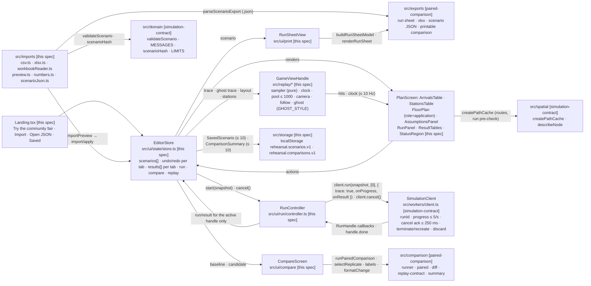

# Design Document

## Overview

This spec builds everything the organizer touches: the import adapters that turn a CSV pair or a workbook into a validated `Scenario` through a preview and one atomic reducer action; the editor store whose single current `Scenario` feeds the tables, the floor plan and the assumptions panel in the same commit, with results held per tab; the run controller on the UI side of the engine's worker adapter (snapshot, the adapter's `RunHandle`, progress, cancel, the UI-side drop of callbacks from a superseded handle, stale labels); the PixiJS game view (one canvas, a 1,000-sprite pool, a pure sampler over the trace, a display-only clock, the follow camera, the person timeline, the queue inspector and the baseline ghost layer); the Compare screen over `src/comparison/` with the replicate selector; the Print screen that renders the run-sheet model (task 15, last); the landing screen; the bounded saved-scenario store; the Playwright journeys, including the four the comparison spec specifies; and the storyboard capture scripts. Nothing here computes a path, samples a service time, schedules an event, compares runs, parses a worker message or generates an export: those are the modules `src/domain/`, `src/simulation/`, `src/spatial/` and `src/workers/` of `simulation-contract` and `src/comparison/` and `src/exports/` of `paired-comparison-and-release`, reached by the exact names of their specs' design documents and never reimplemented.

Owner: Kiro does every task of this spec in the main checkout on one branch, and edits the shared files (`package.json`, the lockfile, `tsconfig.json`, `vite.config.ts`, `playwright.config.ts`, `src/app.tsx`, `src/main.tsx`) itself in the task that needs them, naming each change in that task's log row; there is no fleet, integrator, worktree, `docs/fleet.md` or reviewer agent. Figures in this document (1,000 ms preview, 250 ms cancel, 200 ms click, 3,000 ms first example, 60 and 30 fps, 960 px print height) are targets until `docs/performance.md` or an acceptance file records a measurement with the device, browser, commit and date. Dependencies: everything this spec uses from `src/domain/`, `src/spatial/`, `src/simulation/` and `src/workers/` exists and works (the `simulation-contract` tasks are done); `src/comparison/` and `src/exports/` do not exist until `paired-comparison-and-release` runs, which the revision steering places after this spec's tasks 1 to 14, 16 and 17. Those tasks therefore import nothing from either folder; tasks 18 and 19 run after that spec's task 9 (labels, constants, comparison, scenario JSON), and task 15 runs last, after that spec's tasks 10 to 13 (CSV, workbook, printable comparison, run sheet), and only if the owner says there is time. A control whose generator is not there yet is not rendered; there is no `Not in this build` state and no local copy of any type or function of another spec. Until the game view lands, the replay and run tests use the hand-authored trace fixtures of Testing Strategy and the fake client of `tests/ui/fakePort.ts`.

## Architecture



Three interactions fix the order of events.

Import preview and atomic apply (Requirements 1 and 2):

```mermaid
sequenceDiagram
  participant U as user
  participant D as ImportDialog
  participant A as csv.ts / xlsx.ts
  participant V as src/domain [simulation-contract]
  participant S as EditorStore
  U->>D: choose harbor-hall.xlsx
  D->>D: size ≤ 2,097,152 bytes? else "… is 2.40 MiB; the limit is 2 MiB."
  D->>A: previewWorkbook(file, current scenario)
  A->>A: reader.sheetNames(); open only Arrivals, Stations, Settings
  A->>A: per cell: number | text | formula+saved | formula-no-value | date/boolean/error
  A->>A: rows → stations, cohorts, settings; layout from current scenario
  A->>V: validateScenario(candidate)
  V-->>A: ok | issues (code, path 'stations[1].servers', message, entity)
  A->>A: map issues to sheet!cell (row, field) through the candidate's array indices
  A->>V: scenarioHash(candidate) when no errors
  A-->>D: ImportPreview { sheetsRead, sheetsIgnored, formulaCells, errors, candidate, hash }
  U->>D: Apply import (enabled only when errors = [])
  D->>S: dispatch import/apply { candidate, sources }
  S->>S: past.push(prev); future = []; revision + 1; results.status = stale if results
  S-->>D: close; focus first changed table; setStatus("Imported 1 cohorts and 2 stations from harbor-hall.xlsx.")
```

Run, cancel and late messages (Requirement 5):

```mermaid
sequenceDiagram
  participant U as user
  participant S as EditorStore
  participant C as RunController
  participant K as SimulationClient [engine adapter]
  U->>S: Simulate
  S->>C: start(snapshot, hash, tabIndex)
  C->>C: createPathCache(snapshot).unreachable is empty (else run/blocked, nothing requested)
  C->>K: run(snapshot, [0], { trace: true, onProgress, onResult })
  K-->>C: RunHandle { runId: 7, done }  → active handle; dispatch run/started
  K-->>C: onProgress(0, 1)  → run/progress (handle is active)
  U->>S: Cancel
  S->>C: cancel()
  C->>K: cancel()  (the adapter posts cancel, arms its 250 ms timer, bumps runId)
  alt worker acknowledges within 250 ms
    K-->>C: done resolves { status: 'cancelled', message: 'Simulation cancelled.' }
  else no acknowledgement
    K->>K: terminate and recreate the worker (adapter rule)
    K-->>C: done resolves { status: 'cancelled', message: 'Simulation cancelled. The simulation worker did not respond within 250 ms and was restarted.' }
  end
  C->>S: run/finished { outcome: 'cancelled', message }; setStatus("Run cancelled."); results untouched
  K-->>C: onResult(result) from handle 7 (late; only possible from a fake client, the adapter drops it first)
  C->>C: handle 7 is not active → dropped, no dispatch
```

Replay clock and sampling (Requirements 6 and 7):

```mermaid
sequenceDiagram
  participant T as Pixi Ticker
  participant K as clock.ts (pure)
  participant M as sampler.ts (pure)
  participant R as renderer (sprites, camera)
  participant D as DOM (scrubber, inspector)
  T->>K: tick(deltaRealMs)
  K->>K: ms = clamp(ms + deltaRealMs × speed, 0, endMs) if playing
  K->>M: sampleAt(index, ms) and, on the Compare screen, sampleAt(ghostIndex, ms) at the same ms
  M-->>R: attendees[] (phase, position along the cells of the path with id pathId, station, queueIndex), perStation counts
  R->>R: pool.sync(visible ≤ 1000, split 500 + 500 with a ghost); badges for the rest; camera.centerOn(follow ? pos : camera)
  R-->>D: onClock(ms, playing) at most every 100 ms
  Note over T,R: no call into src/simulation; the trace object is never mutated
```

### File layout for this spec

| Path | Role | Task (Kiro) |
| --- | --- | --- |
| `src/imports/numbers.ts`, `csv.ts`, `xlsx.ts`, `workbookReader.ts`, `preview.ts`, `units.ts` | decimal parsing, the two adapters, the SheetJS wrapper, preview assembly and issue mapping, display-unit conversion | 3, 4 |
| `src/imports/scenarioJson.ts` | the `Open JSON` wrapper over `parseScenarioExport` | 19 |
| `src/ui/import/ImportDialog.tsx`, `PreviewTable.tsx`, `Templates.tsx` | the dialog, the preview, the template downloads (`Export workbook` is task 15's) | 7 |
| `src/ui/state/store.ts`, `reducer.ts`, `types.ts`, `undo.ts`, `selectors.ts` | the editor store, committed-edit rules, undo/redo, stale derivation (the `compare` slice from task 18) | 5 |
| `src/ui/plan/PlanScreen.tsx`, `ArrivalsTable.tsx`, `StationsTable.tsx`, `AssumptionsPanel.tsx`, `LayoutPanel.tsx`, `ScenarioTabs.tsx` | the Plan screen and its tables and panels | 6 |
| `src/ui/floorplan/FloorPlan.tsx`, `grid.ts`, `drag.ts`, `cursor.ts`, `routes.ts` | the floor plan (DOM/SVG, not Pixi), drag, cell cursor, route polylines through `createPathCache` | 8 |
| `src/ui/run/controller.ts`, `RunPanel.tsx`, `port.ts` | run controller, Simulate/Cancel/progress, the `WorkerPort` type (the engine's `SimulationClient` narrowed to `run`, `cancel`, `currentRunId`) | 9 |
| `src/ui/results/ResultTables.tsx`, `format.ts` | the accessible result tables; `formatMetricValue` for every `MetricValue`, `mm:ss.mmm` only for trace timestamps | 9 |
| `src/replay/traceIndex.ts`, `sampler.ts`, `clock.ts` | the pure index, sampler and clock | 10.1 |
| `src/replay/pool.ts`, `camera.ts`, `queueLine.ts`, `badges.ts` | sprite pool, camera, queue lines, badges | 10.2 |
| `src/replay/gameView.ts`, `fallback.ts` | the game view behind `GameViewHandle` | 10.3 |
| `src/replay/ghost.ts` | the baseline ghost layer | 18 |
| `src/ui/game/GameViewPanel.tsx`, `FindAttendee.tsx`, `PersonTimeline.tsx`, `QueueInspector.tsx` | the DOM around the canvas on the Plan screen; the ghost legend on the Compare screen from task 18 | 11 |
| `src/ui/compare/CompareScreen.tsx`, `PickScenarios.tsx`, `ChangeList.tsx`, `MetricCard.tsx`, `StationTable.tsx`, `ReplicateSelect.tsx`, `ExportControls.tsx` | the Compare screen over `src/comparison/` and `src/exports/` | 18 (the export controls other than `export-scenario-json`: 15) |
| `src/ui/print/RunSheetView.tsx`, `PrintScreen.tsx`, `run-sheet.css` | the Print screen over `buildRunSheetModel` and `renderRunSheet` | 15 (last, only if there is time) |
| `src/ui/landing/Landing.tsx`, `loadExample.ts` | landing and the three example fetches | 6 (the JSON and saved-scenario buttons: 19) |
| `src/storage/scenarios.ts`, `prefs.ts` | saved scenarios (bound passed in, `SAVED_SCENARIO_LIMIT` from task 19), preferences | 12 |
| `src/storage/comparisons.ts` | saved comparison summaries (≤ 10) | 18 |
| `src/ui/StatusRegion.tsx`, `src/ui/styles/tokens.css`, `app.css`, `src/ui/testHook.ts` | the one live region, tokens, the test hook | 6 (`storage.failNextWrite`: 19) |
| `src/app.tsx`, `src/main.tsx`, `package.json`, `package-lock.json`, `tsconfig.json`, `vite.config.ts`, `vitest.ui.config.ts`, `playwright.config.ts`, `.env.test` | shared files, edited by Kiro in the task that needs them and named in that task's log row | 1, 6 and later |
| `public/examples/arrivals.csv`, `stations.csv`, `rehearsal-template.xlsx`, `public/examples/harbor-hall/{arrivals.csv,stations.csv,harbor-hall.xlsx}`, `scripts/make-fixtures.ts` | the CSV and workbook data files and the script that writes the workbooks; `baseline.json`, `plus-one-checkin.json`, `shorter-route.json` and `expected.json` in the same folder are written by `simulation-contract` task 15 (bare `Scenario` objects with `modelVersion` `'0.1.0'`) and only read here | 2 |
| `tests/imports/**`, `tests/ui/**`, `tests/replay/**` | Vitest unit and component tests (script `test:ui` over `vitest.ui.config.ts`, added to `verify` in task 1; a plan refinement) | 1 and the task of each module |
| `tests/e2e/**` | Playwright journeys and helpers, including `compare.spec.ts` and `judge-access.spec.ts` (task 18) and `exports.spec.ts` and `run-sheet.spec.ts` (task 15) with the assertions of `paired-comparison-and-release/design.md` | 1 and the task of each journey |
| `tests/video/*.spec.ts`, `tests/video/out/` | the storyboard capture scripts of Requirement 13 (`npm run test:video`) | 20 |
| `.kiro/specs/scenario-editor-and-replay/{requirements,design,tasks}.md` | this spec; Kiro replaces a *verify* mark with the observed value and ticks a task, and logs both | every task |
| `docs/kiro-log.md`, `docs/acceptance/scenario-editor-and-replay.md`, `docs/acceptance/img/` | log rows, Kiro's own acceptance record, headless screenshots and PDFs | every task; 14, 15, 16, 17 |

Screens (`src/app.tsx`, edited by Kiro in tasks 6, 18 and 15): `landing` is the default when no scenario is loaded; `plan` holds the scenario tabs, the tables, the floor plan, the assumptions panel, the run panel, the game view, the result tables and, from tasks 18 and 15, the `Compare` and `Print run sheet` controls; `compare` holds the Compare screen with its own game view (ghost on); `print` holds the run sheet (task 15). One game view exists at a time: the Plan screen's is destroyed when `compare` or `print` mounts and recreated on return. Thread model: the main thread renders React, the SVG floor plan and the Pixi game view; the one module worker simulates. `src/app.tsx` creates one `SimulationClient` with `createSimulationClient()` for the session and passes it to the run controller and the Compare screen; the store never posts a worker message.

## Components and Interfaces

### Consumed contracts (verbatim from the plan; defined by `simulation-contract`, never redefined here)

```ts
type Scenario = {
  schemaVersion: 1; id: string; revision: number; title: string;
  modelVersion: string; baseSeed: string; horizonMs: number;
  layout: {
    cols: number; rows: number; cellSizeM: number;
    blockedCells: [number, number][];
    entrance: [number, number]; exit: [number, number];
  };
  walkSpeedMps: number;
  stations: {
    id: string; label: string; cell: [number, number]; servers: number;
    service: { kind: 'constant'; seconds: number } |
      { kind: 'triangular'; minS: number; modeS: number; maxS: number };
  }[];
  cohorts: {
    id: string; startMs: number; endMs: number; count: number;
    arrivals: 'even' | 'uniform'; route: string[];
  }[];
  notes: string;
};

type RunResult = {                                   // src/simulation/simulate.ts
  scenarioHash: string; modelVersion: string; baseSeed: string; replication: number;
  horizonMs: number; completion: 'complete' | 'drain-capped'; unfinished: string[];
  metrics: Metrics; trace?: Trace;
};
```

Attendee IDs are `${cohortId}#${ordinal}` with a four-digit zero-padded ordinal (`doors#0000` … `doors#0119`); lexical order is arrival order within a cohort. `Metrics` (`src/simulation/metrics.ts`: `completedByClosing`, `activeAtClosing`, `queueWait`, `journeyTime`, `walkingTime`, `queues`, `stations[]`, `staffHours`, plus `horizonMs` and `admitted`) carries the ten metrics of the plan's section 7 with units and denominators as `MetricValue`s; the result tables render every `MetricValue` through the engine's `formatMetricValue`, which gives `n/a` for an undefined average or percentile. This spec never sends or parses a worker message (`ToWorker`/`FromWorker` are the adapter's concern); it consumes the adapter's `SimulationClient` below.

### Seams consumed from the other two specs (signatures as they stand in `src/` for `simulation-contract`, and verbatim from `paired-comparison-and-release/design.md`; a divergence is a defect in that spec, reported to the owner and recorded in the log row, never patched here)

```ts
// src/domain/validate.ts, src/domain/hash.ts, src/domain/limits.ts  (simulation-contract, read from src/ on 2026-11-16)
export type ValidationIssue = { code: IssueCode; path: string; message: string; entity?: { kind: 'station' | 'cohort'; id: string } };
// path forms: 'stations[2].servers', 'cohorts[0].route[1]', 'layout.blockedCells[4]', 'horizonMs'; UNREACHABLE uses 'layout'
// (entrance to a station or to the exit) or 'cohorts[i].route[k]' (a route segment) and carries no entity
export type ValidationWarning = { code: 'MODEL_VERSION_MISMATCH'; message: string };
export type ValidationResult =
  | { ok: true; scenario: Scenario; warnings: ValidationWarning[] }
  | { ok: false; issues: ValidationIssue[] };
export function validateScenario(input: unknown): ValidationResult;      // synchronous; never mutates; passes 4 to 5 run only when passes 1 to 3 found nothing
export const MESSAGES: Record<IssueCode, (args: Record<string, string | number>) => string>;
export function scenarioHash(scenario: Scenario): Promise<string>;       // lowercase 64-hex SHA-256 of canonicalJson
export const LIMITS: Limits;   // { maxAttendees 5000, maxStations 10, maxRouteVisits 6, maxCols 80, maxRows 80, maxHorizonMs 21_600_000, minServers 1, maxServers 20, maxServiceSeconds 86_400, maxIdLength 64, maxSeedLength 64 }, typed readonly number

// src/simulation/version.ts, src/simulation/metrics.ts  (simulation-contract)
export const MODEL_VERSION: string;                                       // '0.1.0'; no version in this repository reaches 1.0.0
export function formatMetricValue(m: MetricValue): string;               // ', ' | '30.0 s' | '100.0%' | '2.00 h' | '3'; '*' suffix when conditioned

// src/spatial/path-cache.ts  (simulation-contract), the spatial seam of 3.8, 4.4 and 5.1; NodeRef is declared in src/simulation/heap.ts
export type NodeRef = { kind: 'entrance' } | { kind: 'exit' } | { kind: 'station'; id: string };
export type CachedPath = { id: number; from: NodeRef; to: NodeRef; cells: Cell[]; distanceM: number; durationMs: number };
export type PathCache = {
  key: string;                                              // canonicalJson of { layout, stations: [{ id, cell }] sorted by id, walkSpeedMps }
  paths: CachedPath[];
  lookup(from: NodeRef, to: NodeRef): CachedPath;           // throws when unreachable; check `unreachable` first
  unreachable: { from: NodeRef; to: NodeRef }[];
  unsafe: { from: NodeRef; to: NodeRef; durationMs: number }[];
};
export function createPathCache(input: Pick<Scenario, 'layout' | 'stations' | 'walkSpeedMps'>): PathCache;
export function describeNode(input: Pick<Scenario, 'layout' | 'stations'>, node: NodeRef): string;   // 'entrance (0,12)' | 'exit (0,4)' | 'station "packs" (34,12)'

// src/workers/client.ts  (simulation-contract), the adapter this spec drives; it owns runId, cancellation and the discard rule
export type RunOutcome =
  | { status: 'complete'; results: RunResult[] }
  | { status: 'cancelled'; message: string }               // 'Simulation cancelled.' | 'Simulation cancelled. The simulation worker did not respond within 250 ms and was restarted.' | 'Simulation replaced by a newer run.' (only when run() is called while a run is active; the controller cancels first, 5.5)
  | { status: 'error'; message: string };                  // the worker's first issue or 'Simulation failed: …' | 'Malformed worker message.' | 'The simulation worker stopped unexpectedly: <reason>.'
export type RunHandle = { runId: number; done: Promise<RunOutcome> };
export type RunCallbacks = { onProgress?: (done: number, total: number) => void; onResult?: (result: RunResult) => void };
export type SimulationClient = {
  run(scenario: Scenario, replications: number[], options: { trace: boolean } & RunCallbacks): RunHandle;
  cancel(): void;
  dispose(): void;
  readonly currentRunId: number;
  readonly discardedMessages: number;
};
export function createSimulationClient(deps?: Partial<ClientDeps>): SimulationClient;   // the app passes no deps

// src/simulation/trace.ts  (simulation-contract), read only through src/replay/traceIndex.ts
export type TraceEvent =
  | { kind: 'arrive'; timeMs: number; attendeeId: string }
  | { kind: 'depart'; timeMs: number; attendeeId: string; from: NodeRef; to: NodeRef; pathId: number; arriveMs: number }
  | { kind: 'join'; timeMs: number; attendeeId: string; stationId: string; position: number }      // position: index in the line before dispatch at timeMs
  | { kind: 'start'; timeMs: number; attendeeId: string; stationId: string; server: number; waitMs: number }   // server is 0-based; shown as server + 1
  | { kind: 'complete'; timeMs: number; attendeeId: string; stationId: string; server: number }
  | { kind: 'exit'; timeMs: number; attendeeId: string }
  | { kind: 'cap'; timeMs: number };
export type MovementSegment = { attendeeId: string; startMs: number; endMs: number; pathId: number };   // endMs - startMs === durationMs of the path whose id === pathId
export type TraceAttendee = { id: string; cohortId: string; arrivalMs: number; exitMs: number | null };
export type Trace = { version: 1; paths: CachedPath[]; attendees: TraceAttendee[]; events: TraceEvent[]; segments: MovementSegment[] };
// trace.paths holds only the paths a segment references, in id order, so it is NOT indexed by id: buildIndex maps id → path

// src/comparison  (paired-comparison-and-release), consumed by the Compare screen, the ghost and storage
export function runPairedComparison(client: SimulationClient, baseline: Scenario, candidate: Scenario, options?: RunnerOptions): ComparisonHandle;
export function selectReplicate(client: SimulationClient, comparison: Comparison, r: number, options?: Pick<RunnerOptions, 'onProgress' | 'clock'>): ReplicateHandle;
export type ReplaySelection = { replication: number; baseline: RunResult; candidate: RunResult; label: string; clock: { horizonMs: number; endMs: number } };
export function attendeePairs(selection: ReplaySelection, population: PopulationChange): { ok: true; pairs: AttendeePair[] } | { ok: false; code: 'POPULATION_CHANGED'; message: string };
export function isComparisonCurrent(c: Comparison, baselineHashNow: string, candidateHashNow: string): boolean;
export function toComparisonSummary(c: Comparison): ComparisonSummary;
export function fromComparisonSummary(json: string): { ok: true; summary: ComparisonSummary; restored: true } | { ok: false; code: 'SUMMARY_INVALID'; message: string };
export const SAVED_SCENARIO_LIMIT: 10; export const COMPARISON_SUMMARY_MAX_BYTES: 32768;
export const GHOST_STYLE: { role: 'baseline'; alpha: 0.45; outline: 'dashed'; fill: 'hatched'; hue: 'orange' };
export const CANDIDATE_STYLE: { role: 'candidate'; alpha: 1; outline: 'solid'; fill: 'solid'; hue: 'cyan' };
export const GHOST_LEGEND: string; export const REPLAY_NOTE: string; export const RANGE_LABEL: string; export const STALE_TEXT: 'Stale, rerun'; export const COMPLETE_TEXT: string; export const COMBINED_NOTE: string; export const PER_PERSON_OFF: string;
export const SAVE_REASONS: { quota: string; unavailable: string; limit: string };
export function saveErrorText(reason: keyof typeof SAVE_REASONS): string;   // 'Could not save: <reason>.'
export function replayLabel(r: number): string; export function progressText(done: number, total: number): string; export function loadingReplicationText(r: number): string; export function timingText(pairedMs: number): string; export function restoredSummaryText(createdAt: string): string; export function changesHeader(kind: 'none' | 'single' | 'combined', n: number): string;
export function countSentence(input: { direction: 'lower' | 'higher' | 'none'; metricLabel: string; improved: number | null; n: number; languageMode: 'person-for-person' | 'population'; baselineCount: number; candidateCount: number }): string;
export function formatChange(value: number | null, unit: Unit): string; export function formatMean(value: number | null, unit: Unit): string;

// src/exports  (paired-comparison-and-release)
export type RunSheetSegment = { from: string; to: string; fromLabel: string; toLabel: string; cells: number; distanceM: number; durationMs: number };
export type RunSheetModel = {
  title: string; generatedAt: string; scenarioHash: string; modelVersion: string; horizonMs: number;
  cohorts: { id: string; startMs: number; endMs: number; count: number; arrivals: 'even' | 'uniform'; route: string[] }[];
  stations: { id: string; label: string; servers: number; service: Service; cell: Cell; metersFromEntrance: number }[];
  segments: RunSheetSegment[]; walkingPerRoute: { cohortId: string; distanceM: number; durationMs: number }[];
  staffHours: number; assumptions: readonly string[]; limits: string;
};
export function buildRunSheetModel(scenario: Scenario, scenarioHash: string): RunSheetModel;
export function renderRunSheet(scenario: Scenario, options: { generatedAt: string; scenarioHash: string }): { html: string; model: RunSheetModel };
export function renderComparisonHtml(comparison: Comparison | ComparisonSummary, options: { generatedAt: string }): string;
export function exportScenarioJson(input: { scenario: Scenario; scenarioHash: string; results?: RunResult[]; generatedAt: string }): string;
export function parseScenarioExport(text: string): Promise<ParseExportResult>;   // envelope or bare Scenario; FILE_TOO_LARGE | NOT_JSON | NOT_A_SCENARIO_EXPORT | UNSUPPORTED_FORMAT_VERSION | SCENARIO_INVALID
export function exportWorkbook(scenario: Scenario): Uint8Array;
export function exportResultsCsv(comparison: Comparison): string; export function exportComparisonCsv(comparison: Comparison | ComparisonSummary): string;
export const FORBIDDEN_BADGE_WORDS: readonly string[];
```

Availability: the `src/domain`, `src/spatial`, `src/simulation` and `src/workers` names exist and work now (`simulation-contract` is done). The `src/comparison` and `src/exports` names do not exist while tasks 1 to 14, 16 and 17 run; `paired-comparison-and-release` task 1 adds them as typed stubs with every constant real and `labels.ts` complete, and its tasks 3 to 9 make the comparison, the labels and the scenario JSON functions work, after which tasks 18 and 19 use them. The CSV, workbook, printable-comparison and run-sheet generators work only after that spec's tasks 10 to 13, so the controls that call them (`Export workbook`, `export-results-csv`, `export-comparison-csv`, `export-workbook`, `open-printable-comparison`, `open-run-sheet`, `download-comparison-csv`, `Print run sheet` and `Save as HTML`) are added by task 15 and are not rendered before it. There is no `Not in this build` state and no local copy of any type or function of another spec; the one shared literal is `STALE_LABEL` (`Stale, rerun`, the Plan screen's badge, a fixed text of `.kiro/steering/model-limits.md`), which task 18 asserts equal to `STALE_TEXT`.

### Import adapters (`src/imports/`)

```ts
export type ImportTable = 'arrivals' | 'stations' | 'settings';
export type CellRef = { sheet: string; cell: string };                 // { sheet: 'Stations', cell: 'C3' }
export type ImportLocation = { table: ImportTable; row: number; field: string; cell?: CellRef };   // row is 1-based; row 1 = header
export type ImportErrorCode =
  | 'file-too-large' | 'file-unreadable' | 'missing-header' | 'duplicate-header'
  | 'missing-sheet' | 'duplicate-id' | 'not-a-number' | 'not-whole' | 'out-of-range'
  | 'formula-without-value' | 'unsupported-cell' | 'unknown-station' | 'repeated-station'
  | 'route-too-long' | 'bad-pattern' | 'bad-window' | 'bad-service' | 'cell-out-of-bounds'
  | 'cell-occupied' | 'unreachable' | 'too-many-stations' | 'too-many-attendees' | 'bad-id' | 'bad-settings';
export type ImportError = { code: ImportErrorCode; location?: ImportLocation; message: string };   // message is the exact user-visible text of Error Handling

export type ArrivalsRow  = { cohort_id: string; start_min: number; end_min: number; count: number; arrival_pattern: 'even' | 'uniform'; route: string[] };
export type StationsRow  = { station_id: string; label: string; servers: number; service_min_s: number; service_mode_s: number; service_max_s: number; cell_x: number; cell_y: number };
export type SettingsRow  = { key: 'title' | 'horizon_min' | 'walk_speed_mps' | 'base_seed'; value: string | number };
export type PreviewRow<T> = { row: number; cell?: CellRef; values: Partial<T>; raw: Record<string, string>; errors: ImportError[]; formulaFields: string[] };

export type ImportPreview = {
  previewVersion: 1;
  source: { kind: 'csv'; files: { table: 'arrivals' | 'stations'; name: string; bytes: number }[] } | { kind: 'xlsx'; name: string; bytes: number };
  sheetsRead: string[]; sheetsIgnored: string[];                    // xlsx only; [] for csv
  columnsNotRead: Record<'arrivals' | 'stations', string[]>;
  settingsKeysNotRead: string[];
  arrivals: PreviewRow<ArrivalsRow>[] | null;                        // null when that table was not given
  stations: PreviewRow<StationsRow>[] | null;
  settings: PreviewRow<SettingsRow>[] | null;
  formulaCells: CellRef[];
  errors: ImportError[];                                             // every error, in document order
  candidate: Scenario | null;                                        // present only when errors.length === 0
  canonicalHash: string | null;
};

export function parseDecimal(text: string): { ok: true; value: number } | { ok: false };   // ^[+-]?(\d+(\.\d*)?|\.\d+)$ after trim, then Number(); finite only
export function previewCsv(files: { table: 'arrivals' | 'stations'; file: File }[], current: Scenario, deps: Deps): Promise<ImportPreview>;
export function previewWorkbook(file: File, current: Scenario, deps: Deps): Promise<ImportPreview>;
export function openScenarioJson(file: File, deps: { parseExport: typeof parseScenarioExport }): Promise<ParseExportResult>;   // task 19; reads the file as text and returns parseScenarioExport(text) unchanged (the 2 MiB check is the parser's); the dialog renders ok/warnings/code messages
export type Deps = { validate: typeof validateScenario; hash: typeof scenarioHash; pathCache: typeof createPathCache; reader?: (bytes: ArrayBuffer) => WorkbookReader; maxBytes: number /* 2,097,152 */ };   // nothing from src/exports, so tasks 3 to 4 compile before that folder exists

// workbookReader.ts, the only file that imports SheetJS; tests pass a fake
export interface WorkbookReader {
  sheetNames(): string[];
  sheet(name: string): SheetReader | null;        // called only for 'Arrivals', 'Stations', 'Settings' (2.2)
}
export interface SheetReader {
  rows(): CellValue[][];                          // row-major from row 1; trailing all-blank rows removed
}
export type CellValue =
  | { kind: 'blank'; ref: CellRef }
  | { kind: 'number'; ref: CellRef; value: number; formula?: string }      // formula present → 'formula (saved value used)'
  | { kind: 'text'; ref: CellRef; value: string; formula?: string }
  | { kind: 'formula-no-value'; ref: CellRef; formula: string }
  | { kind: 'date' | 'boolean' | 'error'; ref: CellRef };
export function openWorkbook(bytes: ArrayBuffer): WorkbookReader;     // SheetJS CE; the cell-object field names for value, type and formula are `t`, `v` and `f`, settled on 0.20.3, and are read only here
```

Rules the adapters implement: the header row is matched by exact name after trimming; a column outside the template is listed in `columnsNotRead` and never read; rows whose cells are all blank are skipped and do not count; row numbers in messages are the source row numbers (CSV line or sheet row); a numeric cell in a text field is converted with `String(value)`; display units convert once (`start_min` × 60,000 → `startMs`, `horizon_min` × 60,000 → `horizonMs`; `service_*_s` stay seconds in `Scenario.stations[].service`; equal `min = mode = max` → `{ kind: 'constant', seconds }`); the candidate is `{ ...current, stations, cohorts, title?, horizonMs?, walkSpeedMps?, baseSeed?, revision: current.revision + 1 }` with `layout`, `id`, `notes` and `modelVersion` unchanged; reachability, ID format, duplicates and every other domain rule come from `validateScenario(candidate)`: each `ValidationIssue` is mapped to `(table, row, field)` through its `path` (`stations[2].servers` → stations row 3, field `servers`; `cohorts[0].route[1]` → arrivals row 2, field `route`; code `UNREACHABLE` with path `layout` (it carries no `entity`) → the row of the station `s` for which `createPathCache(candidate).unreachable` holds the pair `{ kind: 'entrance' } → { kind: 'station', id: s }`, field `cell_x/cell_y` (an unreachable exit maps to no row and is listed as `Layout: <engine message>`); `ID_FORMAT` → the row's `station_id` or `cohort_id`) and rendered as `Row <n>, <field>: <engine message>` (sheet form `Stations!C3 (servers): …`) when the adapter has not already reported the same cell; an issue whose row lies in a table this import did not supply (for example a route segment of a current cohort when only `Stations CSV` is given) is listed as `Current scenario, cohort "<id>", <field>: <engine message>`; the adapters add only what the validator cannot know (sheet, cell, row and column names, the occupied-cell editor rule of 3.5, the limits phrased per row) and never re-implement a validator rule.

### Editor store (`src/ui/state/`)

```ts
export type Selection =
  | { kind: 'none' }
  | { kind: 'station'; id: string }
  | { kind: 'cohort'; id: string }
  | { kind: 'cell'; cell: [number, number] };            // the floor plan's cell cursor

export type ResultsState =
  | { status: 'none' }
  | { status: 'fresh' | 'stale'; result: RunResult; snapshot: Scenario; hash: string; completedAt: string };

export type RunState =
  | { status: 'idle' }
  | { status: 'running'; runId: number; tabIndex: number; done: number; total: number; startedAt: number }
  | { status: 'cancelling'; runId: number; tabIndex: number; since: number }
  | { status: 'blocked'; message: string }                 // 4.4, 4.5: the message shown in the run panel
  ;

export type TabKey = string;                               // example file stem ('baseline', 'plus-one-checkin', 'shorter-route') or the scenario id

// the compare slice, the compare/* actions and storage.savedComparisons are added by task 18 (they need src/comparison types)
export type CompareState =
  | { status: 'idle'; baselineIndex: number | null; candidateIndex: number | null }
  | { status: 'running'; baselineIndex: number; candidateIndex: number; done: number; total: 62 }
  | { status: 'complete'; baselineIndex: number; candidateIndex: number; comparison: Comparison; selection: ReplaySelection; loadingReplicate: number | null }
  | { status: 'restored'; summary: ComparisonSummary }
  | { status: 'failed'; baselineIndex: number; candidateIndex: number; message: string; previous: Comparison | null };
// stale is derived: status 'complete' and !isComparisonCurrent(comparison, hashes[baselineIndex], hashes[candidateIndex])

export type EditorState = {
  stateVersion: 1;
  screen: 'landing' | 'plan' | 'compare' | 'print';
  scenarios: Scenario[];                                   // the open tabs; Harbor Hall opens three
  tabKeys: TabKey[];                                       // indexed like scenarios; used in data-testid values
  currentIndex: number;
  scenario: Scenario;                                      // === scenarios[currentIndex]; the canonical object
  hashes: (string | null)[];                               // scenarioHash per tab, recomputed after every committed edit of that tab (async; null while pending)
  hash: string | null;                                     // === hashes[currentIndex]
  selection: Selection;
  past: Scenario[][]; future: Scenario[][];                // per tab, indexed like scenarios; past[i].length ≤ 100
  drag: { stationId: string; from: [number, number]; current: [number, number] } | null;   // transient, never in past
  results: ResultsState[];                                 // per tab, indexed like scenarios; { status: 'none' } until that tab runs
  run: RunState;                                           // one run at a time; tabIndex names the tab it belongs to
  compare: CompareState;
  replay: { follow: string | null; selectedAttendee: string | null; inspectedStation: string | null; speed: 1 | 4 | 16; playing: boolean; clockMs: number };   // mirrored from the game view at ≤ 10 Hz, never the source of truth for drawing
  importDialog: { open: boolean; preview: ImportPreview | null; busy: boolean; message: string | null };
  storage: { saved: SavedScenarioSummary[]; savedComparisons: ComparisonSummary[]; message: string | null; unreadable: boolean; saveError: { reason: 'quota' | 'unavailable' | 'limit' } | null };
  prefs: Prefs;
  status: string;                                          // the status region's text
};

export type EditorAction =
  | { type: 'station/move'; id: string; cell: [number, number]; via: 'drag' | 'form' | 'nudge' }
  | { type: 'station/set'; id: string; patch: Partial<Omit<Scenario['stations'][number], 'id' | 'cell'>> }
  | { type: 'station/rename'; id: string; newId: string }
  | { type: 'station/add' } | { type: 'station/delete'; id: string }
  | { type: 'cohort/set'; id: string; patch: Partial<Omit<Scenario['cohorts'][number], 'id'>> }
  | { type: 'cohort/rename'; id: string; newId: string } | { type: 'cohort/add' } | { type: 'cohort/delete'; id: string }
  | { type: 'layout/toggle-blocked'; cell: [number, number] } | { type: 'layout/set-entrance'; cell: [number, number] } | { type: 'layout/set-exit'; cell: [number, number] } | { type: 'layout/resize'; cols: number; rows: number }
  | { type: 'settings/set'; patch: Partial<Pick<Scenario, 'title' | 'horizonMs' | 'walkSpeedMps' | 'baseSeed' | 'notes'>> }
  | { type: 'import/apply'; candidate: Scenario; sources: string[] }
  | { type: 'scenario/open'; scenario: Scenario } | { type: 'scenario/select-tab'; index: number }
  | { type: 'undo' } | { type: 'redo' }
  | { type: 'drag/start' | 'drag/move' | 'drag/end' | 'drag/cancel'; id: string; cell: [number, number] }
  | { type: 'select'; selection: Selection }
  | { type: 'run/started'; runId: number; tabIndex: number } | { type: 'run/progress'; runId: number; done: number; total: number }
  | { type: 'run/result'; runId: number; tabIndex: number; result: RunResult; snapshot: Scenario; hash: string }
  | { type: 'run/cancelling'; runId: number } | { type: 'run/finished'; runId: number; outcome: 'complete' | { cancelled: string } | { error: string } }
  | { type: 'run/blocked'; message: string }
  | { type: 'compare/pick'; role: 'baseline' | 'candidate'; index: number } | { type: 'compare/started' } | { type: 'compare/progress'; done: number }
  | { type: 'compare/complete'; comparison: Comparison } | { type: 'compare/failed'; message: string } | { type: 'compare/loading-replicate'; r: number }
  | { type: 'compare/restored'; summary: ComparisonSummary }
  | { type: 'hash/computed'; tabIndex: number; revision: number; hash: string }
  | { type: 'storage/save-failed'; reason: 'quota' | 'unavailable' | 'limit' } | { type: 'storage/save-ok' }
  | { type: 'status/set'; text: string };

export function reduce(state: EditorState, action: EditorAction): EditorState;   // pure; throws never; refusals return the same state object and a message through `refusal(action, state)`
export function refusal(state: EditorState, action: EditorAction): string | null; // 'Cell (16, 21) is blocked.' etc.; null when the action is allowed
export function commits(action: EditorAction): boolean;                           // the committed-edit list of requirement 4.2
export function createEditorStore(deps: { hash: typeof scenarioHash; now: () => string }): EditorStore;   // useSyncExternalStore-compatible; recomputes that tab's hash after each committed edit and dispatches hash/computed with the tab and the revision it belongs to (a stale hash result for an older revision is dropped)
```

Committed-edit rule: when `commits(action)` and `reduce` changes `scenario`, the reducer pushes the previous scenario on `past[currentIndex]` (dropping the oldest beyond 100), clears `future[currentIndex]`, sets `revision + 1`; `undo` moves the current scenario to `future[currentIndex]` and pops `past[currentIndex]`; `redo` the reverse. `results[i].status` is derived, not stored: `'stale'` when `results[i]` exist and `hashes[i] !== results[i].hash`, `'fresh'` otherwise; `title` and `notes` are outside the hash so they never stale results. `scenario/select-tab` changes `currentIndex` only: it never touches another tab's results, label, undo stacks or hash, and while `run.status` is `running` or `cancelling` the store calls the controller's `cancel()` first (5.5). A `run/result` is applied to `results[action.tabIndex]`, never to the current tab if the user switched meanwhile. Field inputs are controlled by local component state and dispatch on Enter or blur only when the parsed value differs from the scenario's. `scenario/open` and `import/apply` are committed edits with one undo entry each.

### Run controller (`src/ui/run/`)

```ts
// src/ui/run/port.ts
export type WorkerPort = Pick<SimulationClient, 'run' | 'cancel' | 'currentRunId'>;   // the engine adapter itself in the app; tests/ui/fakePort.ts in tests

// src/ui/run/controller.ts
export function createRunController(port: WorkerPort, dispatch: (a: EditorAction) => void, deps: { pathCache: typeof createPathCache; describe: typeof describeNode }): {
  start(snapshot: Scenario, hash: string, tabIndex: number): number | null;   // the handle's runId, or null when the run was blocked
  cancel(): void;
  activeRunId(): number | null;
};
```

`start` builds `deps.pathCache(snapshot)` and walks every cohort's route in scenario order, segment by segment from `entrance` through the route to `exit`; at the first segment listed in `unreachable` it dispatches `run/blocked` with the 4.4 message (labels from the snapshot's stations, `from the entrance (0, 12)` / `to the exit (0, 4)` for the end nodes) and requests nothing. An unreachable pair that no route uses does not block here; the worker's validation then answers with `UNREACHABLE` and the run panel shows `Run failed: <message>`. Otherwise it calls `port.run(snapshot, [0], { trace: true, onProgress, onResult })`, records `active = { handle, snapshot, hash, tabIndex }` and dispatches `run/started { runId: handle.runId, tabIndex }`. Every callback is bound to the handle that produced it: `onProgress` dispatches `run/progress` only while that handle is `active`; `onResult` dispatches `run/result { runId, tabIndex, result, snapshot, hash }` only while that handle is `active` and `result.scenarioHash === hash` (a mismatch is logged as `hash mismatch` and dropped); `handle.done.then(outcome)` dispatches `run/finished` only while that handle is `active`, then clears `active`. A callback from any other handle is dropped before any dispatch (5.4; the adapter already discards messages of a non-current `runId`, so in the app this guard fires only on a programming error, and `tests/ui/run-controller.test.ts` exercises it through the fake client). `cancel()` with an active handle dispatches `run/cancelling` and calls `port.cancel()`; the outcome arrives through `handle.done` within 250 ms by the adapter's rule (`simulation-contract` 9.4) and is shown verbatim in the run panel under `Run cancelled.`. The controller keeps no timer, parses no message and numbers no run. `Simulate` during a run, and `scenario/select-tab` during a run, call `cancel()`; a new run starts from the `run/finished` callback of the cancelled one.

### Game view (`src/replay/`)

```ts
export type Phase = 'not-arrived' | 'walking' | 'waiting' | 'in-service' | 'exited';
export type AttendeeSample = { id: string; phase: Phase; position: [number, number] /* fractional cells */; stationId?: string; queueIndex?: number; server?: number };
export type StationSample = { waiting: number; inService: number; servers: number; nextServiceEndMs: number | null; longestWaitMs: number };
export type Sample = { tMs: number; attendees: AttendeeSample[]; perStation: Record<string, StationSample>; arrived: number; exited: number };
export type TimelineRow = { tMs: number; label: string; detail: string };   // 'Arrived' / 'Walked to Check-in desk' / '00:04.167' …

export function buildIndex(trace: Trace, stations: Scenario['stations']): TraceIndex;   // per-attendee sorted events and segments; O(log n) lookup by time
export function sampleAt(index: TraceIndex, tMs: number): Sample;                        // pure; never mutates index or trace
export function timelineOf(index: TraceIndex, attendeeId: string, labels: Record<string, string>): TimelineRow[];
export function visibleSet(sample: Sample, cap: 1000): { drawn: AttendeeSample[]; aggregated: { stationId: string | 'entrance'; waiting: number; inService: number; walking: number }[] };   // the 1,000 lexically smallest IDs among arrived-not-exited

export type ClockState = { ms: number; playing: boolean; speed: 1 | 4 | 16; endMs: number };
export function advance(c: ClockState, deltaRealMs: number): ClockState;   // ms + delta × speed when playing, clamped to [0, endMs]; pauses at endMs
export function seek(c: ClockState, ms: number): ClockState;                // clamped
export function step(c: ClockState, delta: 1000 | -1000): ClockState;      // clamped; keeps playing state

export type GameViewOptions = { container: HTMLElement; reducedMotion: boolean; test: boolean; dpr: number /* window.devicePixelRatio */ };
export type GameViewDebug = { tickerRunning: boolean; resolution: number; clockMs: number; playing: boolean; speed: number; follow: string | null; spritesDrawn: number; spritesPooled: number; aggregatedAttendees: number; ghostLoaded: boolean; framesLast2s: number; rendererStatus: 'ready' | 'unavailable' | 'destroyed' };
export interface GameViewHandle {
  load(input: { trace: Trace; layout: Scenario['layout']; stations: Scenario['stations']; label: string; endMs?: number }): void;   // releases every sprite first; clock 0; endMs defaults to the trace's last event time, the Compare screen passes ReplaySelection.clock.endMs; playing unless reducedMotion
  play(): void; pause(): void; setSpeed(s: 1 | 4 | 16): void; step(delta: 1000 | -1000): void; seek(ms: number): void;
  follow(attendeeId: string | null): void;
  select(target: { kind: 'attendee'; id: string } | { kind: 'station'; id: string } | null): void;
  setGhost(trace: Trace | null): void;                   // the baseline ghost (Requirement 12): indexes the trace, draws it with GHOST_STYLE on the same clock; null removes it
  onHit(cb: (hit: { kind: 'attendee'; id: string } | { kind: 'station'; id: string }) => void): () => void;
  onClock(cb: (ms: number, playing: boolean) => void): () => void;   // at most every 100 ms
  onFollowEnd(cb: (id: string, exitedAtMs: number) => void): () => void;
  sampleNow(): Sample;                                   // for the inspector and the timeline when the ticker is stopped
  debug(): GameViewDebug;                                // throws Error('Game view destroyed') after destroy()
  destroy(): void;
}
export function createGameView(opts: GameViewOptions): Promise<{ ok: true; handle: GameViewHandle } | { ok: false; reason: 'init-failed' | 'no-context' | 'forced'; message: string; sampler: Pick<GameViewHandle, 'load' | 'seek' | 'step' | 'sampleNow' | 'onClock'> }>;
```

Rendering rules: one `Application` with one canvas, resolution `min(dpr, 2)` (the PixiJS 8.22.0 option and ticker method names are recorded in a comment in `gameView.ts` at task 10.3 and used only there); layers back to front `floor` (cells, blocked cells, entrance, exit, route polylines), `ghostQueues` and `ghost` (the baseline layer drawn from `GHOST_STYLE`: `alpha` 0.45, a dashed outline and a hatched fill in the orange `--baseline` hue, present only after `setGhost`), `queues` (queue lines coloured by count), `people` (pooled sprites drawn from `CANDIDATE_STYLE`: solid, cyan `--candidate`), `badges` (aggregate labels as Pixi text), `overlay` (selection ring, follow ring); the pool pre-allocates 1,000 sprites at `load` and never allocates more; with a ghost loaded each layer takes `visibleSet(sample, 500)` so `spritesDrawn` (both layers) stays at most 1,000, without a ghost the candidate layer takes `visibleSet(sample, 1000)`; both layers are sampled at the same clock `ms` every frame (`sampleAt(index, ms)` and `sampleAt(ghostIndex, ms)`), and `endMs` is the value passed to `load` (the Compare screen passes `ReplaySelection.clock.endMs`, the larger of the two traces' ends); a walking attendee's position is interpolated linearly along the `cells` of the trace path whose `id` equals `segment.pathId` (looked up through the index's id map, because `trace.paths` holds only referenced paths) between `segment.startMs` and `segment.endMs`; a sprite's position is set from the sample each frame (no tweens anywhere, so reduced motion changes only the initial paused state, the control order and the CSS); the camera is `{ x, y, zoom }` in cell units with zoom in [0.5, 4], `centerOn(position)` applied every frame while `follow` is set (the candidate layer's attendee); the ticker is stopped when `document.visibilityState === 'hidden'`, when paused with no follow and no drag, and after `destroy()`; `framesLast2s` counts ticker calls in a rolling 2,000 ms window. The Pixi scene reads only `Trace`, `layout`, `stations` and the two style constants; `tests/ui/replay-boundary.test.ts` enforces that `src/replay/**` imports nothing but types from `src/simulation/**`, `src/workers/**`, `src/domain/**` and `src/spatial/**` (the style constants come from `src/comparison/replay-contract.ts`, imported only by `src/replay/ghost.ts` from task 18, which the boundary test does not restrict).

### DOM around the canvas (`src/ui/game/`)

`GameViewPanel.tsx` renders the header (`Game view`; on the Plan screen the subtitle `Replay of replication 0, one example run`, which is always replication 0 there and is written in the panel because task 11 runs before `src/comparison/labels.ts` exists; on the Compare screen `replayLabel(r)`; the `Stale, rerun` badge (`STALE_LABEL`) when the tab's `results.status === 'stale'`), the control row in the order of 6.2 (reordered per 9.4), the wrapper (`role="application"`, `aria-label="Game view"`, key help, single-key shortcuts only while focused), the canvas container, the legend sentence of 6.6, the cap banner of 6.4, `FindAttendee` (combobox pattern), `PersonTimeline` (`<table>` captioned `Timeline of <id>`) and `QueueInspector` (`<table>` captioned `<label> at mm:ss`). With the `ghost` prop (Compare screen) it also renders `replay-label`, `ghost-legend` (`GHOST_LEGEND`), `replay-note` (`REPLAY_NOTE`) and the two legend entries `replay-layer-baseline` and `replay-layer-candidate` with `data-replication="<r>"`, and the timeline gains the `Baseline: waited … · journey …` row from `attendeePairs`. The panel subscribes to `onClock` (≤ 10 Hz) and `onHit`, dispatches `select` and the `replay` mirror, and calls `handle.follow`, `play`, `pause`, `setSpeed`, `step`, `seek`, `load` and `setGhost`. `F` is handled on the listbox option and the timeline table; Escape on any descendant of the panel.

### Compare screen (`src/ui/compare/`)

`CompareScreen.tsx` (`screen: 'compare'`) renders, in this order: `Back to plan`; `PickScenarios` (one `pick-baseline-<tab key>` and one `pick-candidate-<tab key>` toggle per open tab, `aria-pressed`, the first tab preselected as baseline and the current tab as candidate, or the next tab when the first is current; changed on 2026-11-20 after the blind test, so the first comparison reads like the landing sentence); `run-comparison` (`aria-disabled` while the picks are equal or while a comparison runs, with `Cancel comparison` beside it); `compare-status`; the game view panel with `ghost` (12.4); `ReplicateSelect` (`replicate-select`, options 0 to 29, hidden for a restored summary); `ChangeList` (`changesHeader`, the `<ol data-testid="change-list" data-kind>`, `COMBINED_NOTE`, the `population-change` entry when present); `scenario-hash-baseline` and `scenario-hash-candidate`; one `MetricCard` per `comparison.metrics` entry (`metric-card-<key>`; children `[data-field=mean-change]`, `[data-field=range]`, `[data-field=runs]`, plus `Baseline <formatMean>`, `Candidate <formatMean>` and `n = <n>`; a conditioned value shows the `*` and the `note`); `StationTable` (one row per `comparison.stations[].metrics` entry, `formatMean` and `formatChange`); `timingText(pairedMs)`; `ExportControls` (`export-scenario-json` from task 18; `export-results-csv`, `export-comparison-csv`, `export-workbook`, `open-printable-comparison` and `open-run-sheet` from task 15, not rendered before it); `Save` (`save-scenario` for the current tab's scenario and the comparison summary) with the save-failure block of 10.5. The screen calls `runPairedComparison(client, scenarios[b], scenarios[c], { replayReplication: 0, onProgress })` and `selectReplicate(client, comparison, r)`, dispatches the `compare/*` actions on their outcomes, and reads every string from `src/comparison/labels.ts` and every number from `Comparison`; it computes nothing. The "open in a new tab" controls create a Blob URL of the generator's HTML and open it; the printable documents carry no script, so the new tab needs nothing from the app. Stale derivation: when either picked tab's hash changes after a comparison, `compare-status` shows `STALE_TEXT`, the cards and the change list stay readable, and `run-comparison` is enabled again.

### Test ids

The `data-testid` contract, copied verbatim from the `DOM contract the fleet implements` table of `paired-comparison-and-release/design.md`; that table is the source and this copy follows it. In this spec `<id>` in `scenario-tab-<id>`, `pick-baseline-<id>` and `pick-candidate-<id>` is the tab key (Terms in requirements.md): the example file stem for the three Harbor Hall tabs (their scenario ids are `harbor-hall-baseline` and so on). The ids are implemented by task 6 (`try-community-fair`, `scenario-tab-<id>`), task 7 (the three import inputs), task 18 (the Compare screen ids and `export-scenario-json` there), task 19 (`import-json`, `export-scenario-json` on the Plan screen, `save-scenario`, `save-error`, `retry-save`, `download-scenario-json`) and task 15 (`export-results-csv`, `export-comparison-csv`, `export-workbook`, `open-printable-comparison`, `open-run-sheet`, `download-comparison-csv`); that spec's DOM-table sentence names other task numbers, which are superseded by this list. `tests/e2e/compare.spec.ts`, `exports.spec.ts`, `run-sheet.spec.ts`, `judge-access.spec.ts` and the Playwright MCP read of matrix row 30 rely on them.

| `data-testid` | Content or behaviour |
| --- | --- |
| `try-community-fair` | Landing control; loads the three supplied scenarios without login |
| `scenario-tab-<id>` | `baseline`, `plus-one-checkin`, `shorter-route` tabs |
| `pick-baseline-<id>`, `pick-candidate-<id>` | Compare screen toggles |
| `run-comparison` | Starts `runPairedComparison` |
| `compare-status` | `progressText`, then `COMPLETE_TEXT`; `STALE_TEXT` after an edit; `loadingReplicationText(r)` while a replicate loads |
| `change-list` | `<ol>` of `ChangeEntry.text`, attribute `data-kind` = `diff.kind`; header from `changesHeader`; `COMBINED_NOTE` when combined |
| `population-change` | The highlighted population entry; present only when `population.changed` |
| `metric-card-<key>` | Children `[data-field=mean-change]` (`formatChange`), `[data-field=range]` (`<p10> to <p90>, variation across these simulated runs`), `[data-field=runs]` (`countSentence`) |
| `scenario-hash-baseline`, `scenario-hash-candidate` | The 64-hex hashes |
| `replay-label`, `ghost-legend`, `replay-note` | `replayLabel(r)`, `GHOST_LEGEND`, `REPLAY_NOTE` |
| `replicate-select` | `<select>` with options 0 to 29; hidden for a restored summary |
| `replay-layer-baseline`, `replay-layer-candidate` | Carry `data-replication="<r>"` |
| `export-scenario-json`, `export-results-csv`, `export-comparison-csv`, `export-workbook` | Downloads from the generators |
| `open-printable-comparison`, `open-run-sheet` | Open the generated HTML document in a new tab |
| `import-arrivals-csv`, `import-stations-csv`, `import-workbook` | The three file inputs of the import dialog (`Arrivals CSV`, `Stations CSV`, `Workbook (.xlsx)`; the two CSV inputs may be used alone or together) |
| `import-json` | The `Open JSON` file input of the Plan screen; every `.json` goes through `parseScenarioExport` (comparison spec 6.6) |
| `save-scenario`, `save-error`, `retry-save`, `download-scenario-json`, `download-comparison-csv` | Save control and the recovery block of comparison spec 9.4; `download-comparison-csv` present only when a comparison exists |

### Floor plan (`src/ui/floorplan/`)

An SVG (`<svg role="img" aria-label="Floor plan of <cols> by <rows> cells">`) inside the wrapper, not a second Pixi canvas: cells 16 CSS px at zoom 1 (`Zoom in`/`Zoom out`/`Fit` buttons, wheel zoom around the pointer, pan by Shift-drag), `<rect data-cell="x,y">` per cell, markers `<g role="img" data-station data-cell>` with the label, the cell cursor `<rect class="cursor" data-cell>`, route polylines from `routes.ts` (one `createPathCache({ layout, stations, walkSpeedMps })` held per `cache.key`; `cache.lookup(from, to)` per consecutive pair of `['entrance', …route, 'exit']` of the selected cohort, drawn through its `cells` and labelled `<m> m · <s> s` by the rule of 3.8; a pair listed in `cache.unreachable` drawn as a dashed straight line labelled `no path`, never looked up). `drag.ts` uses pointer events: `pointerdown` on a marker dispatches `drag/start`, `pointermove` dispatches `drag/move` with the hovered cell, `pointerup` dispatches `drag/end` (which commits `station/move` if the cell is free and in bounds, else leaves the station and shows the refusal), Escape during a drag dispatches `drag/cancel`. Keyboard: while the wrapper has focus, arrows nudge the selected station (dispatch `station/move` with `via: 'nudge'`) or move the cell cursor when the selection is a cell or none; Escape clears a station or cohort selection to the cell cursor (placed on the deselected station's cell), so the arrows move the cursor again (3.7); Space dispatches `layout/toggle-blocked` on the cursor (refused on a station, the entrance or the exit with `Cell (10, 12) is used by Check-in desk.`); `E` and `X` dispatch `layout/set-entrance`/`layout/set-exit` on the cursor (refused on a blocked or occupied cell).

### Print screen (`src/ui/print/`, task 15, last)

`PrintScreen.tsx` calls `buildRunSheetModel(scenario, scenarioHash)` once per tab hash (memoized) and renders `RunSheetView` over that `RunSheetModel` (`<article id="run-sheet">` with `<h1><title>, run sheet</h1>`, the `Generated` line, four `<table>`s captioned `Cohorts` (`id`, `formatWindow(startMs, endMs)`, `count`, `arrivals`, `formatRoute(route)`), `Stations` (`label` and `id`, `servers`, `formatService(service)`, `formatCell(cell)`, `metersFromEntrance.toFixed(1) m`), `Walking` (`fromLabel → toLabel`, `distanceM.toFixed(1) m`, `(durationMs / 1000).toFixed(3) s`) and `Walking per attendee` (`cohortId`, `distanceM.toFixed(1) m per attendee`, the summed duration with three decimals), the lines `Staff-hours: <formatMetricValue({ value: staffHours, unit: 'hours', … })>`, `Scenario hash`, `Model version`, the `Results` line (`none`, `fresh (replication 0, <completedAt>)` or `Stale, rerun`, from the tab's results), and the footer `<section aria-label="Assumptions and limits">` listing `model.assumptions` and `model.limits`). The formatters `formatWindow`, `formatService`, `formatRoute` and `formatCell` are imported from `src/comparison/format.ts`, so the React view and the generator's HTML print the same strings (comparison spec 8.5). `run-sheet.css`: `@page { margin: 12mm }`; under `@media print` everything but `#run-sheet` is `display: none`, `canvas` is `display: none`, font 10.5 pt, tables with 2 pt cell padding, no page-break inside a table row. `Save as HTML` writes `renderRunSheet(scenario, { generatedAt, scenarioHash }).html` as a Blob download `run-sheet-<hash8>.html`; `Print` calls `window.print()`; `Back to plan` returns to the Plan screen with the selection kept. There is no `src/ui/print/model.ts`: the view compiles against `src/exports/run-sheet.ts`, and task 15 runs only after `paired-comparison-and-release` task 13 has made the generator work, so the Print screen has no "generator absent" state.

### Storage (`src/storage/`)

```ts
export type SavedScenario = { id: string; title: string; savedAt: string; hash: string; scenario: Scenario };   // scenario is the bare Scenario; the ScenarioExport envelope is for downloads only
export type SavedScenarioSummary = Omit<SavedScenario, 'scenario'>;
export const SCENARIOS_KEY = 'rehearsal.scenarios.v1';               // { version: 1, scenarios: SavedScenario[] }, newest first
export const COMPARISONS_KEY = 'rehearsal.comparisons.v1';           // { version: 1, summaries: ComparisonSummary[] }, newest first, at most MAX_SAVED_COMPARISONS (comparisons.ts, task 18)
export type ScenarioStoreOptions = { maxSaved: number };             // task 19 passes { maxSaved: SAVED_SCENARIO_LIMIT } from src/comparison/summary.ts (10); this file holds no second literal
export const MAX_SAVED_COMPARISONS = 10;
export type SaveFailure = { ok: false; reason: 'quota' | 'unavailable' | 'limit'; errorName?: string };   // the keys of SAVE_REASONS; the UI renders saveErrorText(reason) (task 19)
export function createScenarioStore(storage: Storage | null, options: ScenarioStoreOptions): {
  list(): { ok: true; items: SavedScenarioSummary[] } | { ok: false; reason: 'unreadable' };
  save(entry: SavedScenario): { ok: true; count: number } | SaveFailure;   // 'limit' when options.maxSaved are saved and the id is new; 'unavailable' when storage is null or setItem throws SecurityError; 'quota' for any other throw (errorName kept for the log)
  load(id: string): { ok: true; scenario: Scenario } | { ok: false; reason: 'missing' | 'invalid' };
  remove(id: string): { ok: true } | SaveFailure;
};
export function createComparisonStore(storage: Storage | null): {
  list(): { ok: true; items: ComparisonSummary[] } | { ok: false; reason: 'unreadable' };    // each entry through fromComparisonSummary; invalid entries skipped and counted in the one-time message
  save(summary: ComparisonSummary): { ok: true; count: number } | SaveFailure;              // 'quota' when summaryBytes exceeds COMPARISON_SUMMARY_MAX_BYTES or setItem throws
  remove(key: string): { ok: true } | SaveFailure;
};
export type Prefs = { version: 1; motion: 'system' | 'reduce' | 'allow' };
export const PREFS_KEY = 'rehearsal.prefs.v1';
export function createPrefsStore(storage: Storage | null): { read(): Prefs; write(p: Prefs): void };   // every read and write in try/catch; defaults on failure
```

Every `getItem`/`setItem`/`removeItem` call is wrapped in try/catch; a throw from `setItem` returns the `SaveFailure` reason with the error's `name` kept for the log row; stored scenario JSON is validated with `validateScenario` on `load` and with a zod schema for the envelope on `list`; the test hook's `storage.failNextWrite(name)` makes the next `setItem` throw an error with that `name` (`QuotaExceededError` → reason `quota`). The UI never composes a save-failure sentence: from task 19 it renders `saveErrorText(reason)` from `src/comparison/labels.ts` with the `retry-save` and `download-scenario-json` controls, and (from task 15, when `compare.status === 'complete'`) `download-comparison-csv` (comparison spec 9.4). Before task 19 no Save control exists, so no save can fail on screen.

### Status region and test hook

`StatusRegion.tsx` renders the single `<p role="status">` from `state.status`; `setStatus` replaces the text (a repeated identical message is re-announced by clearing and setting in two commits). `testHook.ts` installs `window.__rehearsal = { loadScenario, storage: { failNextWrite }, gameView, forceRendererFailure, lastResultJson }` only when the build-time test flag is set (`VITE_REHEARSAL_TEST=1` through `vite build --mode test` and `.env.test`, settled on Vite 8.3.5 at task 1, recorded in `tests/e2e/README.md`); `storage.failNextWrite` is added by task 19; `loadScenario(json)` opens a scenario object as a new tab (the e2e fixtures); `forceRendererFailure(true)` makes the next `createGameView` resolve `{ ok: false, reason: 'forced' }`; `lastResultJson(tabKey)` returns `JSON.stringify` of that tab's stored `RunResult` (trace included) so `replay.spec.ts` can compare two runs byte for byte (6.3). There is no hook into the worker or the adapter: the late-result and cancel cases of matrix row 17 are the adapter's `tests/model/worker.test.ts` (worker side) and `tests/ui/run-controller.test.ts` with the fake client (UI side).

## Data Models

This spec persists three records (`SavedScenario` envelope, the `ComparisonSummary` list and `Prefs`) and holds everything else in memory. `Scenario`, `RunResult` and `Trace` are consumed, never mutated: the reducer produces new objects, the sampler reads the index, and the game view keeps the trace by reference without writing to it.

| Record | Where | Identity and version | Content and invariants |
| --- | --- | --- | --- |
| `Scenario` | `EditorState.scenario`, `scenarios[]`, `past`, `future` | `schemaVersion: 1`; `id` (a string such as `harbor-hall-baseline`, kept across edits and saves); `revision` (+1 per committed edit, undo and redo) | the plan's type; `stations[].id` and `cohorts[].id` obey the engine's `ID_FORMAT` (1 to 64 characters, no `|` or `#`) and are unique; every route token names a station; limits of 3.10; the occupied-cell rule of 3.5 is an editor rule, not a validator rule |
| canonical hash | `EditorState.hash`, `ResultsState.hash`, `SavedScenario.hash` | SHA-256 hex of the canonical JSON per the plan (excludes `id`, `revision`, `title`, `notes`) | computed by `src/domain/`; `results.status` is derived from `hash === results.hash` |
| `ImportPreview` | `importDialog.preview` (memory) | `previewVersion: 1`; one per chosen file set | `candidate !== null ⇔ errors.length === 0`; `sheetsRead ⊆ {Arrivals, Stations, Settings}`; `sheetsIgnored ∩ sheetsRead = ∅`; every error with a `location` has `row ≥ 1` |
| `EditorState` | store (memory) | `stateVersion: 1`; one per app | `scenario === scenarios[currentIndex]`; `past.length ≤ 100`; `drag` never inside `past`; `run.status === 'running'` ⇒ `Simulate` disabled |
| `ResultsState` | store (memory) | the `runId` that produced it, its `snapshot` and `hash` | `result.scenarioHash === hash` (asserted on `run/result`; a mismatch is a defect logged as `hash mismatch`); traces live only here and in the game view |
| `ClockState` | game view (memory) |, | `0 ≤ ms ≤ endMs`; `speed ∈ {1, 4, 16}`; `playing` false at `endMs` |
| `Sample` | derived per frame | `tMs` | `arrived = walking + waiting + inService + exited` over the attendees with `phase !== 'not-arrived'` (P9); `spritesDrawn = min(arrived − exited, 1000)` |
| Sprite pool | game view (memory) | 1,000 slots allocated at `load` | `spritesDrawn + free = 1000`; a slot is reused, never reallocated; `load` releases all |
| `SavedScenario` envelope | `localStorage['rehearsal.scenarios.v1']` | `{ version: 1, scenarios }`; entries by `id`, newest first | `scenarios.length ≤ SAVED_SCENARIO_LIMIT` (10); each `scenario` is the bare `Scenario` and validates; no trace, result or file bytes |
| `ComparisonSummary` list | `localStorage['rehearsal.comparisons.v1']` (task 18) | `{ version: 1, summaries }`, newest first | at most 10 entries of at most `COMPARISON_SUMMARY_MAX_BYTES` each; no `differences`, traces or results |
| `Prefs` | `localStorage['rehearsal.prefs.v1']` | `version: 1` | `{ version, motion }`; unreadable storage yields `{ version: 1, motion: 'system' }` |
| Kiro log row | `docs/kiro-log.md` | date + task | seven cells as the table header of `docs/kiro-log.md`; the task column reads `scenario-editor-and-replay, task <n> (<title>)`; shared files edited are named |
| Acceptance row | `docs/acceptance/scenario-editor-and-replay.md` (Kiro's own record) | matrix row number | pass / fail / not run with the test name and the printed result line |

Invariants (checked by the tests named in Testing Strategy):

- I1 Agreement: after any committed edit, the stations table inputs, the floor plan markers and `scenario.stations[].cell` are equal (3.1; `editor-agreement.test.tsx`).
- I2 Atomic import: a preview with `errors.length > 0` can never be applied; `import/apply` with a candidate produces a scenario deep-equal to the candidate with `revision + 1` (1.6, 1.7, 2.9).
- I3 Undo/redo: `past` holds exactly one entry per committed edit (≤ 100); `undo` then `redo` returns a deep-equal scenario (4.1, 4.2).
- I4 Stale derivation: `results.status === 'stale' ⇔ results exist ∧ hash ≠ results.hash` (4.3).
- I5 Run identity: a dispatched `run/result`, `run/progress` or `run/finished` always comes from the controller's active `RunHandle` and carries its `runId`; callbacks of a superseded handle never reach the reducer (5.4).
- I6 Display only: no value import from `src/simulation/**` or `src/workers/**` in `src/replay/**`; `sampleAt` is referentially transparent; the trace is deep-equal before and after any playback (6.3).
- I7 Pool bound: `spritesDrawn ≤ 1000` and `spritesPooled === 1000` after `load` (6.4, 6.9).
- I8 One live region; the status text does not change during playback (9.2).
- I9 Storage bound: `scenarios.length ≤ 10`; every write failure leaves memory state deep-equal (10.4, 10.5).
- I10 Sheet isolation: the set of opened sheet names is a subset of `{Arrivals, Stations, Settings}` for every workbook (2.2).
- I11 Delete guard: a `station/delete` for a routed station returns the same state object (3.6).

## Error Handling

Every failure is a typed value (`ImportError`, `refusal`, the storage results, the `createGameView` result) or a caught promise rejection; components never throw for a domain condition, never retry on their own, and never change the scenario on failure. Messages are React text nodes. The table lists the exact user-visible text; `<…>` are substitutions.

| Situation | Where | Exact user-visible text | Preserved | Focus / status region |
| --- | --- | --- | --- | --- |
| File above 2,097,152 bytes (1.3) | import dialog | `<file name> is <size> MiB; the limit is 2 MiB.` | everything | focus stays on the file input; dialog open |
| Papa Parse error or unreadable file (1.8) | import dialog | `Could not read <file name>: <message or error name>.` | everything | same |
| Not a workbook (2.10) | import dialog | `Could not read <file name> as a workbook: <error name>.` | everything | same |
| Missing sheet (2.3) | import dialog, no rows | `The workbook has no sheet named "Stations". Sheets found: <names>.` | everything | same |
| Settings sheet absent (2.3) | preview note | `Settings sheet not present; current settings kept.` |, |, |
| Duplicate header (1.5) | error list | `Column "start_min" appears twice in row 1.` | everything | first error button receives focus |
| Missing header (1.5) | error list | `Column "route" is missing from row 1.` | everything | same |
| Not a number / not whole (1.4) | error list and row | `Row 2, count: must be a whole number of 0 or more (got "-5").` · `Row 3, servers: must be a whole number from 1 to 20 (got "two").` | everything | same |
| Range violations (1.5) | error list and row | `Row 2, service_mode_s: must be between service_min_s (8) and service_max_s (22) (got 30).` · `Row 2, end_min: must be greater than start_min (0) and at most the horizon (40).` · `Row 2, arrival_pattern: must be "even" or "uniform" (got "random").` | everything | same |
| Duplicate ID (1.5) | error list and row | `Row 3, station_id: "checkin" is already used in row 2.` | everything | same |
| Unknown or repeated station, long route (1.5) | error list and row | `Row 2, route: station "lounge" is not defined.` · `Row 2, route: station "checkin" appears twice.` · `Row 2, route: at most 6 stations per route (got 7).` | everything | same |
| Cell out of bounds, occupied or unreachable (1.5) | error list and row | `Row 3, cell_x/cell_y: (45, 12) is outside the 40 × 24 grid.` · `… (16, 21) is blocked.` · `… (0, 12) is the entrance.` · `Row 3, cell_x/cell_y: No walkable path between entrance (0,12) and station "packs" (30,4).` (the engine's `UNREACHABLE` message verbatim) · `Current scenario, cohort "doors", route: No walkable path between station "checkin" (10,12) and station "packs" (30,4).` | everything | same |
| ID outside `ID_FORMAT` (1.5, 3.9) | error list and row | `Row 2, station_id: Station id "a#1" must be 1 to 64 characters and must not contain "\|" or "#".` (the engine's message) | everything | same |
| Too many stations or attendees (1.5) | error list | `At most 10 stations (got 11).` · `At most 5,000 attendees in total (got 5,200).` | everything | same |
| xlsx cell errors (2.4 to 2.6) | error list and row | `Stations!C3 (servers): must be a whole number from 1 to 20 (got "two").` · `Stations!C3 (servers) is a formula with no saved value. Open the workbook, let it calculate, save, and import again.` · `Arrivals!B2 (start_min): expected a number, found a date cell.` · `Settings!B3 (horizon_min): must be greater than 0 and at most 360 (got 400).` | everything | same |
| Formula with saved value (2.5) | preview cell marker and list | `formula (saved value used)` · `Formula cells: Stations!C3, Stations!D3` |, |, (not an error) |
| Non-template content (2.1, 2.4, 1.2) | preview notes | `Sheets read: Arrivals, Stations, Settings. Not read: Attendees.` · `Columns not read: notes, owner` · `Settings keys not read: currency` |, |, |
| Move refused (3.5) | inline under the input and status region | `Cell (16, 21) is blocked.` · `Cell (45, 12) is outside the 40 × 24 grid.` · `Cell (0, 12) is the entrance.` · `Cell (0, 4) is the exit.` · `Cell (10, 12) is used by Check-in desk.` | scenario; typed values stay in the inputs | focus stays |
| Shared cell in an opened scenario (3.5) | beside the station's `cell_x`/`cell_y` inputs | `Cell (10, 12) is shared with Check-in desk.` | scenario opens, runs and prints |, |
| Delete refused (3.6) | beside the button and status region | `Check-in desk (checkin) is on the route of cohort "doors". Remove it from the route before deleting the station.` | scenario | focus stays on `Delete` |
| Duplicate ID typed (3.9) | inline | `"checkin" is already used.` · `"a#1" must be 1 to 64 characters and must not contain "\|" or "#".` | scenario | focus stays |
| Grid shrink refused (3.7) | inline | baseline, `Columns` 30: `Column 34 is used by Welcome packs.`; `Rows` 22: `Row 22 is blocked.`; `… is the entrance.` (the lowest-numbered removed column or row that holds anything) | scenario | focus stays |
| Limit reached (3.10) | disabled `Add`, inline | `10 of 10 stations` · `At most 6 stations per route.` · `At most 5,000 attendees in total (got 5,200).` | scenario |, |
| Route without a path (4.4, 8.6) | run panel, status region, `Print run sheet` disabled (task 15) | `Run blocked: no path from Check-in desk (checkin) to Welcome packs (packs). Clear a corridor on the floor plan or move a station.` | previous results, labelled `Stale, rerun` | focus stays on `Simulate` |
| Run error (4.5) | run panel and status region | `Run failed: <message>` with the adapter's message verbatim (the worker's first issue or `Simulation failed: …`, `Malformed worker message.`, `The simulation worker stopped unexpectedly: <reason>.`) | previous results, stale | `Simulate` re-enabled |
| Cancel (5.3) | run panel and status region | `Cancelling…`, then `Run cancelled.` in the status region and the adapter's message (`Simulation cancelled.` or `Simulation cancelled. The simulation worker did not respond within 250 ms and was restarted.`) in the run panel | previous results and label | focus moves to `Simulate` |
| Late callback (5.4) |, | nothing | everything |, |
| Game view cannot start (6.8) | inside the panel | `The game view could not start in this browser. The timeline and result tables have every number.` with `Retry game view` | results, timeline, inspector, tables | focus to `Retry game view` |
| Sprite cap (6.4) | banner under the canvas | `Showing 1,000 of <m> attendees as sprites; the others are counted in the badges and every table is complete.` |, |, |
| Follow ended by exit (7.2) | status region | `doors#0007 exited at <mm:ss>; follow released.` | camera position |, |
| No attendee match (7.3) | listbox area | `No attendee matches "<query>".` | selection | focus stays in the field |
| Example fetch failed (10.2) | status region, landing kept | `The community fair example could not be loaded (<status or error name>). Reload the page, or import a spreadsheet.` | landing | focus stays on the button |
| Save failed: limit, quota or unavailable (10.4, 10.5; task 19) | `save-error` block beside `Save` and status region | `saveErrorText(reason)`: `Could not save: 10 saved scenarios already; delete one first.` · `Could not save: storage quota exceeded.` · `Could not save: storage is unavailable in this browser.`, with `Retry save`, `Download scenario JSON` and, from task 15 with a comparison in memory, `Download comparison CSV` | scenario, results, undo stacks, comparison | focus to `Retry save` |
| Storage unreadable (10.6) | status region once | `Saved scenarios could not be read; starting with none.` |, |, |
| Scenario JSON refused (10.7; task 19) | dialog | the message of `paired-comparison-and-release` 6.2 for the code (`FILE_TOO_LARGE`, `NOT_JSON`, `NOT_A_SCENARIO_EXPORT`, `UNSUPPORTED_FORMAT_VERSION`, `SCENARIO_INVALID`) verbatim | everything | focus stays on the file input |
| Model version differs (10.7) | notice in the assumptions panel | the engine's `MODEL_VERSION_MISMATCH` text verbatim: `This scenario was saved with model version 0.2.0; the engine is 0.1.0. Results may differ from the saved export.` | scenario opened |, |
| Undo/redo stack empty (4.1) | buttons | `aria-disabled="true"`, no message |, | focus stays |

What the user sees on the paths that matter most: an organizer whose workbook has a half-finished `Stations` sheet gets every cell named and nothing replaced; a judge whose browser cannot draw the canvas gets the timeline, the inspector and every table; a cancel answers in a quarter of a second or the worker is restarted, and the previous numbers stay on screen with their label.

## Testing Strategy

Commands. `npm run verify` is the plan's `typecheck` + `test:model` + `build` plus `test:ui`, which task 1 adds (a plan refinement, named in its log row): Vitest 5.0.5 (plan section 4) over `tests/ui/**`, `tests/imports/**` and `tests/replay/**` through `vitest.ui.config.ts`, jsdom (pinned exactly at task 1, license recorded) for `*.tsx` and the node environment for the rest; `verify` targets under 90 s. `npm run test:e2e` runs `@playwright/test` 1.64.1 (plan section 4) specs under `tests/e2e/**` against `vite preview` of a test build (10.8), Chromium, headless only, one fresh browser context per test, viewport 1,280 × 720 unless a spec sets 1,024 × 640 or 640 × 360, condition-based assertions and no fixed sleeps; reduced-motion emulation, print-media emulation, file choosing, download capture, device-scale-factor contexts and a visibility override use Playwright's own APIs (method names read from the 1.64.1 types, recorded in `tests/e2e/README.md` by task 1); whether PixiJS 8.22.0 starts in headless Chromium was observed at task 10.3 (it starts on WebGL) and, if it ever cannot, the canvas cases record `not run (no graphics context in headless Chromium)` and the fallback path is still tested; nothing runs headed. `npx playwright test <file>` runs one spec. Component tests use React Testing Library (`@testing-library/react`, pinned exactly at task 1, license recorded) with a fake `GameViewHandle` (`tests/ui/fakeGameView.ts`) that records every call and a fake `SimulationClient` (`tests/ui/fakePort.ts`) whose handles the test resolves and whose superseded handles can still fire callbacks. Property-based tests use fast-check 4.10.2 with 200 runs per property through `checkProperty` of `tests/model/helpers/property.ts` with `{ seedsFile: 'tests/ui/failing-seeds.json' }`: a failure is appended there with its seed, path and counterexample and replayed first on every run until the fix is logged.

Browser helpers (`tests/e2e/helpers.ts`, task 1): `openFair(page)` activates `Try the community fair` and waits for the Plan screen heading `Harbor Hall Community Fair: baseline`; `importFile(page, path)` opens `Import`, sets the file input and waits for the preview; `applyImport(page)`; `readHash(page)` returns the 64-hex text after `Scenario hash:`; `simulate(page)` clicks `Simulate` and waits for `Run complete`; `tabTo(page, name)` presses Tab until the focused element has that accessible name (fails after 300 presses); `assertFocusVisibleAndUnobscured(page)`; `readStatus(page)`; `gameDebug(page)` returns `window.__rehearsal.gameView().debug()`; `loadFixture(page, name)` calls `window.__rehearsal.loadScenario` with `tests/e2e/fixtures/<name>.json`; `expectDownload(page, pattern)`.

Fixtures and expected results:

| Fixture | Content | Expected |
| --- | --- | --- |
| `public/examples/harbor-hall/arrivals.csv`, `stations.csv` | the rows of 1.1 | import into the baseline layout → canonical hash equal to `baseline.json`'s |
| `public/examples/harbor-hall/harbor-hall.xlsx`, `public/examples/rehearsal-template.xlsx` (identical bytes) | `Arrivals` (header row 1, `doors` row 2), `Stations` (header, `checkin` row 2, `packs` row 3; columns A to H in template order), `Settings` (`key,value`; rows 2 to 5: `title` `Harbor Hall Community Fair: baseline`, `horizon_min` 40, `walk_speed_mps` 1.2, `base_seed` `harbor-hall-2026`); written by `scripts/make-fixtures.ts` with SheetJS CE | `Sheets read: Arrivals, Stations, Settings. Not read: none.`; hash equal to `baseline.json`'s (2.7) |
| `baseline.json`, `plus-one-checkin.json`, `shorter-route.json` (written by `simulation-contract` task 15, read only here) | the plan's section 5 table: `checkin` servers 1 / **2** / 1; `packs` cell (34,12) / same / **(14,8)**; everything else in the hash identical; ids `harbor-hall-baseline`, `harbor-hall-plus-one-checkin`, `harbor-hall-shorter-route`; titles `Harbor Hall Community Fair: baseline`, `…: extra check-in staff`, `…: shorter walking route`; `modelVersion` `0.1.0` | three tabs with tab keys `baseline`, `plus-one-checkin`, `shorter-route`; the assumptions panel shows three different hashes; walking labels `5 m · 4.2 s`, `12 m · 10.0 s`, `21 m · 17.5 s` (shorter route: `5 m · 4.2 s`, `4 m · 3.3 s`, `9 m · 7.5 s`) |
| `tests/imports/fixtures/arrivals-duplicate-header.csv` | header `cohort_id,start_min,start_min,count,arrival_pattern,route` | `Column "start_min" appears twice in row 1.`; no candidate (matrix row 13) |
| `arrivals-invalid-route.csv` | `doors,0,20,120,uniform,checkin\|lounge` | `Row 2, route: station "lounge" is not defined.` (matrix row 13) |
| `arrivals-negative-count.csv` | `doors,0,20,-5,uniform,checkin\|packs` | `Row 2, count: must be a whole number of 0 or more (got "-5").` (matrix row 13) |
| `stations-unreachable.csv` with layout `ring-30-4` (`layout-ring-30-4.json`: the baseline plus blocked (29,3) (30,3) (31,3) (29,4) (31,4) (29,5) (30,5) (31,5), the eight neighbours of (30,4), so its four-neighbour moves (30,3), (31,4), (30,5), (29,4) are all blocked) | `packs` at (30,4), the `checkin` row unchanged | two errors with the engine's messages: `Row 3, cell_x/cell_y: No walkable path between entrance (0,12) and station "packs" (30,4).` and `Current scenario, cohort "doors", route: No walkable path between station "checkin" (10,12) and station "packs" (30,4).` (matrix row 13) |
| `stations-bad-id.csv` | `a#1,Desk A,1,8,15,22,10,12` plus the `packs` row | `Row 2, station_id: Station id "a#1" must be 1 to 64 characters and must not contain "\|" or "#".` (3.9) |
| `stations-not-a-number.csv` | `checkin,Check-in desk,two,8,15,22,10,12` | `Row 2, servers: must be a whole number from 1 to 20 (got "two").` |
| `stations-script-label.csv` | `checkin,<script>alert(1)</script>,1,8,15,22,10,12` plus the `packs` row | label verbatim in table, marker, timeline, inspector and run sheet; `document.scripts.length` unchanged (9.5) |
| `arrivals-extra-column.csv` | the template columns plus `notes` | `Columns not read: notes`; hash equal to the baseline's |
| generated at test time: 2,097,153 bytes of valid CSV |, | `big.csv is 2.00 MiB; the limit is 2 MiB.`; no preview (1.3) |
| `tests/imports/fixtures/harbor-hall-extra-sheet.xlsx` | the workbook plus sheet `Attendees` (`name,email`; `Example Person,person@example.org`; `Second Example,second@example.org`) | `Not read: Attendees`; recording reader opened only the three; hash equal to the baseline's (2.2) |
| `harbor-hall-missing-stations.xlsx` | `Arrivals` and `Settings` only | `The workbook has no sheet named "Stations". Sheets found: Arrivals, Settings.` (2.3) |
| `harbor-hall-formula-saved.xlsx` | `Stations!C3` = `=1+1` with saved value 2 (observed at task 2: SheetJS CE 0.20.3 writes `<f>1+1</f><v>2</v>`, so no owner-authored file was needed) | marker `formula (saved value used)` on C3; `Formula cells: Stations!C3`; hash equal to the baseline's (2.5) |
| `harbor-hall-formula-unsaved.xlsx` | `Stations!C3` formula with no saved value (observed at task 2: SheetJS CE 0.20.3 writes an error-typed cell with a formula and no value) | `Stations!C3 (servers) is a formula with no saved value. Open the workbook, let it calculate, save, and import again.`; no candidate (2.5) |
| `harbor-hall-date-cell.xlsx`, `harbor-hall-text-numbers.xlsx` | `Arrivals!B2` a date cell; every number stored as text | `Arrivals!B2 (start_min): expected a number, found a date cell.`; text numbers import with the baseline's hash (2.6) |
| `tests/imports/fakeWorkbook.ts` | `fakeWorkbook({ Arrivals: CellValue[][], Stations, Settings, Attendees? })` with a recording `sheet()` that throws outside the three names | every cell-kind case of 2.4 to 2.6 without binary files; the `opened` list (2.2, I10) |
| `tests/replay/fixtures/three-people.json` | layout 10 × 3, `cellSizeM` 0.5, entrance (0,1), exit (9,1), station `desk` ("Desk", (4,1), 1 server, constant 3 s = 3,000 ms), walk 1 m/s; `paths`: id 0 entrance→desk, cells (0,1)…(4,1), 4 edges = 2 m, 2,000 ms, and id 3 desk→exit, cells (4,1)…(9,1), 5 edges = 2.5 m, 2,500 ms (the engine numbers the pairs entrance→desk 0, entrance→exit 1, desk→entrance 2, desk→exit 3 and keeps only referenced ones); 21 events, 7 per attendee: `a#0000` arrive 0, depart 0 (path 0, `arriveMs` 2,000), join 2,000 (position 0), start 2,000 (server 0, `waitMs` 0), complete 5,000, depart 5,000 (path 3, `arriveMs` 7,500), exit 7,500; `a#0001` arrive 1,000, depart 1,000 (path 0, 3,000), join 3,000 (position 0), start 5,000 (`waitMs` 2,000), complete 8,000, depart 8,000 (path 3, 10,500), exit 10,500; `a#0002` arrive 2,000, depart 2,000 (path 0, 4,000), join 4,000 (position 1), start 8,000 (`waitMs` 4,000), complete 11,000, depart 11,000 (path 3, 13,500), exit 13,500; 6 segments matching the departs | `sampleAt(3500)`: `a#0000` in-service, `a#0001` waiting (`queueIndex` 0), `a#0002` walking at (3, 1) (1,500 of 2,000 ms = 0.75 × 4 edges = 3 cells); desk `{ waiting: 1, inService: 1, nextServiceEndMs: 5000, longestWaitMs: 500 }` (3,500 − 3,000); `sampleAt(9000)`: `a#0000` exited, `a#0001` walking at (6, 1) (1,000 of 2,500 ms = 0.4 × 5 edges = 2 cells past (4,1)), `a#0002` in-service; `arrived 3 = 1 + 0 + 1 + 1`; `timelineOf('a#0001')`: `Arrived 00:01.000`, `Walked to Desk (00:02.000)`, `Joined queue at Desk 00:03.000`, `Service started (server 1) 00:05.000 · waited 00:02.000`, `Service ended 00:08.000`, `Walked to exit (00:02.500)`, `Exited 00:10.500` |
| `tests/replay/fixtures/unfinished.json` | one attendee `a#0000` with `arrive`, `depart`, `join` and `start` events and no later event for it, then a `cap` event; `completion: 'drain-capped'`, `unfinished: ['a#0000']` | last timeline row `Unfinished at the drain cap`; phase `in-service` at every later time |
| `tests/replay/generators.ts` | `makeTrace({ attendees, stations, seed })` with a mulberry32 PRNG: arrivals, walks, queues and exits consistent with one FIFO server per station; `cap1200` = 1,200 attendees arriving within 10 s, none exiting before 60 s | at `t = 30,000`: `arrived 1200`, `spritesDrawn 1000`, `aggregatedAttendees 200`; P9 to P11 on 200 generated traces |
| `tests/e2e/fixtures/large-1200.json` | Harbor Hall layout and stations; cohort `doors` count 1,200, 0 to 20 min, `uniform` | at clock 20:00 every attendee has arrived (arrivals lie in [0, 1,200,000) ms) and at most 149 have finished `checkin` (one server, at least 8 s each, the first starting at 4,167 ms: (1,200,000 − 4,167) / 8,000 = 149.5), so at least 1,051 are arrived-not-exited, more than 1,000; the banner of 6.4; result table counts complete; the run ends `drain-capped` (even at 8 s each, 1,200 services need 9,600 s = 160 min after 4,167 ms, more than the 40-min horizon plus the 120-min drain cap), so the completion-conditioned metrics carry their mark (matrix row 22) |
| `tests/e2e/fixtures/large-5000.json` | Harbor Hall layout; six stations `s1`…`s6` at (5,2), (10,2), (15,2), (20,2), (25,2), (30,2) with 1 server and constant 60 s each, cohort count 5,000, 0 to 60 min, route `s1\|s2\|s3\|s4\|s5\|s6`, horizon 360 min | a run long enough to cancel (at most 135,000 trace events, 5,000 × (3 + 4 × 6)); if `Run complete` appears before `Cancel` is clicked the test records `not run (run completed before cancel)` instead of passing |
| `tests/ui/generators.ts` | `makeScenario({ stations ≤ 10, cohorts ≤ 5, grid ≤ 80 × 80, seed })` valid by construction; `makeEdits(n)` random committed actions | P1 to P8, P14 to P16 |

Unit and component test files (`npm run test:ui`):

| File | Cases |
| --- | --- |
| `tests/imports/numbers.test.ts` | 1.4 the accept and reject lists (`"1.5"`, `" 7 "`, `"+3"`, `".5"` accepted; `"1e3"`, `"1,200"`, `"10%"`, `"NaN"`, `"Infinity"`, `"∞"`, `""` rejected); whole-number fields reject `"1.5"`; P2 |
| `tests/imports/csv.test.ts` | 1.1 template bytes equal the committed files; 1.2 header order free, extra column listed, blank rows skipped; 1.3 size refusal before parsing (parser spy not called); 1.5 every message of the Error Handling table on the fixtures; 1.6 `candidate === null` whenever `errors.length > 0`; 1.7 candidate keeps `layout`, `id`, `baseSeed`, `horizonMs`, `walkSpeedMps`, `notes`, has `revision + 1`; 1.8 injected parser error; 1.9 `=HYPERLINK` label kept as text; P1, P3 |
| `tests/imports/xlsx.test.ts` | 2.1 `sheetsRead`/`sheetsIgnored`; 2.2 sheet isolation with the throwing fake and `harbor-hall-extra-sheet.xlsx` (I10, P16); 2.3 missing `Stations`, absent `Settings`; 2.4 sheet!cell messages, `Settings` keys and ranges, unknown keys listed; 2.5 formula with and without saved value; 2.6 date, boolean, error cells, numeric-in-text and text-in-numeric; 2.7 hash equality of the workbook, the CSV pair and `baseline.json` (with the real `scenarioHash`); 2.10 reader throw |
| `tests/imports/scenarioJson.test.ts` (task 19) | 10.7 through `parseScenarioExport`: an envelope; the bare `baseline.json`; `{}` with the `NOT_A_SCENARIO_EXPORT` message; a 2,097,153-byte text with `FILE_TOO_LARGE`; a `modelVersion` `0.2.0` file with the `MODEL_VERSION_MISMATCH` warning text verbatim |
| `tests/ui/reducer.test.ts` | 3.2 to 3.6 move by drag/form/nudge, refusals with the exact texts, delete guard (I11); 3.7 obstacle toggle, entrance/exit, Escape clearing the selection, resize refusals (`Column 34 is used by Welcome packs.`, `Row 22 is blocked.`); 3.9 rename rewrites routes, duplicate and `ID_FORMAT` refused; 3.10 limits; 4.1 to 4.2 undo/redo depth 100 per tab, which actions commit (I3); 4.3 stale derivation per tab (I4), a tab switch leaving the baseline `fresh`, a late `run/result` for tab 0 landing in `results[0]`; 5.5 a tab switch during a run calling `cancel()`; P4 to P7 |
| `tests/ui/editor-agreement.test.tsx` | 3.1 after each edit kind the inputs, the marker `data-cell` and the scenario agree (I1) |
| `tests/ui/floorplan.test.tsx` | 3.2 drag commits once on drop; drag in progress creates no undo entry; Escape cancels; 3.4 one cell per `keydown`; 3.8 route labels `5 m · 4.2 s` etc. on the baseline and `no path` dashed on `ring-30-4`; cell cursor keys |
| `tests/ui/tables.test.tsx` | 9.1 `<table>`, `<caption>`, `<th scope="col">`, labelled inputs; field commit on Enter/blur only; inline errors keep typed text; `Inspect` and `Delete` buttons |
| `tests/ui/run-controller.test.ts` | with the fake client of `fakePort.ts`: 5.1 `run(snapshot, [0], { trace: true, … })` called once, the handle's `runId` dispatched with `run/started`; 5.3 both cancelled outcomes (`Simulation cancelled.` and the restart message) shown verbatim, `cancel()` forwarded once, no timer in the controller; 5.4 a late `onResult`/`onProgress`/`done` from a superseded handle dropped while the next run completes, a `scenarioHash` mismatch dropped (I5, P8); 5.5 Simulate and a tab switch during a run; 4.4 a blocked route requests nothing and reports the first segment in route order; 4.5 an `error` outcome shown as `Run failed: <message>` |
| `tests/ui/run-panel.test.tsx` | 5.1 to 5.3 button states and texts; 4.4 to 4.5 messages; 5.2 the completion announcement with and without `drain-capped` |
| `tests/ui/results.test.tsx` | the ten metrics rendered through `formatMetricValue` with units and N (`30.0 s`, `100.0%`, `2.00 h`, `30.0 s*` for a conditioned value); `n/a` for undefined averages (plan row 11, display portion); `Stale, rerun` badge follows `results.status` |
| `tests/replay/sampler.test.ts` | `three-people.json` samples and timeline; `unfinished.json`; P9 conservation, P13 timeline order and waits on generated traces; referential transparency (same input, deep-equal output; trace deep-equal after 1,000 samples) |
| `tests/replay/clock.test.ts` | 6.2 to 6.3 `advance`, `seek`, `step` bounds, pause at end, speeds; P11 |
| `tests/replay/pool.test.ts` | 6.4 `visibleSet` picks the 1,000 lexically smallest, aggregates the rest per station and entrance; P10; pool reuse and the 1,000 bound (I7) |
| `tests/replay/camera.test.ts` | 7.1 `centerOn` places the followed position at the viewport centre within 0.5 px for random positions and zooms; 7.7 re-centre after seek; P12 |
| `tests/ui/game-panel.test.tsx` | 6.2 control order and names; 9.4 reduced-motion order and paused load; 7.1 to 7.3 `Follow` state, `F`, Escape, the combobox pattern and messages; 7.4 to 7.5 timeline and inspector tables from the fake handle's `sampleNow`; 6.8 fallback banner with `Retry game view` and the inspector still working |
| `tests/ui/print.test.tsx` (task 15) | 8.1 to 8.2 headings, tables and lines from `buildRunSheetModel` on the three Harbor Hall scenarios (`4.167 s`, `10.000 s`, `17.500 s`, `31.667 s`, `38.0 m per attendee`, `2.00 h`; shorter route `3.334 s`, `7.500 s`; plus-one `2.67 h`); 8.6 `Results:` line and the disabled state |
| `tests/ui/compare.test.tsx` (task 18) | 12.1 to 12.6 every Compare-screen `data-testid`, strings read from `labels.ts`, `STALE_TEXT === STALE_LABEL`, 500 + 500 sprite split with a ghost, the replicate switch keeping the previous selection until `complete`, a restored summary hiding `replicate-select` |
| `tests/ui/storage.test.ts` | 10.3 to 10.6 save, replace by `id`, full at the `maxSaved` bound, write failure with the error name, unreadable storage → empty plus message; P14 |
| `tests/ui/landing.test.tsx` | 10.1 heading, pitch line, buttons and order (`Open a scenario JSON` and `Open a saved scenario` from task 19); 10.2 the failure text with an injected `fetch` |
| `tests/ui/status-region.test.tsx` | 9.2 exactly one live region in the rendered app; `setStatus` replacement; no status change from `onClock` callbacks (I8) |
| `tests/ui/styles.test.ts` | 9.6 contrast ratios from `tokens.css`; no `outline: none`; the reduced-motion block; `--baseline` dashed-outline rule |
| `tests/ui/no-html-injection.test.ts`, `tests/ui/vocabulary.test.ts` | 9.5 forbidden APIs absent from `src/ui/**`, `src/replay/**`, `src/imports/**`, `src/storage/**`; 8.2 the six words of `FORBIDDEN_BADGE_WORDS` (written in the test until task 19 imports the constant) absent as whole words from the source string literals of `src/ui/print/**` and `src/ui/results/**`, and `forecast` absent there except inside `not a forecast` |
| `tests/ui/replay-boundary.test.ts` | 5.6 and 6.3: every import in `src/replay/**`, `src/ui/**`, `src/imports/**`, `src/storage/**` from `src/simulation/**`, `src/workers/**`, `src/domain/**` or `src/spatial/**` is `import type`, except `validateScenario` and `MESSAGES` (`src/domain/validate.ts`), `scenarioHash`, `LIMITS`, `MODEL_VERSION`, `formatMetricValue`, `createPathCache`, `describeNode` and `createSimulationClient` (allowed by 5.6; in practice only `src/app.tsx`, outside the scanned folders, calls it); no value import at all from those folders in `src/replay/clock.ts` and `src/replay/camera.ts` (I6) |
| `tests/ui/properties.test.ts` | fast-check runs of P1 to P8 and P14 to P16 on `makeScenario`, `makeEdits` and arbitrary strings containing `<`, `>`, `&`, `"`, `'`, `=`, `+`, `-`, `@` |

Browser spec files (`npm run test:e2e`):

| File | Cases |
| --- | --- |
| `tests/e2e/landing.spec.ts` | 10.1 heading, pitch line, buttons, first Tab stop, no modal; 10.2 three requests, three tabs, `Harbor Hall Community Fair: baseline` current; the failure text with a routed 500 (`Open a saved scenario` after a save is in `storage.spec.ts`, task 19) |
| `tests/e2e/import.spec.ts` | 1.1 three downloads byte-equal to the committed files; 1.3 the 2 MiB refusal; 1.5 to 1.6 the four matrix-row-13 fixtures with hash unchanged (`readHash` before and after); 1.7 apply announces and focuses; 2.1 to 2.3 `harbor-hall-extra-sheet.xlsx` and `harbor-hall-missing-stations.xlsx`; 2.5 both formula workbooks; 2.7 the three hashes equal (matrix row 14); 2.8 `Export workbook` → re-import → equal hash (added by task 15) |
| `tests/e2e/editor.spec.ts` | 3.2 drag `packs` to (12,7) (pointer events on the marker and the target cell) → inputs `12`/`7`, status text; 3.3 type (12,7); 3.4 one cell per ArrowUp; 3.5 refusal texts; 3.6 delete `checkin` refused with the exact text (matrix row 15); 3.7 Escape clears the selection; 4.1 undo/redo over the three moves; 4.3 `Stale, rerun` after an edit and gone after undo (matrix row 17, stale portion; task 9) |
| `tests/e2e/blocked-route.spec.ts` | 4.4 block every corridor between `checkin` and `packs`: block (20, 0) to (20, 19) one by one (the stage already blocks (20, 20) to (20, 23), and Space on an already blocked cell would unblock it), so column x = 20 is blocked for every y 0 to 23 of the 24 rows; `Simulate` → the exact message (entrance → `checkin` still has a path, `checkin` → `packs` is the first segment without one), previous results still shown with `Stale, rerun` (matrix row 16); `Print run sheet` disabled is asserted in `print.spec.ts` (task 15) |
| `tests/e2e/run-controls.spec.ts` | 5.1 to 5.2 progress text and completion announcement; 5.3 cancel on `large-5000.json` with the measured interval printed or the `not run` note; 5.5 Simulate during a run; 5.6 click latency during the 5,000 run (the late-callback case of matrix row 17 is `tests/ui/run-controller.test.ts` and the engine's `tests/model/worker.test.ts`; nothing in the test build can inject a worker message) |
| `tests/e2e/replay.spec.ts` | 6.1 one canvas, the header and subtitle; 6.2 controls, Space, arrows, the scrubber attributes; 6.3 two runs at different speed and follow give deep-equal results and byte-identical trace JSON (matrix row 10, rendering portion); 6.4 `large-1200.json` at 20:00: `spritesDrawn === 1000`, the banner, complete tables (matrix row 22); 6.5 resolution at device scale factors 1, 2, 3 and `tickerRunning` false while hidden with the clock unchanged; 6.9 `spritesDrawn === 0` between loads and `debug()` throwing after `Restart` |
| `tests/e2e/follow.spec.ts` | 7.1 `Follow` on `doors#0007`, `debug().follow`, the camera centre within 0.5 px over 20 frames, the status text; 7.2 Escape, re-activation and exit release; 7.3 combobox counts and the no-match text; 7.4 the timeline of `doors#0000` with `Walked to Check-in desk` `00:04.167`; 7.5 the inspector on `checkin` at a scrubbed time; 7.7 re-centre after seek |
| `tests/e2e/print.spec.ts` (task 15) | 8.1 to 8.2 heading, tables, lines; 8.3 `scrollHeight` ≤ 960 px at a 704 px wide viewport under print emulation for the three scenarios, no canvas in the print tree; 8.4 `Save as HTML` download name and the escaped label; 8.6 `Print run sheet` disabled with the blocked route |
| `tests/e2e/round-trip.spec.ts` | 8.5 replay half (task 16): imported cells and servers, one hash in the assumptions panel and the game view header, floor plan labels, the timeline row `(00:04.167)`, for the baseline and the shorter route; print half (task 15): run-sheet segment texts, staff-hours, the same hash, the timeline duration equal to the first segment |
| `tests/e2e/compare.spec.ts` (task 18), `exports.spec.ts` and `run-sheet.spec.ts` (task 15), `judge-access.spec.ts` (task 18, skipped without `BASE_URL`) | exactly the steps and assertions of the `Playwright journeys` table of `paired-comparison-and-release/design.md` |
| `tests/e2e/storage.spec.ts` (task 19) | 10.3 save and count; 10.4 full at 10; 10.5 `failNextWrite('QuotaExceededError')` → `Could not save: storage quota exceeded.` under `save-error` with `retry-save` and `download-scenario-json`, scenario, results and undo stacks unchanged (matrix row 18); 10.6 malformed storage → empty list and the message; `Open a saved scenario` after a save |
| `tests/e2e/keyboard-journey.spec.ts` | 9.3 the journey with assertions after every step (task 13 up to `Follow released.`; task 19 adds the Compare, `Export JSON` and re-import steps); 9.1 names and patterns; focus ring and `elementFromPoint` after every Tab (matrix row 20); 9.8 viewports |
| `tests/e2e/reduced-motion.spec.ts` | 9.4 the journey with reduced motion emulated: paused after `Run complete`, control order, `Follow` unpressed, `transitionDuration` `0s`; the same with the `Motion` toggle set to `Reduce` (matrix row 19) |
| `tests/e2e/network.spec.ts` | 9.7 every request during the journey is same-origin under `/`, `/assets/` or `/examples/`; no font, script or style from another origin (matrix row 21, preview portion) |
| `tests/e2e/renderer-fallback.spec.ts` | 6.8 `?renderer=off` and `forceRendererFailure(true)`: the banner, the inspector and timeline working, results kept; `Retry game view` after `forceRendererFailure(false)` draws the trace |
| `tests/e2e/hook-absent.spec.ts` | 10.8 against the plain production build served by the second `webServer`: `window.__rehearsal === undefined` |

Recorded checks (never assumed): there is no reviewer agent. Kiro runs both suites at the checkpoint of task 14 and again in task 17, saves headless screenshots from the Playwright runs under `docs/acceptance/img/` (the drag, the blocked-route message, the sprite-cap banner, the reduced-motion control order, the labels), and writes `docs/acceptance/scenario-editor-and-replay.md` as its own record, not an independent review: matrix rows 13 to 22, the round trip and the labels, and from task 15 the Letter and A4 PDFs of the run sheet with their page counts. A manual smoke test by the owner is optional; if one happens, Kiro logs what the owner reports with the date and browser, and if none happens nothing says it did. The deployed-URL network check (matrix row 21) is `judge-access.spec.ts`, run by `paired-comparison-and-release` task 16.

## Correctness Properties

Each property is checked on the fixtures by the deterministic tests above and on generated inputs by `tests/ui/properties.test.ts`, `tests/replay/sampler.test.ts`, `tests/replay/clock.test.ts` and `tests/replay/pool.test.ts` (generators: `makeScenario`, `makeEdits`, `makeTrace`, arbitrary strings containing `<`, `>`, `&`, `"`, `'`, `=`, `+`, `-`, `@`; 200 runs through `checkProperty` with `tests/ui/failing-seeds.json`; a failing seed, path and counterexample are saved there and replayed first).

- P1 CSV round trip (1.2, 1.7, 2.8): for every valid generated scenario, serializing its cohorts and stations to the two template CSVs and importing them into the same layout yields a candidate whose `stations`, `cohorts` (and so its canonical hash) equal the original's.
- P2 Decimal parsing (1.4): `parseDecimal(s)` accepts exactly the strings matching `^[+-]?(\d+(\.\d*)?|\.\d+)$` after trimming, returns `Number(s)`, and every accepted value is finite.
- P3 Atomic apply (1.6, 2.9): for every preview with at least one error, `candidate === null` and dispatching `import/apply` is impossible; for every preview without errors, the applied scenario is deep-equal to the candidate except `revision`.
- P4 Agreement (3.1 to 3.4): after any sequence of `station/move` actions (any `via`), the station's `cell` equals the value rendered in its inputs and its marker's `data-cell`.
- P5 Undo/redo (4.1, 4.2): for any sequence of `n ≤ 100` committed edits, `undo` applied `n` times yields the initial scenario deep-equal, `redo` applied `n` times yields the final one, `past.length ≤ 100`, and a non-committing action leaves `past` unchanged.
- P6 Delete guard (3.6): for any scenario and any station referenced by at least one route, `reduce(state, station/delete)` returns the same state object and `refusal` returns the delete text.
- P7 Stale derivation (4.3): for any committed edit, `results.status === 'stale'` exactly when results exist and the hash of the new scenario differs from `results.hash`; `title` and `notes` edits never change the hash.
- P8 Late-callback rejection (5.4): for any interleaving of `onProgress`, `onResult` and `done` callbacks from the active handle and from superseded handles of the fake client, the reducer receives only those of the active handle, and no `run/result` whose `result.scenarioHash` differs from the snapshot's.
- P9 Sample conservation (6.3, 6.4): for every generated trace and every `t` in `[0, endMs]`, the attendees with `phase !== 'not-arrived'` number `walking + waiting + inService + exited`, every waiting attendee's `queueIndex` is unique per station, and `sampleAt` returns deep-equal results for equal inputs without mutating the index.
- P10 Sprite cap (6.4): for every sample, `visibleSet(sample, 1000).drawn.length === min(arrived − exited, 1000)`, the drawn IDs are the lexically smallest, and `drawn + Σ aggregated === arrived − exited`.
- P11 Clock bounds (6.2, 6.3): for any sequence of `advance`, `seek`, `step` and `setSpeed` with arbitrary deltas, `0 ≤ ms ≤ endMs`, `ms` never changes while `playing === false` except by `seek` or `step`, and `playing` is false at `endMs`.
- P12 Follow (7.1, 7.7): for any viewport, zoom in [0.5, 4] and followed position, `camera.centerOn(position)` maps the position to the viewport centre within 0.5 px.
- P13 Timeline (7.4): for every attendee of every generated trace, `timelineOf` rows are non-decreasing in `tMs`, every `waited` equals `serviceStart − queueJoin ≥ 0`, and the row kinds follow the grammar `Arrived (Walked, Joined, Started, Ended)* (Walked, Exited | Still … | Unfinished)`.
- P14 Storage (10.3 to 10.6): for any saved list and any scenario, `save` then `load` returns a deep-equal scenario, the list never exceeds the `maxSaved` bound (10 in the app), and a throwing `setItem` leaves the list and the in-memory state unchanged.
- P15 Text safety (9.5): for any string used as a label, ID, title, query or message, every rendered surface's `textContent` contains it verbatim and the rendered tree gains no element created from it.
- P16 Sheet isolation (2.2): for any workbook with any extra sheet names and contents, the opened sheet names are a subset of `{Arrivals, Stations, Settings}` and `sheetsIgnored` lists exactly the other names.

## Decisions and Alternatives

- **One reducer with a snapshot undo stack, no state library.** The plan prescribes a reducer and immutable snapshots; a `Scenario` is at most 10 stations, 5 cohorts and 6,400 cells, so 100 snapshots are cheap and undo is trivially correct. Rejected: command-pattern inverse actions (more code, harder to prove I3); Redux or Zustand (a dependency for one store).
- **Commit on drop, blur or Enter; never per keystroke or per pointer move.** Keeps undo entries meaningful and the stale label stable while typing. Rejected: per-keystroke commits (undo becomes character-level; results flicker between stale and fresh).
- **The floor plan is SVG in the DOM; the game view is the only Pixi canvas.** The plan allows exactly one canvas; the floor plan needs semantics (markers with names, a cell cursor) and precise hit testing, which SVG gives for free at ≤ 6,400 cells. Rejected: two Pixi canvases (violates the plan); drawing the floor plan on the game canvas (editing and replay states collide).
- **Import builds a full candidate `Scenario` and runs the engine's validator; the adapters only parse, map and locate.** Every model rule lives once in `src/domain/`; the adapters add what the validator cannot know (sheet, cell, row, column, the mapping of a `layout`-path `UNREACHABLE` issue to a station row through `createPathCache`). Rejected: a second validation layer in the adapters (two sources of truth).
- **Editor-only rules, stricter than the validator, declared as such.** The validator allows a station on the entrance, the exit or another station's cell (`simulation-contract` design, Decisions); the editor refuses new edits that create such a cell (3.5) because two markers on one cell cannot be dragged apart by pointer. A validated scenario that already shares a cell opens, runs and prints, and shows `Cell (10, 12) is shared with Check-in desk.` beside the inputs. IDs follow the engine's `ID_FORMAT` exactly (1 to 64 characters, no `|` or `#`); there is no stricter editor ID pattern, so `paired-comparison-and-release`'s hostile cohort id `+late` imports. Rejected: an ASCII-only 32-character ID pattern (the JSON and CSV paths would accept different inputs).
- **xlsx behind a `WorkbookReader` seam with a throwing fake.** "Never reads a non-template sheet" becomes a test that fails if any code opens another sheet, and SheetJS field names (`t`, `v`, `f`, observed on 0.20.3) are confined to one file. Rejected: asserting on SheetJS internals; trusting a code review alone.
- **Values only; a formula is its saved value or an error.** The plan forbids formula evaluation; the saved value is what the organizer saw in their spreadsheet, and a missing saved value is the one case where the app cannot know the number. Rejected: a formula evaluator (evaluates untrusted content, contradicts the plan).
- **Layout stays in the app; the workbook carries assumptions only.** Spreadsheet users edit numbers, not grids, and the plan says so; station cells are the only spatial fields in the sheets. Rejected: a `Layout` sheet (hard to edit by hand, invites inconsistent obstacles).
- **The engine's adapter owns `runId`, cancellation and the discard of late messages; the run controller only guards against callbacks of a superseded handle.** `createSimulationClient` already numbers runs, arms the 250 ms terminate-and-recreate and drops non-current messages (`simulation-contract` 9.1 to 9.12), so a second numbering or timer in the UI would race the first. Row 17's UI side is a controller unit test with a fake client; its worker side is `tests/model/worker.test.ts`. Rejected: a UI-side port with its own `runId`, `generation()` counter and 250 ms timer (two layers numbering runs; a cancel raced twice).
- **Pure sampler over a trace index; the ticker only advances a clock.** Replay correctness becomes property tests; the model cannot be touched from a frame because nothing in `src/replay/` can reach it (boundary test). Rejected: an incremental replay state machine advanced per frame (stateful, order-dependent, exactly what the plan forbids).
- **No tweens anywhere; positions come from the sample.** Movement is already continuous from the trace segments, so easing adds nothing and reduced motion needs no second code path beyond the paused start, the control order and the CSS. Rejected: camera easing for follow (feels nicer, costs a reduced-motion branch and a frame-order dependency).
- **1,000 lexically smallest IDs as the sample; per-station and entrance badges for the rest.** Deterministic, explainable in one banner, and counts stay complete in the tables. Rejected: random sampling (changes between frames); drawing density heatmaps (reads as crowd modelling, which the plan excludes).
- **Follow is a camera rule, not a mode of the model.** `follow` only changes `centerOn`; releasing keeps the camera where it is so the user never loses the place. Rejected: snapping back on release.
- **Print screen renders a model, not generator HTML.** React text nodes keep the injection rule mechanical; the generator's HTML is used only for the download, so the two renderings share one model and one set of numbers. Rejected: `dangerouslySetInnerHTML` of the generator's output (bypasses the text-only rule); an `<iframe srcdoc>` (prints separately, awkward focus).
- **Print layout checked as a height bound under print emulation plus PDF files.** The automated bound (704 px viewport, `scrollHeight ≤ 960`, the same in `print.spec.ts` for the React view and `run-sheet.spec.ts` for the generator's HTML) catches regressions; the `page.pdf` files on Letter and A4 under `docs/acceptance/img/`, with their page count read by counting the page objects in the file (`/Type /Page`, *verify* on Chromium's PDF output), are the evidence. Rejected: a PDF-parsing dependency the plan does not list; a manual print preview (no reviewer exists to make it).
- **Single `role="status"` region written through `setStatus`, never from the ticker.** The plan's rule; `onClock` feeds DOM text, not the live region. Rejected: per-panel live regions.
- **`test:ui` script added to `verify`.** `test:model` covers `tests/model` and `tests/comparison` only (its `vite.config.ts` include stays unchanged); this spec's unit tests need their own script in `verify` or they would not gate anything. A separate `vitest.ui.config.ts` keeps the two suites apart. Recorded as a plan refinement in task 1's log row.
- **Test hook behind a build-time flag; e2e runs against a test build of `vite preview`.** The deployed build has no hook (`hook-absent.spec.ts`), and e2e still exercises the production bundle. Rejected: a dev-server e2e (not the shipped bundle); a runtime query string (reachable on the deployed URL).
- **Labels from plan revision 2** (`Game view`, `Replay of replication 0, one example run`, `Stale, rerun`, `Try the community fair`, the pitch line, `variation across these simulated runs` for the comparison spec); the October plan's `Run` tab name is superseded by the game view panel inside the Plan screen.
- **One writer, Kiro, in one checkout; shared files edited in the task that needs them.** The revision steering replaces the fleet, the integrator and the worktrees; `src/app.tsx`, `src/main.tsx`, `package.json`, the lockfile and the configuration files change in the task whose Verify needs the change, and that task's log row names it. The `Scenario` type and every other file of `simulation-contract` are not edited here. Rejected: a request queue to another owner (there is none).
- **Order by dependency, not by the plan's dates.** Tasks 1 to 14, 16 and 17 run before `paired-comparison-and-release` and import nothing from it; tasks 18 and 19 wait for its task 9; task 15 waits for its tasks 10 to 13 and runs only if there is time; task 20 waits for the deployment. Every control whose generator is missing is simply not rendered. Rejected: rendering such controls `aria-disabled` with `Not in this build` (a visible state nobody should ship, and type imports of modules that do not exist yet would not compile).

## Out of Scope

- The simulation engine, the scheduler, the samplers, the arrivals, the metrics, the worker body and the adapter's run numbering, cancellation and terminate-and-recreate, the canonical hash and the validator (`simulation-contract`); this spec calls `validateScenario`, `scenarioHash`, `createPathCache`, `describeNode`, `formatMetricValue` and `createSimulationClient`, and never reimplements a rule.
- Paired replications, the differences and ranges, the improvement counts, the population-change switch, the assumptions diff, the replicate selection logic and every generator in `src/exports/` (`paired-comparison-and-release`); this spec calls `runPairedComparison`, `selectReplicate`, `parseScenarioExport`, `exportScenarioJson` and, in task 15, `buildRunSheetModel`, `renderRunSheet`, `renderComparisonHtml`, `exportWorkbook`, `exportResultsCsv` and `exportComparisonCsv`.
- Matrix row 29's measurement script and `docs/performance.md` rows (`paired-comparison-and-release` task 15, which also records the `framesLast2s` readings of 6.7); the Playwright MCP use (row 30, that spec's task 14); hooks, steering and `mcp.json` (`.kiro/` outside this spec's folder). The Compare screen, the baseline ghost and the storyboard capture scripts are in scope (tasks 18 and 20).
- Accounts, collaboration, remote CSV or workbook URLs, formula evaluation, a `Layout` sheet, PNG floor-plan underlays, touch gestures beyond single-pointer drag, sound, a second event example, any accessibility conformance claim, any telemetry.
