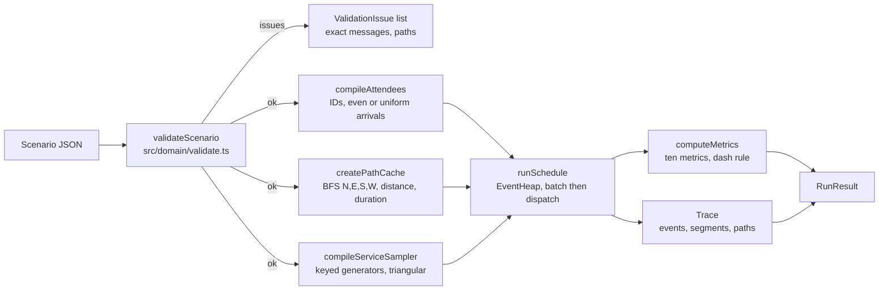
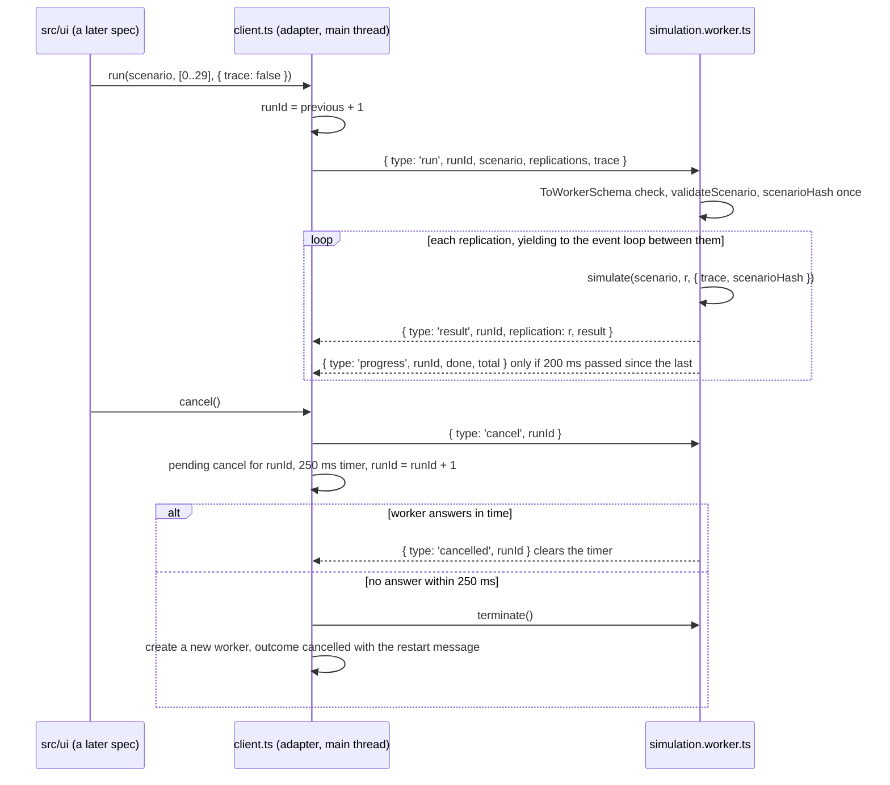

# Design Document

## Overview

`simulation-contract` is spec 11.1 of `plans/rehearsal-implementation-plan.md`: the Kiro-owned engine that turns a validated `Scenario` into a `RunResult`, implemented November 4–11 on branch `kiro/simulation-contract` under a 550-credit cap and accepted at the November 11 gate as package R1. It delivers four source folders (`src/domain/`, `src/simulation/`, `src/spatial/`, `src/workers/`), the test suite `tests/model/`, the regression snapshot `public/examples/harbor-hall/expected.json` and `docs/model-contract.md`. The editor, replay, comparison and exports built by later specs consume its outputs through two entry points only: `simulate(scenario, replication, options)` and the worker adapter `createSimulationClient()`.

Design rules carried from plan sections 5–7: time is integer milliseconds and converts from display units exactly once; `simulate` is free of DOM, wall-clock time, rendering and storage; every random draw comes from a local generator keyed by purpose (`baseSeed|replication|attendeeId|stationId|service`, `baseSeed|replication|attendeeId|arrival`) and `Math.random` is never used; equal-time events are batched before dispatch; grid paths have a mathematical effect on queue arrival times; every metric carries unit, population and denominator and renders `—` when undefined; the worker adapter owns cancellation and progress; nothing in this spec advances model state from a ticker or a camera.

## Architecture

The engine is a pipeline of pure functions. Validation runs once per scenario; compilation of attendees, paths and samplers runs once per replication; the scheduler consumes resolved inputs only, so the scheduler fixtures (matrix rows 1–3) run without the arrival, sampling or grid modules.



The worker protocol wraps the same pipeline. The adapter on the main thread owns `runId`, the 250 ms cancel deadline and the discard rule; the worker owns validation, hashing, the per-replication loop and progress throttling.



Ownership: every file below is written by Kiro under this spec, on top of the scaffold of task 0 (`package.json`, lockfile, `vite.config.ts`, `src/main.tsx`, `src/app.tsx` and the `Scenario` types). A later change to the `Scenario` type follows plan section 5 and gets its own log row. No file here imports from `src/ui`, `src/replay`, `src/imports`, `src/storage`, `src/comparison` or `src/exports`.

## Components and Interfaces

### File layout

```text
src/domain/
  scenario.ts            Scenario, Layout, Station, Cohort, Service, Cell types; ScenarioSchema (zod)
  limits.ts              LIMITS, DRAIN_CAP_MS
  validate.ts            validateScenario, toDurationMs, ValidationIssue, MESSAGES
  hash.ts                stableJson, canonicalJson, scenarioHash
src/simulation/
  version.ts             MODEL_VERSION
  random.ts              createGenerator, serviceKey, arrivalKey
  arrivals.ts            attendeeId, evenArrivalMs, uniformArrivalMs, compileAttendees
  sampling.ts            triangular, serviceDurationMs, compileServiceSampler
  heap.ts                EventHeap, compareEvents, KIND_PRIORITY, SimEvent, NodeRef
  line.ts                Line sorted by (queueJoinMs, attendeeId)
  scheduler.ts           runSchedule over resolved inputs
  metrics.ts             computeMetrics, p95Index, percentile95, formatMetricValue
  trace.ts               Trace, TraceEvent, MovementSegment, buildTrace
  simulate.ts            simulate, RunResult, ScenarioInvalidError
src/spatial/
  grid.ts                findPath (BFS), pathDistanceM, walkDurationMs, isInBounds, isBlocked
  path-cache.ts          createPathCache, nodeCell, describeNode
src/workers/
  protocol.ts            ToWorker, FromWorker, ToWorkerSchema, FromWorkerSchema
  simulation.worker.ts   worker entry: createWorkerHandler wired to self.onmessage
  client.ts              createSimulationClient, SimulationClient, RunOutcome, WorkerLike
tests/model/             see Testing Strategy
public/examples/harbor-hall/expected.json
docs/model-contract.md
```

### Domain: schema, limits, validation, hash

```ts
// src/domain/scenario.ts  (verbatim from plan section 5; created in task 0)
export type Cell = [number, number];                       // [x, y]; x grows east, y grows south
export type Service =
  | { kind: 'constant'; seconds: number }
  | { kind: 'triangular'; minS: number; modeS: number; maxS: number };
export type Station = { id: string; label: string; cell: Cell; servers: number; service: Service };
export type Cohort = { id: string; startMs: number; endMs: number; count: number; arrivals: 'even' | 'uniform'; route: string[] };
export type Layout = { cols: number; rows: number; cellSizeM: number; blockedCells: Cell[]; entrance: Cell; exit: Cell };
export type Scenario = {
  schemaVersion: 1; id: string; revision: number; title: string;
  modelVersion: string; baseSeed: string; horizonMs: number;
  layout: Layout; walkSpeedMps: number; stations: Station[]; cohorts: Cohort[]; notes: string;
};
export const ScenarioSchema: z.ZodType<Scenario>;           // structural check only; limits live in validate.ts

// src/domain/limits.ts
export const LIMITS = {
  maxAttendees: 5_000, maxStations: 10, maxRouteVisits: 6, maxCols: 80, maxRows: 80,
  maxHorizonMs: 21_600_000, minServers: 1, maxServers: 20, maxServiceSeconds: 86_400,
  maxIdLength: 64, maxSeedLength: 64,
} as const;
export const DRAIN_CAP_MS = 7_200_000;

// src/domain/validate.ts
export type IssueCode =
  | 'SCHEMA_VERSION' | 'MODEL_VERSION_FORMAT' | 'SEED_FORMAT' | 'ID_FORMAT' | 'DUPLICATE_ID'
  | 'HORIZON_RANGE' | 'GRID_SIZE' | 'CELL_SIZE' | 'WALK_SPEED' | 'CELL_OUT_OF_BOUNDS' | 'CELL_BLOCKED'
  | 'DUPLICATE_BLOCKED_CELL' | 'SERVERS_RANGE' | 'SERVICE_RANGE' | 'COHORT_WINDOW' | 'COUNT_RANGE'
  | 'ARRIVAL_PATTERN' | 'ROUTE_LENGTH' | 'ROUTE_UNKNOWN_STATION' | 'ROUTE_REPEAT'
  | 'ATTENDEE_LIMIT' | 'STATION_LIMIT' | 'NON_FINITE' | 'UNSAFE_MS' | 'UNREACHABLE';
export type ValidationIssue = { code: IssueCode; path: string; message: string; entity?: { kind: 'station' | 'cohort'; id: string } };
export type ValidationWarning = { code: 'MODEL_VERSION_MISMATCH'; message: string };
export type ValidationResult =
  | { ok: true; scenario: Scenario; warnings: ValidationWarning[] }
  | { ok: false; issues: ValidationIssue[] };
export function validateScenario(input: unknown): ValidationResult;   // synchronous; never mutates input
export function toDurationMs(seconds: number): number;                // Math.max(1, Math.round(seconds * 1000))
export const MESSAGES: Record<IssueCode, (args: Record<string, string | number>) => string>;

// src/domain/hash.ts
export function stableJson(value: unknown): string;                  // JSON with keys sorted at every object level; arrays keep their order; used by canonicalJson and the path-cache key
export function canonicalJson(scenario: Scenario): string;            // drops only the top-level id, revision, title, notes (station and cohort ids stay)
export function scenarioHash(scenario: Scenario): Promise<string>;   // lowercase hex SHA-256, globalThis.crypto.subtle
```

Validation runs in five passes and collects every issue instead of stopping at the first: (1) structural, through `ScenarioSchema` (wrong types, missing fields, `schemaVersion`, `modelVersion` format, non-finite numbers); (2) limits from `LIMITS` (`horizonMs`, `startMs`, `endMs`, `cols` and `rows` must be whole numbers; a fractional value is reported under the range code of its field); (3) identifiers (format, duplicates, route references and repeats, attendee total); (4) geometry (bounds and whole-number coordinates, blocked cells, duplicates); (5) reachability through `createPathCache`, of whose unreachable pairs only those of requirement 1.8 (entrance to each station and to the exit, each consecutive pair of each cohort route) become issues, each reported once, and which also reports `UNSAFE_MS` when a computed walking duration is not a safe integer. Passes 4 and 5 run only when passes 1–3 found no issue, because an out-of-bounds cell makes the BFS meaningless. `canonicalJson` drops the four top-level fields `id`, `revision`, `title` and `notes` (never a station or cohort `id`) and serializes the rest through `stableJson` with keys sorted at every object level, `stations` and `cohorts` sorted by `id` in code-unit order and `blockedCells` sorted by `x` then `y`; the hash is the SHA-256 of its UTF-8 bytes. Node 22.12+ exposes `globalThis.crypto.subtle` in the Vitest Node environment (*verify* at scaffold; the fallback is `node:crypto`'s `webcrypto` in the test helper only).

### Arrivals, random streams and sampling

```ts
// src/simulation/arrivals.ts
export type CompiledAttendee = { id: string; cohortId: string; ordinal: number; arrivalMs: number; route: string[] };
export function attendeeId(cohortId: string, ordinal: number): string;      // `${cohortId}#${String(ordinal).padStart(4, '0')}`
export function evenArrivalMs(startMs: number, endMs: number, count: number, j: number): number;
// Math.min(endMs - 1, Math.max(startMs, startMs + Math.round((j + 0.5) * (endMs - startMs) / count)))
export function uniformArrivalMs(startMs: number, endMs: number, u: number): number;
// startMs + Math.floor(u * (endMs - startMs))
export function compileAttendees(scenario: Scenario, replication: number): CompiledAttendee[];
// one entry per attendee of every cohort, sorted by (arrivalMs, id) in code-unit order

// src/simulation/random.ts
export type Generator = () => number;                                      // uniform in [0, 1)
export function createGenerator(key: string): Generator;                   // wraps seedrandom 3.0.5 (MIT); *verify* the import form at scaffold
export function serviceKey(baseSeed: string, replication: number, attendeeId: string, stationId: string): string;
// `${baseSeed}|${replication}|${attendeeId}|${stationId}|service`
export function arrivalKey(baseSeed: string, replication: number, attendeeId: string): string;
// `${baseSeed}|${replication}|${attendeeId}|arrival`

// src/simulation/sampling.ts
export function triangular(u: number, a: number, c: number, b: number): number;   // seconds; a === b returns a
export function serviceDurationMs(service: Service, draw: () => number): number;  // constant takes no draw; result through toDurationMs
export function compileServiceSampler(scenario: Scenario, replication: number): (attendeeId: string, stationId: string) => number;
// creates createGenerator(serviceKey(...)) on first use per (attendeeId, stationId) and memoizes the drawn duration
```

`createGenerator` is the only place `seedrandom` is imported; the engine depends on the `Generator` type alone, so a generator swap is one file and a `MODEL_VERSION` bump. A uniform-arrival cohort takes exactly one draw per attendee from the arrival generator; a triangular visit takes exactly one draw from the service generator; constant services create no generator. Because keys contain neither positions nor server counts, the three Harbor Hall scenarios compile identical `arrivalMs` and `serviceMs` values for every attendee (requirement 3.6).

### Heap, line and scheduler

```ts
// src/simulation/heap.ts
export type EventKind = 'service-complete' | 'movement-arrival' | 'external-arrival';
export const KIND_PRIORITY: Record<EventKind, 0 | 1 | 2> = { 'service-complete': 0, 'movement-arrival': 1, 'external-arrival': 2 };
export type NodeRef = { kind: 'entrance' } | { kind: 'exit' } | { kind: 'station'; id: string };
export type SimEvent = {
  timeMs: number; kind: EventKind; attendeeId: string; sequence: number;
  stationId?: string; server?: number;        // service-complete
  node?: NodeRef; pathId?: number;            // movement-arrival
};
export function compareEvents(a: SimEvent, b: SimEvent): number;   // timeMs, KIND_PRIORITY, attendeeId (code units), sequence
export class EventHeap {
  push(event: Omit<SimEvent, 'sequence'>): void;   // assigns sequence = ++counter
  pop(): SimEvent | undefined;
  peek(): SimEvent | undefined;
  size(): number;
}

// src/simulation/line.ts
export type LineEntry = { attendeeId: string; queueJoinMs: number };
export class Line {
  insert(entry: LineEntry): number;        // keeps (queueJoinMs, attendeeId) order; returns the 0-based position
  shift(): LineEntry | undefined;          // head of the line
  readonly length: number;
  entries(): readonly LineEntry[];
}

// src/simulation/scheduler.ts
export type ScheduleStation = { id: string; servers: number; serviceMs: (attendeeId: string) => number };
export type TravelLookup = (from: NodeRef, to: NodeRef) => { pathId: number; durationMs: number };
export type ScheduleInput = {
  attendees: CompiledAttendee[]; stations: ScheduleStation[]; travel: TravelLookup;
  horizonMs: number; drainCapMs: number; trace: boolean;
};
export type Visit = { stationId: string; queueJoinMs: number; serviceStartMs: number | null; completeMs: number | null; server: number | null };
export type AttendeeRecord = { id: string; cohortId: string; arrivalMs: number; route: string[]; visits: Visit[]; walkingMs: number; exitMs: number | null;
  state: 'pending' | 'walking' | 'waiting' | 'inService' | 'exited' };
export type SettledSample = { timeMs: number; admitted: number; walking: number; waiting: number; inService: number; exited: number; waitingByStation: Record<string, number> };
export type ScheduleOutput = {
  attendees: AttendeeRecord[]; settled: SettledSample[];
  events: TraceEvent[]; segments: MovementSegment[];        // empty arrays when trace is false
  completion: 'complete' | 'drain-capped'; unfinished: string[]; capMs: number;
};
export function runSchedule(input: ScheduleInput): ScheduleOutput;
```

`runSchedule` executes these steps; nothing else touches model state.

1. Build one `AttendeeRecord` per compiled attendee (`state: 'pending'`), one line and one `busy: boolean[]` of length `servers` per station (all free), the counters `admitted`, `walking`, `waiting`, `inService`, `exited` at 0, and `capMs = horizonMs + drainCapMs`. Push an `external-arrival` for every attendee at its `arrivalMs`.
2. Loop while the heap is not empty: let `t = peek().timeMs`; if `t > capMs`, stop with the cap reached. Otherwise pop and apply every event whose `timeMs === t`, including events pushed at `t` during this step, in heap order:
   - `external-arrival`: `admitted += 1`, `state = 'walking'`, `walking += 1`, set `walkingMs` to the sum of `travel(from, to).durationMs` over every segment of the attendee's route (entrance, its stations in order, exit), emit `arrive`, then depart from the entrance toward `route[0]` or the exit.
   - `movement-arrival` at a station: `walking -= 1`, `waiting += 1`, `state = 'waiting'`, insert `{ attendeeId, queueJoinMs: t }` into the station's line, open a visit with `queueJoinMs = t`.
   - `movement-arrival` at the exit: `walking -= 1`, `exited += 1`, `state = 'exited'`, `exitMs = t`, emit `exit`.
   - `service-complete`: set `busy[server] = false`, close the visit with `completeMs = t`, `inService -= 1`, `walking += 1`, `state = 'walking'`, emit `complete`, then depart from the station toward the next route station or the exit.
   - Depart from `from` to `to`: `{ pathId, durationMs } = travel(from, to)`; push `movement-arrival` at `t + durationMs` with `node = to`; emit `depart` with `arriveMs = t + durationMs` and one `MovementSegment { attendeeId, startMs: t, endMs: t + durationMs, pathId }`. A zero duration pushes an event at `t`, which this same step pops next because the heap keeps `t` at the top.
3. Emit one `join` event per line insertion made in step 2, in line order, with `position` equal to the entry's index in the line's current order at this point (never the value `Line.insert` returned at insertion, which a later insertion at the same `t` can change): after every event at `t` has been applied and before step 4 dispatches anything (row 1 at `t` = 60,000: `c#0000` joins with `position: 1` behind `b#0000`, who has waited since 30,000; step 4 then dispatches `b#0000`).
4. Dispatch stations in code-unit order of `id`: while the line is non-empty and some server is free, `head = line.shift()`, `server` = lowest free index, `busy[server] = true`, `waiting -= 1`, `inService += 1`, `state = 'inService'`, `serviceMs = station.serviceMs(head.attendeeId)` (always ≥ 1), set `serviceStartMs = t` and `server` on the open visit, emit `start` with `waitMs = t - queueJoinMs`, push `service-complete` at `t + serviceMs`.
5. Record `SettledSample` for `t` (counters and each station's `line.length`).
6. After the loop: `unfinished` = IDs of attendees whose `state !== 'exited'`, sorted in code-unit order; `completion = unfinished.length === 0 ? 'complete' : 'drain-capped'`; when the cap was reached, emit `cap` at `capMs`.

### Spatial: grid paths and the cache

```ts
// src/spatial/grid.ts
export function isInBounds(layout: Layout, cell: Cell): boolean;
export function isBlocked(layout: Layout, cell: Cell): boolean;
export function findPath(layout: Layout, start: Cell, goal: Cell): Cell[] | null;
// BFS, FIFO queue, neighbours enqueued north (x, y-1), east (x+1, y), south (x, y+1), west (x-1, y);
// parent recorded on first discovery; returns the cells from start to goal inclusive; [start] when start equals goal
export function pathDistanceM(cells: Cell[], cellSizeM: number): number;      // (cells.length - 1) * cellSizeM
export function walkDurationMs(distanceM: number, walkSpeedMps: number): number;  // Math.ceil(distanceM / walkSpeedMps * 1000)

// src/spatial/path-cache.ts
export type CachedPath = { id: number; from: NodeRef; to: NodeRef; cells: Cell[]; distanceM: number; durationMs: number };
export type PathCache = {
  key: string;                                              // stableJson of { layout with blockedCells sorted by x then y, stations: [{ id, cell }] sorted by id, walkSpeedMps }
  paths: CachedPath[];                                      // ids assigned in node order: entrance, stations by id, exit; then (from, to) pairs
  lookup(from: NodeRef, to: NodeRef): CachedPath;           // throws when unreachable; validation prevents that
  unreachable: { from: NodeRef; to: NodeRef }[];            // every ordered pair without a path
  unsafe: { from: NodeRef; to: NodeRef; durationMs: number }[];
};
export function createPathCache(input: Pick<Scenario, 'layout' | 'stations' | 'walkSpeedMps'>): PathCache;
export function nodeCell(input: Pick<Scenario, 'layout' | 'stations'>, node: NodeRef): Cell;
export function describeNode(input: Pick<Scenario, 'layout' | 'stations'>, node: NodeRef): string;
// 'entrance (0,12)' | 'exit (0,4)' | 'station "packs" (34,12)'
```

The cache computes every ordered pair among the entrance, the stations and the exit once (at most 12 nodes, 132 pairs, each one BFS over at most 6,400 cells). `simulate` builds one cache per call from the validated scenario; the editor (a later spec) may hold a cache per layout `key` and discard it when the key changes, which is what "paths are precomputed and cached per layout revision" means in practice. `Trace.paths` lists the cached paths referenced by at least one segment, in `id` order. Because the grid is undirected, `length(a → b) === length(b → a)` even though the two cell sequences may differ under the tie-break.

### Metrics

```ts
// src/simulation/metrics.ts
export type Unit = 'count' | 'ms' | 'ratio' | 'people' | 'hours';
export type Population = 'admitted' | 'completedJourney' | 'closingWindow';
export type MetricValue = { value: number | null; unit: Unit; population: Population; n: number; conditioned: boolean; note: string | null };
export type StationMetrics = {
  id: string; servers: number;
  busyMs: MetricValue; utilization: MetricValue; averageQueueLength: MetricValue; maxQueueLength: MetricValue; served: MetricValue;
};
export type Metrics = {
  horizonMs: number; admitted: number;
  completedByClosing: MetricValue;                                                            // count, admitted
  activeAtClosing: { total: MetricValue; walking: MetricValue; waiting: MetricValue; inService: MetricValue };   // people, admitted
  queueWait: { total: MetricValue; mean: MetricValue; p95: MetricValue };                     // ms, completedJourney
  journeyTime: { mean: MetricValue; p95: MetricValue };                                       // ms, completedJourney
  walkingTime: { mean: MetricValue };                                                         // ms, admitted
  queues: { averageLength: MetricValue; maxLength: MetricValue };                             // people, closingWindow
  stations: StationMetrics[];                                                                 // code-unit order of id
  staffHours: MetricValue;                                                                    // hours, closingWindow
};
export function computeMetrics(out: ScheduleOutput, scenario: Scenario, cache: PathCache): Metrics;
export function p95Index(n: number): number;                   // Math.ceil(0.95 * n) - 1
export function percentile95(values: number[]): number | null; // null for an empty array; sorts ascending, returns values[p95Index(n)]
export function formatMetricValue(m: MetricValue): string;     // '—' for null; see Error Handling for the unit rules
```

Definitions, each computed from `ScheduleOutput` with `H = horizonMs`:

| Metric | Population | Computation |
| --- | --- | --- |
| completedByClosing | admitted | count of attendees with `exitMs !== null && exitMs ≤ H` |
| activeAtClosing.* | admitted | from the last `SettledSample` with `timeMs ≤ H`: `total = admitted - exited`, `walking`, `waiting`, `inService`; all 0 when no sample exists |
| queueWait.total / mean / p95 | completedJourney (attendees with `exitMs !== null`) | per attendee `Σ (serviceStartMs - queueJoinMs)` over visits; total is the sum, mean the sum over `n`, p95 the `percentile95` of the per-attendee values |
| journeyTime.mean / p95 | completedJourney | per attendee `exitMs - arrivalMs` |
| walkingTime.mean | admitted | per attendee `walkingMs` summed over the route segments (`entrance → s1`, `s1 → s2`, …, `sk → exit`) from the cache; mean over admitted |
| stations[i].busyMs | closingWindow | `Σ` over that station's visits of the length of `[serviceStartMs, completeMs ?? +∞) ∩ [0, H]` |
| stations[i].utilization | closingWindow | `busyMs / (servers * H)` |
| stations[i].averageQueueLength | closingWindow | `Σ_i w_i * (min(t_{i+1}, H) - t_i)` over consecutive settled samples with `t_i < H`, plus `w_last * (H - t_last)` when `t_last < H`, divided by `H`, where `w` is that station's waiting count |
| stations[i].maxQueueLength | closingWindow | max of that station's waiting count over settled samples with `timeMs ≤ H` |
| stations[i].served | closingWindow | count of visits with `completeMs !== null && completeMs ≤ H` |
| queues.averageLength / maxLength | closingWindow | the same integral and maximum over the total waiting count |
| staffHours | closingWindow | `Σ servers * H / 3_600_000` |

`n` is the population size; `value` is `null` whenever `n === 0` for a mean, total or percentile, and the counts, utilizations, queue lengths and staff-hours are `0` or their formula value with `n` reported. `conditioned` is `true` for every `completedJourney` metric when `unfinished.length > 0`, with `note = 'from <n> of <admitted> admitted attendees; <k> unfinished at the drain cap'`; otherwise `conditioned` is `false` and `note` is `null`.

### Trace and `simulate`

```ts
// src/simulation/trace.ts
export type TraceEvent =
  | { kind: 'arrive'; timeMs: number; attendeeId: string }
  | { kind: 'depart'; timeMs: number; attendeeId: string; from: NodeRef; to: NodeRef; pathId: number; arriveMs: number }
  | { kind: 'join'; timeMs: number; attendeeId: string; stationId: string; position: number }
  | { kind: 'start'; timeMs: number; attendeeId: string; stationId: string; server: number; waitMs: number }
  | { kind: 'complete'; timeMs: number; attendeeId: string; stationId: string; server: number }
  | { kind: 'exit'; timeMs: number; attendeeId: string }
  | { kind: 'cap'; timeMs: number };
export type MovementSegment = { attendeeId: string; startMs: number; endMs: number; pathId: number };
export type TraceAttendee = { id: string; cohortId: string; arrivalMs: number; exitMs: number | null };
export type Trace = { version: 1; paths: CachedPath[]; attendees: TraceAttendee[]; events: TraceEvent[]; segments: MovementSegment[] };
export function buildTrace(out: ScheduleOutput, cache: PathCache): Trace;

// src/simulation/simulate.ts
export type SimulateOptions = { trace: boolean; scenarioHash: string };
export type RunResult = {
  scenarioHash: string; modelVersion: string; baseSeed: string; replication: number;
  horizonMs: number; completion: 'complete' | 'drain-capped'; unfinished: string[];
  metrics: Metrics; trace?: Trace;
};
export class ScenarioInvalidError extends Error { issues: ValidationIssue[] }
export function simulate(scenario: Scenario, replication: number, options: SimulateOptions): RunResult;
```

`simulate` is synchronous and runs: `validateScenario` (throws `ScenarioInvalidError` on `ok: false`), `compileAttendees`, `createPathCache`, `compileServiceSampler`, `runSchedule` with `DRAIN_CAP_MS`, `computeMetrics`, and `buildTrace` only when `options.trace` is `true`. It takes `scenarioHash` as an input because Web Crypto hashing is asynchronous; the worker computes it once per `run` message and tests compute it with the same `scenarioHash` function. Events are appended in the order step 2–4 of the scheduler emits them, so `JSON.stringify(result)` is a deterministic function of `(canonicalJson(scenario), replication, trace)`.

### Worker protocol and adapter

```ts
// src/workers/protocol.ts  (message types verbatim from plan section 6)
export type ToWorker =
  | { type: 'run'; runId: number; scenario: Scenario; replications: number[]; trace: boolean }
  | { type: 'cancel'; runId: number };
export type FromWorker =
  | { type: 'progress'; runId: number; done: number; total: number }
  | { type: 'result'; runId: number; replication: number; result: RunResult }
  | { type: 'cancelled'; runId: number }
  | { type: 'error'; runId: number; message: string };
export const ToWorkerSchema: z.ZodType<ToWorker>;     // zod discriminated union on `type`; *verify* helper names on zod 4.6.7
export const FromWorkerSchema: z.ZodType<FromWorker>;
export const PROGRESS_INTERVAL_MS = 200;             // at most 5 progress messages per second
export const CANCEL_DEADLINE_MS = 250;

// src/workers/simulation.worker.ts
export type WorkerDeps = { now: () => number; yieldToLoop: () => Promise<void> };   // defaults: performance.now, setTimeout(0)
export function createWorkerHandler(post: (message: FromWorker) => void, deps: WorkerDeps): (data: unknown) => Promise<void>;
// the module's top level wires createWorkerHandler(self.postMessage, defaults) to self.onmessage

// src/workers/client.ts
export type WorkerLike = {
  postMessage(message: unknown): void; terminate(): void;
  onmessage: ((event: { data: unknown }) => void) | null;
  onerror: ((event: { message?: string }) => void) | null;          // uncaught exception in the worker, or the browser stopping it
  onmessageerror: ((event: unknown) => void) | null;                // a message that could not be delivered (structured-clone failure)
};
export type RunOutcome =
  | { status: 'complete'; results: RunResult[] }
  | { status: 'cancelled'; message: string }
  | { status: 'error'; message: string };
export type RunHandle = { runId: number; done: Promise<RunOutcome> };
export type RunCallbacks = { onProgress?: (done: number, total: number) => void; onResult?: (result: RunResult) => void };
export type SimulationClient = {
  run(scenario: Scenario, replications: number[], options: { trace: boolean } & RunCallbacks): RunHandle;
  cancel(): void;
  dispose(): void;
  readonly currentRunId: number;
  readonly discardedMessages: number;
};
export type ClientDeps = { createWorker: () => WorkerLike; setTimeout: typeof globalThis.setTimeout; clearTimeout: typeof globalThis.clearTimeout };
export function createSimulationClient(deps?: Partial<ClientDeps>): SimulationClient;
// default createWorker: new Worker(new URL('./simulation.worker.ts', import.meta.url), { type: 'module' })  (*verify* on the pinned Vite)
```

Worker handler, per message: parse with `ToWorkerSchema`; on failure post `error { runId: 0, message: 'Malformed worker message.' }` when `data.runId` is not a number, otherwise `error { runId, message }`. On `cancel`, add `runId` to `cancelledRuns`, a set of run IDs and never a single value, so that a `cancel` for run 1, a `run` 3 and a `cancel` for run 3 arriving before run 1's loop resumes still acknowledge run 1. On `run`: `validateScenario`; on `ok: false` post `error` with the first issue's message plus ` (+<k> more)` when `issues.length > 1`; otherwise `await scenarioHash(scenario)`, then for each replication in order: if `cancelledRuns.has(runId)`, post `cancelled { runId }` and return; `simulate(scenario, replication, { trace, scenarioHash })` inside try/catch (a throw posts `error { runId, message: 'Simulation failed: ' + error.message }` and returns); post `result`; if `now() - lastProgressAt ≥ 200` post `progress { done, total }` and record `lastProgressAt`; `await yieldToLoop()`. The worker never terminates itself and serves the next `run` after any error.

Adapter, per call: `run()` with an empty `replications` array resolves `{ status: 'complete', results: [] }` at once, posts nothing and leaves `currentRunId` unchanged (9.12); otherwise it sets `currentRunId += 1`, posts `run`, stores the handle. A message is parsed with `FromWorkerSchema`, dropped and counted in `discardedMessages` when invalid, when its `runId` differs from `currentRunId` (for `progress`, `result`, `error`), or when it is a `cancelled` matching no pending cancel; the one exception is an `error` with `runId` 0 (the worker's answer to a message it could not parse), which resolves the pending run, if any, as `{ status: 'error', message: 'Malformed worker message.' }` (9.2, 9.9). `result` is pushed to the handle's results and `onResult`; when `results.length === replications.length` the handle resolves `{ status: 'complete' }`; `error` resolves `{ status: 'error', message }`. `cancel()` with an active run posts `cancel { runId: currentRunId }`, records `pendingCancel = { runId, timer }` with a 250 ms timer, sets `currentRunId += 1`; `cancelled` with the pending `runId` clears the timer and resolves `{ status: 'cancelled', message: 'Simulation cancelled.' }`; the timer firing calls `worker.terminate()`, replaces the worker with `createWorker()` and resolves `{ status: 'cancelled', message: 'Simulation cancelled. The simulation worker did not respond within 250 ms and was restarted.' }`. The adapter sets `worker.onerror` and `worker.onmessageerror` on every worker it creates: either event resolves the pending run, if any, as `{ status: 'error', message: 'The simulation worker stopped unexpectedly: <event.message, or "message could not be delivered" for onmessageerror>.' }`, clears any pending cancel timer, calls `terminate()`, replaces the worker with `createWorker()` and sets `currentRunId += 1`, so that a late message from the dead worker is discarded and the next `run()` is served by the new worker (9.11). `dispose()` terminates the worker and rejects nothing (a pending handle resolves `cancelled`).

## Data Models

### Identity and versions

| Record | Identity | Version field | Where it lives |
| --- | --- | --- | --- |
| `Scenario` | `id` (assigned by the editor; excluded from the hash) and `scenarioHash` (content identity: every field except `id`, `revision`, `title`, `notes`) | `schemaVersion: 1` for the JSON shape; `modelVersion` for the engine the scenario was last saved with; `revision` incremented by the editor per committed edit | editor state, scenario JSON exports |
| Attendee | `${cohortId}#${ordinal}` (`doors#0000` … `doors#0119`); unique within a scenario because cohort IDs are unique and `#` is forbidden in IDs | — | compiled per replication, never stored |
| `CachedPath` | `id` (0-based, assigned in node order entrance, stations by `id`, exit, then by ordered pair); `key` of the cache is `stableJson` of the layout (blocked cells sorted), the stations' `(id, cell)` pairs sorted by `id` and `walkSpeedMps` | — | per `simulate` call; referenced from `Trace.segments` |
| `RunResult` | `(scenarioHash, modelVersion, baseSeed, replication)`; two results with equal identity are byte-identical | `modelVersion = MODEL_VERSION` | worker messages, comparison, exports |
| `expected.json` | `scenarioHash` per scenario | `modelVersion` | `public/examples/harbor-hall/expected.json` |
| `failing-seeds.json` | `property` name plus `seed` | — | `tests/model/failing-seeds.json` |

### Units

| Quantity | Display unit (editor, fleet) | Internal unit | Conversion point |
| --- | --- | --- | --- |
| Arrival windows, horizon | minutes | integer ms (`startMs`, `endMs`, `horizonMs`) | import adapters and the editor form, before `validateScenario` |
| Service durations | seconds (`seconds`, `minS`, `modeS`, `maxS` stay in seconds inside `Scenario`) | integer ms per visit | `toDurationMs` inside `serviceDurationMs` only |
| Distance | meters | `edgeCount * cellSizeM` (float meters) | `pathDistanceM` |
| Walking duration | — | integer ms | `walkDurationMs` only |
| Counts, servers, queue lengths | people | integers | none |
| Utilization | percent | ratio in `[0, 1]` | `formatMetricValue` |
| Staff-hours | hours | hours (float) | none |

### Runtime records

```ts
AttendeeRecord { id, cohortId, arrivalMs, route, visits: Visit[], walkingMs, exitMs: number | null,
                 state: 'pending' | 'walking' | 'waiting' | 'inService' | 'exited' }
Visit          { stationId, queueJoinMs, serviceStartMs: number | null, completeMs: number | null, server: number | null }
StationState   { id, servers, line: Line, busy: boolean[] }        // internal to runSchedule
SettledSample  { timeMs, admitted, walking, waiting, inService, exited, waitingByStation }
```

### Snapshot and seed files

```json
// public/examples/harbor-hall/expected.json
{
  "label": "Regression snapshot of the accepted engine at R1, replication 0; not hand-calculated",
  "modelVersion": "0.1.0",
  "generatedOn": "2026-11-11",
  "scenarios": {
    "baseline":          { "scenarioHash": "<64 hex>", "completion": "complete", "unfinished": [], "metrics": { } },
    "plus-one-checkin":  { "scenarioHash": "<64 hex>", "completion": "complete", "unfinished": [], "metrics": { } },
    "shorter-route":     { "scenarioHash": "<64 hex>", "completion": "complete", "unfinished": [], "metrics": { } }
  }
}
```

```json
// tests/model/failing-seeds.json  (committed; empty array until a property fails)
[ { "property": "P1 conservation", "seed": 0, "path": "0:0", "counterexample": "<JSON of the reduced scenario>", "date": "2026-11-07" } ]
```

The `completion` values in `expected.json` are written by the generator at task 15 from actual runs; `complete` above is the shape, not a prediction.

### Invariants

1. Every timestamp and duration in `RunResult`, `Trace` and `SettledSample` is a non-negative safe integer; every `arrivalMs < H`; no `timeMs` exceeds `H + DRAIN_CAP_MS`.
2. `Trace.attendees` is sorted by `(arrivalMs, id)`; `Trace.events` is in processing order with `timeMs` nondecreasing; `Trace.segments[i].endMs - startMs === paths[pathId].durationMs`.
3. `stations` in `Metrics` are in code-unit order of `id`; `activeAtClosing.walking + waiting + inService === activeAtClosing.total`; `completedByClosing + activeAtClosing.total === admitted`.
4. `completion === 'drain-capped'` if and only if `unfinished.length > 0`; `unfinished` is sorted in code-unit order.
5. A `MetricValue` with `n === 0` and `unit` `ms` has `value === null`; a `MetricValue` never holds `NaN` or `±Infinity`.
6. `scenarioHash(a) === scenarioHash(b)` implies `JSON.stringify(simulate(a, r, o)) === JSON.stringify(simulate(b, r, o))` for every `r` and `o`.

## Error Handling

Validation never throws; it returns every issue it found with the path of the offending field so the import adapters can name the CSV row or the xlsx sheet and cell, and the editor can focus the input. The input object is never mutated. Message templates (angle brackets are substituted; numbers are rendered as plain digits with thousands separators only where shown):

| Code | `path` | Message |
| --- | --- | --- |
| `SCHEMA_VERSION` | `schemaVersion` | `Unsupported schemaVersion <v>; this build reads version 1.` |
| `MODEL_VERSION_FORMAT` | `modelVersion` | `modelVersion must look like 0.1.0; got "<v>".` |
| `SEED_FORMAT` | `baseSeed` | `Base seed must be 1–64 characters and must not contain "\|".` |
| `ID_FORMAT` | `stations[<i>].id`, `cohorts[<i>].id` | `<Station|Cohort> id "<id>" must be 1–64 characters and must not contain "\|" or "#".` |
| `DUPLICATE_ID` | `stations[<i>].id`, `cohorts[<i>].id` | `Duplicate <station|cohort> id "<id>".` |
| `HORIZON_RANGE` | `horizonMs` | `Observation window must be a whole number of milliseconds between 1 and 21,600,000 (6 hours); got <v>.` |
| `GRID_SIZE` | `layout.cols`, `layout.rows` | `Grid must be a whole number of cells, between 1 × 1 and 80 × 80; got <cols> × <rows>.` |
| `CELL_SIZE` | `layout.cellSizeM` | `Cell size must be a positive number of meters; got <v>.` |
| `WALK_SPEED` | `walkSpeedMps` | `Walking speed must be a positive number of meters per second; got <v>.` |
| `CELL_OUT_OF_BOUNDS` | `layout.entrance`, `layout.exit`, `stations[<i>].cell`, `layout.blockedCells[<k>]` | `<Entrance|Exit|Station "<id>"|Blocked> cell (<x>,<y>) is outside the <cols> × <rows> grid or has a coordinate that is not a whole number.` |
| `CELL_BLOCKED` | `layout.entrance`, `layout.exit`, `stations[<i>].cell` | `<Entrance|Exit|Station "<id>"> cell (<x>,<y>) is blocked.` |
| `DUPLICATE_BLOCKED_CELL` | `layout.blockedCells[<k>]` | `Blocked cell (<x>,<y>) is listed more than once.` |
| `SERVERS_RANGE` | `stations[<i>].servers` | `Station "<id>": servers must be a whole number from 1 to 20; got <v>.` |
| `SERVICE_RANGE` | `stations[<i>].service.seconds` or `.minS` | `Station "<id>": service seconds must be greater than 0 and at most 86,400; got <v>.` or `Station "<id>": triangular service needs 0 < min ≤ mode ≤ max (seconds, at most 86,400); got <min>/<mode>/<max>.` |
| `COHORT_WINDOW` | `cohorts[<i>].startMs` | `Cohort "<id>": start and end must be whole milliseconds, start at or after 0 and before end, and end at or before the horizon; got start <s> ms, end <e> ms, horizon <h> ms.` |
| `COUNT_RANGE` | `cohorts[<i>].count` | `Cohort "<id>": count must be a whole number of 0 or more; got <v>.` |
| `ARRIVAL_PATTERN` | `cohorts[<i>].arrivals` | `Cohort "<id>": arrival pattern must be "even" or "uniform"; got "<v>".` |
| `ROUTE_LENGTH` | `cohorts[<i>].route` | `Cohort "<id>": route has <n> visits; the limit is 6.` |
| `ROUTE_UNKNOWN_STATION` | `cohorts[<i>].route[<k>]` | `Cohort "<id>": route names unknown station "<sid>".` |
| `ROUTE_REPEAT` | `cohorts[<i>].route[<k>]` | `Cohort "<id>": route visits station "<sid>" more than once.` |
| `ATTENDEE_LIMIT` | `cohorts` | `Total attendees <n> exceed the limit of 5,000.` |
| `STATION_LIMIT` | `stations` | `<n> stations exceed the limit of 10.` |
| `NON_FINITE` | the field | `<path> must be a finite number; got <v>.` |
| `UNSAFE_MS` | `walkSpeedMps` | `Walking duration between <endpoint> and <endpoint> is <v> ms, beyond the largest safe integer; reduce the cell size or raise the walking speed.` |
| `UNREACHABLE` | `layout` (station or exit unreachable from the entrance) or `cohorts[<i>].route[<k>]` (segment) | `No walkable path between <endpoint> and <endpoint>.` with endpoints rendered by `describeNode`: `entrance (0,12)`, `exit (0,4)`, `station "packs" (34,12)` |

What the organizer sees: the editor UI (a later spec) shows the message verbatim beside the row or field named by `path`; the worker's `error` message is the first issue's message plus ` (+<k> more)`. What is preserved: the previous scenario object and any earlier results stay untouched (the editor labels them stale on its side); the worker stays alive after any `error`; the adapter's `currentRunId` moves past a cancelled or failed run so late messages are dropped.

| Situation | Typed result | Message shown |
| --- | --- | --- |
| `simulate` called with an invalid scenario | throws `ScenarioInvalidError { issues }` | the worker converts it to `error { runId, message }` |
| `PathCache.lookup` for an unreachable pair | throws `Error('Path cache: no path between <a> and <b>')` | reaches the user only as `Simulation failed: …`; indicates a validation bug and is logged |
| `simulate` throws for any other reason | worker posts `error { runId, message: 'Simulation failed: <error.message>' }` | that message |
| Malformed `ToWorker` message | `error { runId: 0 \| <runId>, message: 'Malformed worker message.' }` | that message; `runId` 0 resolves the pending run as `error` (the exception to the discard rule of 9.2) |
| Malformed `FromWorker` message | dropped, `discardedMessages += 1` | nothing |
| Worker `onerror` or `onmessageerror` | pending run resolves `{ status: 'error', message: 'The simulation worker stopped unexpectedly: <event message or "message could not be delivered">.' }`; worker terminated and recreated; `currentRunId += 1` | that message; the next `run()` works |
| `run(scenario, [])` | `{ status: 'complete', results: [] }` without a message | nothing |
| `cancel()` acknowledged within 250 ms | `{ status: 'cancelled', message: 'Simulation cancelled.' }` | `Simulation cancelled.` |
| `cancel()` not acknowledged | worker terminated and recreated; `{ status: 'cancelled', message: 'Simulation cancelled. The simulation worker did not respond within 250 ms and was restarted.' }` | that message |
| Late `result` from an older `runId` | dropped, `discardedMessages += 1` | nothing; the newer run is unaffected |
| Metric undefined (`n === 0`) | `MetricValue { value: null, n: 0 }` | `—` from `formatMetricValue`; never `NaN`, `null`, `undefined` or `0` |

`formatMetricValue` rules: `value === null` → `—` (U+2014); `count`, `people` → the integer in plain digits; `ms` → `(value / 1000).toFixed(1) + ' s'` (30,000 → `30.0 s`); `ratio` → `(value * 100).toFixed(1) + '%'` (1 → `100.0%`, 0.5 → `50.0%`); `hours` → `value.toFixed(2) + ' h'` (2 → `2.00 h`, 8/3 → `2.67 h`). When `conditioned` is `true` the formatter appends a single `*`, and the caller shows `note` beside the table; the formatter never hides the asterisk.

## Testing Strategy

All engine tests run under Node with Vitest 5.0.5 (MIT) and fast-check 4.10.2 (MIT), versions from plan section 4; no browser is needed for this spec. Commands: `npm run test:model` runs Vitest over `tests/model` and `tests/comparison`; `npm run verify` runs `typecheck`, `test:model` and `build`; one file runs with `npx vitest run tests/model/<file>` (*verify* the single-file invocation on the pinned Vitest at scaffold). `tests/model/helpers/build-scenario.ts` exports `scenario(overrides)` with the defaults `schemaVersion: 1`, `id: 'test'`, `revision: 0`, `title: 'test'`, `modelVersion: MODEL_VERSION`, `baseSeed: 'test-seed'`, `horizonMs: 180_000`, `layout: { cols: 1, rows: 1, cellSizeM: 0.5, blockedCells: [], entrance: [0,0], exit: [0,0] }`, `walkSpeedMps: 1`, `stations: []`, `cohorts: []`, `notes: ''`; the one-cell layout gives zero walking. `tests/model/helpers/run.ts` exports `runOnce(scenario, replication, trace)` that validates, hashes with `scenarioHash` and calls `simulate`. `tests/model/fixtures/harbor-hall.ts` exports `baseline`, `plusOneCheckin` and `shorterRoute` with exactly the plan section 5 values (`modelVersion: '0.1.0'` written literally, the R1 value and the value of `MODEL_VERSION`, so the fixtures hash-equal the `public/examples/harbor-hall/*.json` files that task 15 writes from them; `baseSeed: 'harbor-hall-2026'`, `horizonMs: 2_400_000`, 40 × 24 grid, `cellSizeM` 0.5, 32 blocked cells for `x` 16–23 × `y` 20–23, entrance (0,12), exit (0,4), `walkSpeedMps` 1.2, cohort `doors` 0–1,200,000 ms count 120 `uniform` route `['checkin', 'packs']`, `checkin` at (10,12) with 1 server and triangular 8/15/22 s, `packs` at (34,12) with 2 servers and triangular 6/10/14 s; the candidates differ only in `checkin.servers: 2` and `packs.cell: [14, 8]`).

### Unit fixtures

| File | Row | Inputs | Expected |
| --- | --- | --- | --- |
| `heap.test.ts` | 4.1 | 1,000 events with random `timeMs` in 0–9, random kind, IDs `a`–`e`, shuffled with `createGenerator('heap-test')` | pops in `(timeMs, KIND_PRIORITY, attendeeId, sequence)` order; `size()` correct; `pop()` on empty is `undefined` |
| `scheduler.test.ts` | 1 | `runSchedule` with attendees `a#0000`/`b#0000`/`c#0000` at 0, 30,000, 60,000; one station, 1 server, `serviceMs` 60,000; travel 0 ms; `H` 180,000; `trace: true` | starts 0, 60,000, 120,000; exits 60,000, 120,000, 180,000; waits 0, 30,000, 60,000; the `join` events carry `position` 0 (`a#0000` at 0), 0 (`b#0000` at 30,000) and 1 (`c#0000` at 60,000, behind `b#0000`) |
| `scheduler.test.ts` | 2 | row 1 with 2 servers | starts 0, 30,000, 60,000; exits 60,000, 90,000, 120,000; waits 0 |
| `scheduler.test.ts` | 3 | `a#0000`, `a#0001` at 0, `c#0000` at 10,000; 1 server; `serviceMs` 10,000 | service order `a#0000`, `a#0001`, `c#0000`; starts 0, 10,000, 20,000 |
| `spatial.test.ts` | 4 | 3 × 3, `cellSizeM` 0.5, (0,1) → (2,1), 1 m/s | `[[0,1],[1,1],[2,1]]`, 1 m, 1,000 ms; with (1,1) blocked `[[0,1],[0,0],[1,0],[2,0],[2,1]]`, 2 m, 2,000 ms, equal on a second call |
| `spatial.test.ts` | 5.4 | Harbor Hall layouts | 4,167 / 10,000 / 17,500 ms and 38 m; shorter route 4,167 / 3,334 / 7,500 ms and 18 m; cache `key` differs between the two |
| `sampler.test.ts` | 5 | `triangular(u, 10, 20, 30)` for `u` 0.125, 0.5, 0.875; `triangular(0.3, 7, 7, 7)`; `toDurationMs(0.0004)`; constant service with a spy draw | 15, 20, 25 (within 1e-9); 7; 1; the spy is never called |
| `arrivals.test.ts` | 8 | cohort `doors` 0–1,200,000 ms, count 120, `even` | `arrivalMs[j] === (j + 0.5) * 10_000`; first 5,000; last 1,195,000; IDs `doors#0000`…`doors#0119`; count 1 in [0, 1) → 0; uniform with stub draws 0 and 0.999999 stays inside the band; two cohorts [0, 600,000) and [300,000, 900,000) validate |
| `simulate.test.ts` | 1, 2, 3 | rows 1–3 as scenarios: cohorts `a` [0,1), `b` [30,000, 30,001), `c` [60,000, 60,001) count 1 each (row 3: `a` count 2 in [0,1), `c` [10,000, 10,001)); one-cell layout | the same starts and exits through `simulate`; row 1 metrics: mean wait 30,000 ms, p95 60,000 ms, utilization 1.0, average queue 0.5, max queue 1, completed 3; row 2: utilization 0.5, completed 3 |
| `horizon.test.ts` | 6 | one arrival at 0 (cohort [0,1) count 1), constant 100 s, 1 server, `H` 60,000 | `busyMs` 60,000, utilization 1.0, completedByClosing 0, inService 1, journey `n` 1, `completion: 'complete'` |
| `horizon.test.ts` | 7 | cohort `late` count 2 `even` in [0, 60,000), constant 4,000 s, 1 server, `H` 60,000 | arrivals 15,000 and 45,000; `completion: 'drain-capped'`; `unfinished: ['late#0001']`; `queueWait.*` and `journeyTime.*` `conditioned: true`, `n: 1`; last event `cap` at 7,260,000 |
| `common-random.test.ts` | 9 | the three Harbor Hall fixtures, replications 0 and 7 | identical `arrivalMs` and `serviceMs` per attendee and station |
| `determinism.test.ts` | 10 | `baseline`, replication 0, `trace: true`, twice, then after `JSON.parse(JSON.stringify())` | three identical `JSON.stringify(result)` strings; `trace: false` gives identical `metrics` |
| `empty.test.ts` | 11 | no cohorts; cohort `none` with count 0 | counts 0; `queueWait.mean/p95/total`, `journeyTime.*`, `walkingTime.mean` are `null` and format as `—`; utilization 0; staff-hours defined |
| `metrics.test.ts` | 7.3, 7.5 | `p95Index` 20, 1, 3; `percentile95([])`; `formatMetricValue` samples | 18, 0, 2; `null`; `—`, `30.0 s`, `100.0%`, `2.00 h`, `2.67 h`, `3` |
| `validation.test.ts` | 1.3–1.8 | one scenario per code; a scenario with three defects; a frozen input; `modelVersion: '0.9.0'` | the exact message per code; three issues in one result; input unchanged; one `MODEL_VERSION_MISMATCH` warning |
| `hash.test.ts` | 1.6 | title change; station reorder; `servers` change; Harbor Hall three | equal, equal, different; 64 lowercase hex; three distinct hashes |
| `worker.test.ts` | 17 (worker side) | `createWorkerHandler` with injected `now` and `yieldToLoop`, wired to `createSimulationClient` through a fake `WorkerLike` whose message queue can hold or drop messages and whose `onerror`/`onmessageerror` the test can fire | 30 replications post 30 `result` and progress spaced ≥ 200 ms; a cancel between replications yields `cancelled` and no later `result`; a held `result` released after a new `run` is discarded (`discardedMessages` 1, `onResult` not called); a dropped `cancel` triggers `terminate()` at 250 ms and a new worker; an invalid scenario yields `error` and the next run succeeds; a run in progress that receives `error { runId: 0 }` resolves `{ status: 'error', message: 'Malformed worker message.' }` and no later `result` is delivered; a run in progress whose worker fires `onerror` with message `boom` resolves `{ status: 'error', message: 'The simulation worker stopped unexpectedly: boom.' }`, `terminate()` is called, `currentRunId` increments and the next `run()` completes on the new worker; `onmessageerror` resolves with `message could not be delivered`; `run(scenario, [])` resolves `{ status: 'complete', results: [] }` with no `postMessage` call; a `cancel` for run 1, a `run` 3 and a `cancel` for run 3 delivered before run 1's loop resumes yield `cancelled` for runs 1 and 3; a Vite `build()` in memory (`write: false`) over an entry that imports `createSimulationClient` contains a chunk for `simulation.worker.ts` (*verify* the option names on Vite 8.3.5) |
| `purity.test.ts` | 3.2, 8.6 | scan `src/domain`, `src/simulation`, `src/spatial` (and `src/workers` for imports) | no `Math.random`, `Date.now`, `performance.now`, `new Date(`; no import from `pixi.js`, `react`, `react-dom`, `src/replay`, `src/ui`, `src/imports`, `src/storage`, `src/comparison`, `src/exports` |
| `expected-snapshot.test.ts` | 11.3 | replication 0 of the three fixtures | `scenarioHash`, `completion`, `unfinished`, `metrics` equal to `expected.json` |
| `harbor-hall-files.test.ts` | 11.4 | the three files in `public/examples/harbor-hall/`, written from the TS fixtures when `UPDATE_EXPECTED=1` | each validates with no issue and no warning and hash-equals its TS fixture; the three hashes are distinct |

### Property-based tests

`tests/model/helpers/property.ts` exports `checkProperty(name, arbitrary, predicate, options?: { seedsFile?: string })`: it first replays every entry of the seeds file (default `tests/model/failing-seeds.json`; `paired-comparison-and-release` passes `tests/comparison/failing-seeds.json`) whose `property` matches (same seed and path), then runs 200 generated cases; on failure it appends `{ property, seed, path, counterexample, date }` to that file and rethrows. fast-check's run-count, seed and path options and the field names of its run details are *verify* items at scaffold (task 1 records the names in the helper). `tests/model/helpers/arbitraries.ts` builds valid scenarios: grid 2 × 2 to 8 × 8; blocked cells chosen then filtered so every node stays reachable (regenerate on failure); 0–3 stations on distinct or shared unblocked cells; 0–3 cohorts with `count` 0–20 and a total of at most 40; `H` 60,000–600,000 ms; windows inside `[0, H]`, and at least 1,000 ms long for a `uniform` cohort; `even` or `uniform`; constant or triangular service 1–120 s, a triangular service always with `minS < maxS`; `servers` 1–3; `walkSpeedMps` 0.5–2; `cellSizeM` 0.5; routes of 0–3 distinct stations. Every generated scenario passes `validateScenario` (asserted as P0).

### Integration and browser

None in this spec. The playback-speed and follow-camera half of row 10, the UI side of row 17 and every Playwright journey belong to `scenario-editor-and-replay`; rows 23–28 belong to `paired-comparison-and-release`.

### Budget

The whole `tests/model` suite targets under 60 s on the builder's named laptop; task 12 measures it three times and records the median in `docs/kiro-log.md`. If the median exceeds 60 s, the property case count drops before any property is removed. The save hook `model-tests-on-save` runs `npm run test:model`, which also covers `tests/comparison` (target 45 s), so a save under `src/simulation/` or `src/spatial/` costs up to about 105 s once both suites exist; when the hook is observed in the Kiro IDE, `.kiro/hooks/README.md` records the measured duration; no task of this spec depends on a hook firing.

## Correctness Properties

Each property is checked by `checkProperty` over the arbitraries above; the requirement it covers is in brackets.

0. **Generator validity** [1.1–1.8]: every generated scenario validates with `ok: true`.
1. **Conservation** [10.2]: replaying `Trace.events` and taking the state at every change of `timeMs`, `admitted = walking + waiting + inService + exited`, with `admitted` the number of applied `arrive` events.
2. **Nonnegative waits** [10.3, 4.3]: every `start` event has `waitMs ≥ 0` and `waitMs = start.timeMs - join.timeMs` of that attendee's latest `join`.
3. **No overlapping jobs** [10.3, 4.4]: for each `(stationId, server)`, the intervals `[start.timeMs, complete.timeMs)` are pairwise disjoint.
4. **Ordered visit** [10.3, 8.3]: per attendee the event kinds follow `arrive, (depart, join, start, complete)*, depart, exit` (truncated only for unfinished attendees) with nondecreasing `timeMs`.
5. **Valid routing** [10.3, 5.7]: the `join.stationId` sequence equals the cohort's `route`; each `depart` targets the next route node; `segment.endMs - segment.startMs === paths[pathId].durationMs`.
6. **Serialization equivalence** [10.4, 8.5]: `JSON.stringify(simulate(roundTrip(s), r, o)) === JSON.stringify(simulate(s, r, o))`.
7. **Determinism** [10.4, 1.6]: two runs are byte-identical; for a scenario with at least one attendee in a `uniform` cohort or at least one visit to a triangular station (`minS < maxS` by construction of the arbitrary), the raw draws of replications 0 and 1 differ for at least one such attendee (`createGenerator(arrivalKey(seed, 0, id))()` versus the replication-1 key) or visit (`createGenerator(serviceKey(seed, 0, id, stationId))()` versus the replication-1 key); scenarios with no such attendee or visit satisfy the clause vacuously.
8. **Common random inputs** [10.5, 3.6]: changing one station's `servers` (1–20) or moving one station to another reachable unblocked cell leaves every attendee's `arrivalMs` and every visit's `serviceMs` unchanged.
9. **FIFO dispatch** [10.6, 4.3, 4.8]: within a station, `start` events are in `(queueJoinMs, attendeeId)` order.
10. **Horizon bounds** [10.6, 6.1, 6.3, 6.7]: no `arrive` at or after `H`; no event after `H + DRAIN_CAP_MS`; `unfinished.length > 0 ⇔ completion === 'drain-capped'`; `unfinished` sorted.
11. **Metric bounds** [10.6, 7.5–7.7]: `0 ≤ utilization ≤ 1`; `busyMs ≤ servers * H`; `0 ≤ averageQueueLength ≤ maxQueueLength`; `completedByClosing + activeAtClosing.total === admitted`; `walking + waiting + inService === total`.
12. **Dash rule** [7.4, 7.5]: every `MetricValue` with `n === 0` and unit `ms` has `value === null`; no `MetricValue` holds `NaN` or `±Infinity`; `formatMetricValue` never returns `NaN`, `null` or `undefined`.
13. **Path geometry** [10.7, 5.1, 5.2]: without blocked cells `cells.length - 1` equals the Manhattan distance; consecutive cells are four-adjacent, in bounds, unblocked; `length(a → b) === length(b → a)`; `findPath` twice returns equal arrays.
14. **Hash invariance** [10.7, 1.6]: permuting `stations`, `cohorts` or `blockedCells` and changing `id`, `revision`, `title` or `notes` leaves `canonicalJson` unchanged; changing any other field changes it.
15. **Arrivals in band** [2.2–2.5]: every compiled `arrivalMs` satisfies `startMs ≤ arrivalMs < endMs`; `even` arrivals are nondecreasing in ordinal; the compiled list is sorted by `(arrivalMs, id)`.
16. **Sampler range** [3.3–3.5]: for `u ∈ [0, 1)`, `a ≤ triangular(u, a, c, b) ≤ b`; `triangular(u, a, a, a) === a`; `serviceDurationMs ≥ 1` always.
17. **No staffing monotonicity assertion** [10.9]: the suite contains no property comparing metrics across server counts for every scenario (checked by review at task 12, not by code).

## Decisions and Alternatives

| Decision | Alternative rejected | Why |
| --- | --- | --- |
| `runSchedule` consumes resolved inputs (`ScheduleInput`), and `simulate` composes it with arrivals, sampling and paths | the scheduler reads `Scenario` directly | rows 1–3 must run as the first bounded 30-credit task before arrivals, sampling and the grid exist, and the split isolates the semantics that `MODEL_VERSION` tracks |
| Binary heap with the four-part comparator `(timeMs, kindPriority, attendeeId, sequence)` | sorted array, or per-timestamp buckets | O(log n) with 135,000 events; the comparator is tested directly (`heap.test.ts`) and buckets would hide the `sequence` tie-break |
| Lines keep `(queueJoinMs, attendeeId)` order on insertion | append in processing order | zero-length transfers interleave priority-1 and priority-2 events inside one batch, so append order would depend on processing order; sorted insertion makes 4.8 hold by construction |
| BFS with north, east, south, west enqueue order and first-discovery parents | A* or Dijkstra | unit edge costs make BFS exact; the tie-break is explicit and row 4 checks it; a heuristic would change which equal-length path wins |
| Eager all-pairs path cache (≤ 132 BFS runs) | lazy per-lookup BFS | deterministic path ids, every unreachable pair reported in one validation pass, and the editor can key a cache on `key` |
| One generator per `(attendee, station)` and per attendee arrival, keyed by purpose | one stream per replication consumed in event order | a staffing change reorders events, which would reassign draws and make the baseline ghost diverge; keyed generators give common random inputs (3.6, P8) |
| Inverse-transform triangular with one draw | sum or min/max of uniforms | one draw per visit, hand-checkable (row 5), and the CDF branch is the plan's formula |
| `toDurationMs = max(1, round(seconds * 1000))` | `ceil` | the plan says "round … at least 1 ms"; nearest keeps 15 s at exactly 15,000; the floor prevents zero-length service |
| `scenarioHash` computed once by the worker and passed into `simulate` | asynchronous `simulate` | keeps `simulate` synchronous and pure; the hash is content identity, not model input |
| Validation returns every issue with a `path` | first-failure return | the import preview lists all row and field errors before apply (plan section 5); `path` lets adapters map to rows, sheets and cells |
| Worker validates `ToWorker` fully and the adapter validates the `FromWorker` envelope (`type`, `runId`, `replication`, `done`, `total`, `message`, `result` present as an object with the `RunResult` top-level keys) | validating every trace event with zod | a 135,000-event trace would be parsed twice per replay run; the envelope check still catches protocol drift |
| Cancel observed between replications, 250 ms terminate-and-recreate otherwise | a cancel flag checked per event inside `simulate` | a worker receives no message while a synchronous replication runs, so the flag could not be set in time; terminate/recreate is the plan's rule and is tested |
| Progress throttled by `performance.now` in the worker shell | counting replications | wall clock is used only to space messages; model state never reads it; the purity scan covers the engine folders, and `src/workers/` is scanned for imports only |
| Trace as a path table plus segments and typed events | per-frame positions | plan rule; bounded by 8.4; the replay interpolates along `paths[pathId].cells` between `startMs` and `endMs` |
| Refinements of plan section 5, to be recorded in its next revision: IDs and `baseSeed` are 1–64 characters without `\|` (and `#` for IDs); service values at most 86,400 s; `UNSAFE_MS` for non-safe-integer durations; duplicate blocked cells rejected; stations may share a cell with each other, the entrance or the exit; `served` per station and overall `queues.*` added beside the ten plan metrics; `position` and `waitMs` on trace events; `warnings` on `ValidationResult` | keeping the plan text as the only limit list | key uniqueness, safe-integer time, a unique hash per layout, the one-cell fixtures of rows 1–3 and 6–7, the queue inspector's needs, and the saved-export version warning each need one of these; none contradicts a plan value |

## Out of Scope

- Everything under `src/ui/`, `src/replay/`, `src/imports/`, `src/storage/`: tables, floor-plan editor, Pixi game view, playback speeds, scrubber, follow camera, reduced-motion behaviour, stale labelling, CSV and xlsx adapters, template downloads, local persistence (spec `scenario-editor-and-replay`).
- `src/comparison/` and `src/exports/`: the 30 paired replications, paired differences, the 10th–90th percentile range and its label, improvement counts, population-change detection, the assumptions diff, scenario JSON, CSV, xlsx and printable HTML generators, the run sheet; matrix rows 23–28 (spec `paired-comparison-and-release`).
- `.kiro/steering`, `.kiro/hooks`, `.kiro/settings/mcp.json`, the hook observation (row 31) and the Playwright MCP use (row 30).
- Performance measurements and `docs/performance.md` (package R5); this spec records timings in the log only as observations.
- Playwright journeys, video capture, the UI side of row 17 and the playback half of row 10.
- Model features the plan excludes: crowd physics, collision avoidance, congestion-dependent speed, abandonment, queue capacity limits, staff breaks, scheduled staffing changes, repeated visits to one station, sensitivity sweeps, floor-plan image underlays, a second example event.
- Any change to the `Scenario` type after task 0 that plan section 5 does not call for, any change to `src/main.tsx` or `src/app.tsx` after task 0, and any edit to `package.json`, the lockfile or `vite.config.ts` that no task's Verify line needs.
