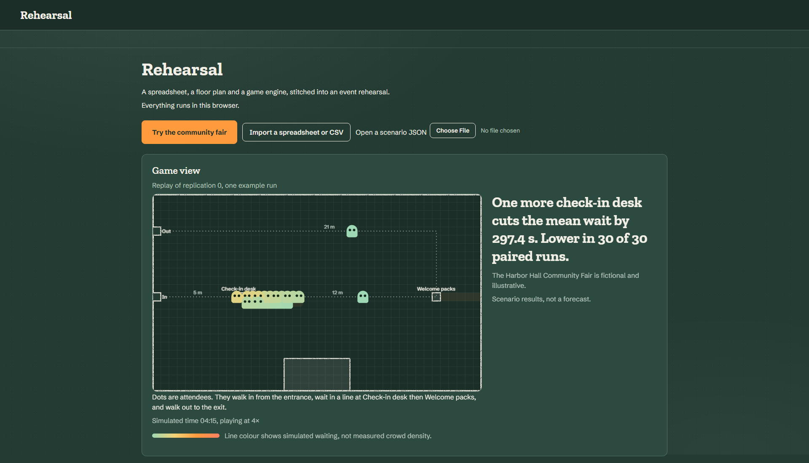

# Rehearsal

**Try it now: https://rehearsal.midknight-ent-llc.workers.dev** (no account). **Film: https://youtu.be/uZS-yUdA6-I** (135 s).



Rehearsal is our Frankenstein entry. It stitches together a chimera of technologies into one app: a spreadsheet import, a grid floor plan editor, a discrete event queue simulation and a 2D game engine replay. Bringing these seemingly incompatible elements together builds something unexpectedly powerful: a dress rehearsal for the line at your event's door, where two staffing or layout choices can be compared before the day. Kiro wrote the code through spec driven development, from specs, in the Kiro CLI, the Kiro IDE and Kiro Web.

Category: Frankenstein.

Video: https://youtu.be/uZS-yUdA6-I

## Judging criteria at a glance

**Potential Impact.** Volunteers who run a community fair, a school open day or a registration desk guess at staffing and find out on the day, with a line out the door. In the United States 75.7 million people formally volunteered through an organization between September 2022 and September 2023 (U.S. Census Bureau and AmeriCorps, read on 2026-11-20). Rehearsal lets an organizer type or import arrivals and stations, see the line form, and test a change first. On the bundled Harbor Hall example, one more desk at check in cuts the mean queue wait by 297.4 s over 30 paired runs, and all 30 runs improve. It runs in the browser with no account. Accessibility: a keyboard journey test walks the main path with no mouse, the replay has a reduced motion mode, body text contrast is 10.47:1 (`tests/ui/styles.test.ts` needs 4.5:1), and an automated axe scan of 20 screens and states ends with 0 violations (`docs/acceptance/axe-scan.md`).

**Technological Implementation.** Kiro wrote the code from three specs (`.kiro/specs/simulation-contract`, `scenario-editor-and-replay`, `paired-comparison-and-release`) and from five small specs for later work (`landing-preview`, `axe-scan`, `kiro-extensions`, `engine-contract-note`, `share-link`). The Kiro tools used: the CLI for every code task, the IDE for one spec (three tasks run from the Start task links, `docs/acceptance/ide-session/`), Kiro Web for one pull request (`docs/acceptance/kiro-web/`), a Kiro Crew app that runs this engine (https://github.com/Midknight56/rehearsal-crew), a Kiro power (`power/rehearsal`, `docs/acceptance/power-session/`), a custom agent (`.kiro/agents/rehearsal-playwright.json`) on the Playwright MCP server, two hooks, five steering files and 32 correctness properties checked with `fast-check`. Experiments: one feature built twice, from a loose prompt and from a short spec (`docs/acceptance/vibe-vs-spec/`), and the spec built again on three more models (`docs/acceptance/model-test/`). Every task has a row in `docs/kiro-log.md` (93 rows). Tests: 303 model, 543 UI and 184 browser tests pass.

**Design.** A complete product, not a demo. The first screen replays the community fair in the game view with the measured result line beside it (`docs/acceptance/img/landing-preview-1920x1080.png`). Then: Plan screen, import with a row by row preview, floor plan with drag, Game view replay with follow and find, Compare screen, saved scenarios, JSON open and save, share a plan as a link, CSV and workbook export, a printable comparison and a run sheet for the day. Every limit of the model is shown next to the results, in plain words. Screens are in `docs/acceptance/img/`.

**Innovation/Idea.** A queue model usually lives in a spreadsheet or a specialist tool, and a game engine usually draws a game. Here the spreadsheet is the input, the floor plan is the model, and the game engine replays one simulated run person by person, so an organizer sees why a line forms. Paired runs (the same random draws for both choices) make a small change show up clearly.

**Presentation.** Open the app: the community fair already plays on the first screen. Click `Try the community fair`, press `Simulate`, then `Compare` the baseline with the extra desk at check in. The whole path needs no data of your own. First load to a usable example measured 2,035 ms on a throttled network profile (`docs/performance.md`).

Results are scenario results under the stated assumptions, not a forecast. The Harbor Hall Community Fair example, its 120 attendees and its service times are fictional and illustrative.

## How Kiro was used

**Kiro IDE, CLI, Web, Crew.** The CLI (3.4.0 and 3.5.0, model Auto unless a row says otherwise) ran every code task from a written prompt, with no person at the keyboard during a run. Each run has a row in `docs/kiro-log.md` with the files touched, the check command and its result. The IDE ran one spec, `.kiro/specs/engine-contract-note/`, from the Start task links of `tasks.md`; it asked approval for each shell command, ticked the tasks itself and ran the `verify-on-stop` hook at the end of each turn. Kiro Web made pull request 1 (a build warning fix) in 28 s for about 0.41 credits; its sandbox could not install packages, so the build was checked on this PC afterwards. Kiro Crew runs the app `rehearsal-crew`: an agent answers "what if we add a desk" by running this engine with 30 paired runs, and it reported -297.4 s, lower in 30 of 30 (https://github.com/Midknight56/rehearsal-crew).

**Custom agents.** One custom agent, `.kiro/agents/rehearsal-playwright.json` (`kiro-cli agent validate` passed). It may use only the Playwright MCP server. It opened the dev build, ran the comparison with 13 browser tool calls and read the result back: `Station "Check-in desk": servers 1 → 2`, mean change -297.4 s. The Crew app adds a second agent, `rehearsal-whatif`, that may use only the engine tools of that app.

**Agent hooks.** Two hooks. `verify-on-stop` runs `npm run verify` when the agent stops; in the IDE it ran at the end of every turn, and after the axe work it caught a stale recipe in the power (a test failed because the Compare buttons had been renamed). `model-tests-on-save` is set to run the engine tests when a file under `src/simulation/` or `src/spatial/` is saved. The IDE loads hooks when a chat session starts, so a change to a hook file needs a new session; its matcher accepts both path separators (`docs/acceptance/ide-session/`).

**Spec driven development.** Three large specs, each in three files: `requirements.md`, `design.md` and `tasks.md`, with numbered user stories and THE SYSTEM SHALL criteria (182 in all), correctness properties in each design, and a Verify command in each task. Against vibe coding: we built one feature, sharing a plan as a link, twice from the same description. The loose prompt (no spec) took 2.9 minutes and 3.49 credits, wrote 9 tests and passed our 5 acceptance checks. The short spec took 8.2 minutes and 13.10 credits, wrote 26 tests including a browser test, and passed the same 5 checks. We kept the spec build. The checks found no fault in either, so the measured difference is cost, time and tests written, not a bug count (`docs/acceptance/vibe-vs-spec/`).

**Model test.** The same spec prompt on three more models, each in its own copy of the repository (`docs/acceptance/model-test/`): on claude-haiku-5.5 (20.9 minutes, 11.95 credits, 41 test cases, 5 of 5 acceptance checks passed), on claude-sonnet-5.5 (14.1 minutes, 26.28 credits, 51 test cases, 5 of 5 passed) and on gpt-5.6-terra (7.5 minutes, 32.29 credits, 9 test cases, 2 of 5 passed: its link always opens a review dialog first, which the check did not expect). The kept build ran on Auto: 8.2 minutes, 13.10 credits, 26 test cases, 5 of 5. All four passed `npm run verify`. One run each, one task: a measurement, not a ranking.

**Steering docs.** Five files, all always included. `units-and-determinism.md` fixes the units, the one ordering rule and the random keys, and forbids the wall clock in the engine. `model-limits.md` holds the limit sentences the app must show. `claims-policy.md` says what the product may claim. `accessibility.md` holds the keyboard, focus, motion and contrast rules. `revision-2026-11-16.md` holds the version and naming rules. The rule that made the biggest difference was the wall clock ban: a test scans the engine folders for it, and the same run at 1 times and at 16 times speed gives byte identical results.

**MCP.** The Playwright MCP server (`.kiro/settings/mcp.json`, headless and isolated) let Kiro click through the real build and read the screen back, which a text only run cannot do. The custom agent and the power use it. The Crew app ships its own MCP server with five tools that run the engine.

**Property based testing (PBT).** The specs name 32 correctness properties, and 13 test files check them with fast check. A failing seed is saved and replayed first on every later run. On its first run, property P12 found a case where the design text and the engine disagreed about an idle station; the design sentence was narrowed and the seed stays in the file. PBT covers the engine rules (conservation of guests, queue order, the metric bounds) and the comparison rules (pairing, summary bounds).

**Kiro powers.** One power, `power/rehearsal` (Agent Plugins format): a skill, `simulation-rules`, that holds the units, the determinism rules, the model limits and the claims policy, plus the Playwright MCP server. It was installed with `kiro-cli powers install`, used in one headless session that opened the live app, ran the community fair, compared the two plans and read -297.4 s, lower in 30 of 30, and then uninstalled (`docs/acceptance/power-session/`). A test checks that the power files parse and name tools that exist. The Stop hook caught a stale recipe after a later change; the recipe and the test were repaired.

## Commands

```
npm ci
npm run verify
npm run test:e2e
```

`npm run verify` runs the type check, the model and UI tests and the build. `npm run test:e2e` runs the browser tests in headless Chromium and starts its own preview servers on ports 4273 and 4274.

## Model limits

Model version 0.1.0 is the engine these lines describe. The sentences below are the ones the app shows beside its results and prints in its exports.

- One station is one service stage: a single FIFO line feeding identical parallel servers.
- A cohort follows its ordered station IDs, each at most once, then exits.
- Staffing is constant through a run.
- Queue capacity is unlimited and nobody leaves early.
- Walking is at one constant speed along the computed grid path.
- Service durations are constant or triangular.
- No personal space, congestion-dependent walking speed, doorway throughput, accessibility clearance, crowd pressure or collisions: queue sprites never block movement.
- The output of a run is a scenario result under these assumptions for one seed and one replication: scenario results, not a forecast.

Limits: at most 5,000 attendees, 10 stations, 6 station visits per route, 80 × 80 cells, a 360-minute observation window, servers 1 to 20, 10 saved scenarios, a 2 MiB import file.

Model version 0.1.0

Scenario results, not a forecast.

The model has no abandonment, staff breaks, scheduled staffing changes, weather, evacuation or crowd physics, and it recommends nothing. One replayed replication is an example run, not the average of the 30 paired runs.

## Privacy

On 2026-11-17 a headless Chromium run (Playwright 1.64.1, this Windows PC) opened the deployed build at https://rehearsal.midknight-ent-llc.workers.dev with no stored site data and no login, clicked `Try the community fair`, ran the baseline against the extra check-in desk for 30 paired runs, and recorded every request the page made. All 28 were GET requests to that same address: the page, its scripts and style sheet, its seven bundled font files, the simulation worker script and the three example scenario files. None went to another address and none sent a request body. The simulation ran in the browser, on that page's own worker. The list is in `docs/acceptance/2026-11-17-release.md`.

What this does not cover: the inspection did not import a workbook or export a file on the deployed address. The site is a static host, which still receives ordinary page requests for its own files. This is one run on one browser, not an audit.

## Status of claims

Performance figures and privacy statements are tied to the recorded checks named beside them. Measured performance readings, with the machine and browser named, are in `docs/performance.md`. Accessibility: WCAG 2.2 AA is the target. An automated axe scan of 20 screens and states (`tests/e2e/a11y.spec.ts`, axe-core 4.14.1) ends with 0 violations; an automated scan finds only some WCAG failures, so conformance is not claimed. `docs/acceptance/axe-scan.md` lists the states and what a scan cannot see. Nothing here claims demand or time saved.

## Licence and notices

Rehearsal is released under the MIT licence: see [LICENSE](LICENSE). Third-party packages and their licences are listed in [docs/third-party-notices.md](docs/third-party-notices.md).
